# 大鲸鱼宇宙金融与经济知识库 (Wiki)

> 本知识库为《大鲸鱼-深空放置》（Deepseek-EVE）经济系统升级与全新「证券交易所（股市系统）」设计打造。  
> 汇聚一线游戏数值经济学理论、华尔街与顶级加密货币交易所撮合引擎架构、经典开源模拟器工程实践，以及本地权威书籍全量知识萃取。

---

## 知识库全景导航

```mermaid
graph TD
    Wiki["大鲸鱼金融与游戏设计知识库 (.wiki)"]
    Wiki --> Part1["一、金融与撮合基石 (Books & Theory)"]
    Wiki --> Part2["二、游戏设计与系统架构 (Game Design Classics)"]
    Wiki --> Part3["三、《平衡掌控者》原书专题库 (15篇)"]
    Wiki --> Part4["四、开源模拟器解构 (Open Source Repos)"]
    Wiki --> Part5["五、工程落地白皮书 (Whitepapers)"]

    Part1 --> B1["[[books/balance-master-game-economy|平衡掌控者理论精要]]"]
    Part1 --> B2["[[books/matching-engines-for-dummies|Matching Engines for Dummies]]"]
    Part1 --> B3["[[books/hft-systems-orderbook-matching|高频交易系统订单簿架构]]"]

    Part2 --> G1["[[books/game-mechanics-advanced-design|游戏机制：高级游戏设计技术]]"]
    Part2 --> G2["[[books/game-programming-patterns|游戏编程模式]]"]
    Part2 --> G3["[[books/art-of-game-design-schell|游戏设计艺术 (第3版)]]"]
    Part2 --> G4["[[books/game-design-236-techniques|游戏设计的236个技巧]]"]
    Part2 --> G5["[[books/game-design-creativity-and-rhythm|大师谈游戏设计：创意与节奏]]"]

    Part3 --> BM_Home["[[balance-master/README|平衡掌控者全书知识图谱]]"]
    
    Part4 --> R1["[[repos/lagback-corleonemarket|LagBack/corleonemarket]]"]
    Part4 --> R2["[[repos/intrepidkarthi-orderbook|intrepidkarthi/orderbook]]"]
    Part4 --> R3["[[repos/tschonsen-stocksim|Tschonsen/StockSim]]"]

    Part5 --> S1["[[synthesis/whale-stock-market-architecture|大鲸鱼股市系统工程白皮书]]"]
```

---

## 核心知识板块

### 一、金融与撮合基石（Financial & Exchange Theory）
* **[[books/balance-master-game-economy|《平衡掌控者：游戏数值经济设计》精要]]**  
  *探讨 MMORPG 经济系统闭环、货币流动、恶性通胀成因与组合拳治理，将股市锚定在游戏经济实体上。*
* **[[books/matching-engines-for-dummies|《Matching Engines for Dummies》（Devexperts）]]**  
  *深入 Central Limit Order Book（CLOB）微观结构、价格-时间优先（FIFO）与撮合引擎状态机。*
* **[[books/hft-systems-orderbook-matching|《高频交易系统：开发与实战》订单簿与撮合架构]]**  
  *内存组合数据结构设计（价格档位有序表 + 双向链表 + O(1) Hash索引）、定点数防漂移与事件回放。*

---

### 二、游戏设计与系统架构殿堂专著（Game Design & System Architecture）
* **[[books/game-mechanics-advanced-design|《游戏机制：高级游戏设计技术》（Ernest Adams & Joris Dormans）]]**  
  *Machinations 系统动力学开山之作：五大核心结构元素（Source/Pool/Drain/Converter/Trader）、正负反馈回路极性与延迟调谐、离散与连续机制演进，深度映射大鲸鱼实体经济完全闭环与股市动力学。*
* **[[books/game-programming-patterns|《游戏编程模式》（Robert Nystrom）]]**  
  *游戏工程重构圣经：四大类经典模式深度解构（游戏循环、更新方法、双缓冲、字节码、组件、事件队列、享元与命令模式），全面映射 `@whale/core` 纯单向数据流与确定性引擎架构。*
* **[[books/art-of-game-design-schell|《游戏设计艺术（第3版）》（Jesse Schell）]]**  
  *游戏设计全景透镜体系：全景四元法（机制/美学/故事/技术）、心流通道动力学与 10 大精选核心透镜卡片库，映射大鲸鱼深空 HUD 操控感与多空博弈心理。*
* **[[books/game-design-236-techniques|《游戏设计的236个技巧：游戏机制、关卡设计和镜头窍门》（大野功二）]]**  
  *手感与微观体验工程学：打击感物理学（Hitstop 帧数冻结与白闪 Shader、Trauma 震动衰减模型、150ms 输入缓冲）、空间明暗诱导与伤害飘字 150ms 聚合合流。*
* **[[books/game-design-creativity-and-rhythm|《大师谈游戏设计：创意与节奏》（吉泽秀雄）]]**  
  *南梦宫元老节奏工程学：创意三角、张弛有度情绪波浪理论（Tension & Release）、残血险象环生强化，以及大鲸鱼双重时间节拍状态机与破除挂机枯燥的四大节奏炸弹。*

---

### 二、权威原著专题：《平衡掌控者》全书知识库（似水无痕 著）
基于本地 292 页原书 PDF 全量提取与系统化蒸馏：
* **[[balance-master/README|全书知识图谱与核心思想总览]]**
* **[[balance-master/01-career-and-game-dev-pipeline|01. 数值策划职业体系、工作流与研发定位]]**（第1章 & 第7章）
* **[[balance-master/02-excel-numerical-engineering|02. Excel 数值工程实战宝典：逆向查询与宏表函数]]**（第2章）
* **[[balance-master/03-economic-loop-production-consumption|03. 生产-积累-交易-消耗四阶段循环与存量守恒]]**（第3.1节）
* **[[balance-master/04-experience-curve-and-pacing|04. 经验值公式曲线、升级节拍与防刷断层]]**（第3.2节）
* **[[balance-master/05-currency-systems-and-isolation|05. 三币制与四币制：硬通货隔离与汇率壁垒]]**（第3.3节）
* **[[balance-master/06-trading-systems-and-anti-exploit|06. 摆摊/拍卖行交易机制、税收杠杆与防倒金模型]]**（第3.4节）
* **[[balance-master/07-player-pursuits-and-monetization|07. 玩家追求点设计、战力阶梯与付费剪刀差]]**（第3.5节）
* **[[balance-master/08-game-lifecycle-and-economic-phases|08. 游戏生命周期与各阶段数值调控]]**（第3.6节）
* **[[balance-master/09-system-rules-and-mechanics|09. MMORPG 基础系统底层规则与数值架构]]**（第4.1-4.2节）
* **[[balance-master/10-production-consumption-simulation-model|10. 系统与资源产耗模型落地与通胀预测算法]]**（第4.3节）
* **[[balance-master/11-fine-tuning-economic-valves|11. 产耗投放动态调整阀门微调实操]]**（第4.4节）
* **[[balance-master/12-vba-monte-carlo-simulation|12. VBA 蒙特卡洛随机模拟实战：洗点与宏观生态演化]]**（第5章）
* **[[balance-master/13-operations-analytics-and-telemetry|13. 运营活动数值设计与全服经济数据监控]]**（第6章）
* **[[balance-master/14-whale-eve-adaptation-guide|14. 实战篇：《平衡掌控者》在大鲸鱼项目的映射指南]]**

---

### 三、开源项目实战解构（Open Source Architecture）
* **[[repos/lagback-corleonemarket|LagBack/corleonemarket 解构]]**  
  *Node.js + MySQL 极简架构：均值回归价格引擎（Mean Reversion）、随机事件表驱动与公司抽成模型。*
* **[[repos/intrepidkarthi-orderbook|intrepidkarthi/orderbook 架构沉思录]]**  
  *Nasdaq、Binance、CME 历史事故复盘（定序漂移与队列阻塞）、第一性原理做市与纯确定性状态机隔离。*
* **[[repos/tschonsen-stocksim|Tschonsen/StockSim 复合模拟器]]**  
  *18个交互子系统、14类AI交易者生态、供应链事件级联传导、迷因股轧空与内幕交易监管检测。*

---

### 四、工程落地白皮书（Synthesis & Implementation）
* **[[synthesis/whale-stock-market-architecture|大鲸鱼证券交易所：理论到落地的工程实施白皮书]]**  
  *将上述理论与开源最佳实践转化为项目代码设计规范，涵盖 `packages/core/src/exchange/` 架构、与现有 `packages/core/src/market/` 订单簿的隔离复用边界、离线高确定性演进算法及随档白名单策略。*

