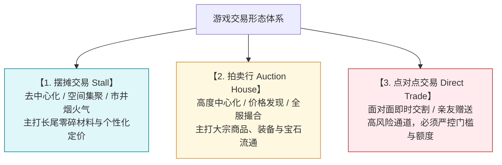
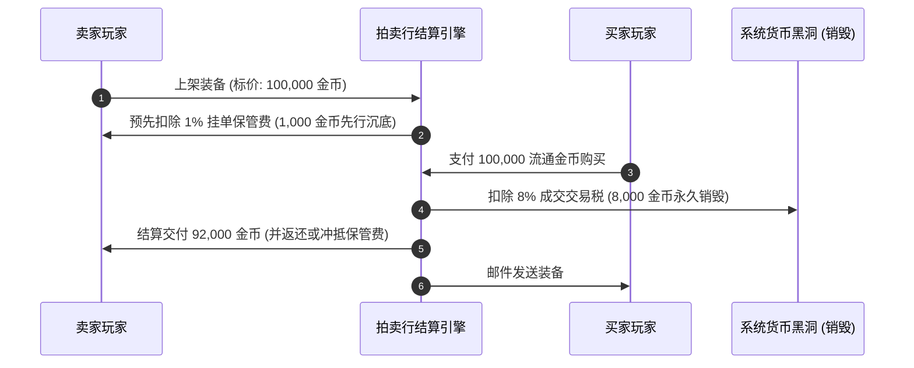
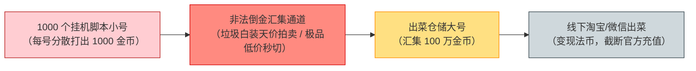
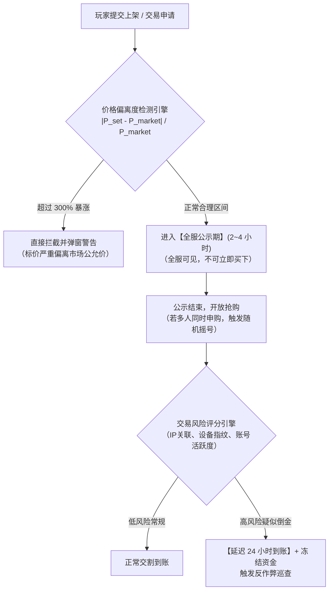

# 摆摊、拍卖行与直接交易机制，交易税收杠杆与黑产防倒金模型

> 对应原书：**第 3.4 节 交易系统**

在大型多人在线游戏（MMORPG）中，交易系统是连接全服所有玩家利益纽带的核心枢纽。一个开放、活跃且秩序井然的市场，能让非付费玩家通过时间积累转化为真实战力，也能让付费大R迅速完成资源整合。

然而，**自由交易的背面是黑产的深渊**。打金工作室、外挂盗号集团、线下黑市出菜团伙无时无刻不在寻找交易漏洞进行“倒金洗钱”。《平衡掌控者》第 3.4 节详细阐述了三大交易形态的设计法则、税收水泵调节机制，以及防倒金风控架构。

---

## 一、三大交易形态机制解构与适用场景（3.4.1 ~ 3.4.3 节）

### 1. 摆摊系统（去中心化的市井集市）
- **运作机制**：玩家前往主城特定商业区域（如长安广场、洛阳南门），角色坐下展开摊位，设定上架商品与单价；其他玩家路过点击摊位即可浏览购买。
- **核心价值**：
  - **沉浸感与烟火气**：主城人头攒动的摆摊大军是经典 MMORPG 最具辨识度的生态景观；
  - **长尾商品流通池**：低级采集药草、零碎烹饪食材、低级技能书等不适合进入拍卖行占用昂贵货架的边角料，在此获得极佳消化；
  - **社交闲聊与砍价乐趣**：支持即时私聊还价。
- **成本与约束**：
  - 占用玩家在线时间（或设计“离线摆摊替身木偶”收费道具）；
  - 强制收取“摊位开市管理费”（固定银两消耗），防止空摊霸占核心黄金地段。

### 2. 拍卖行系统（高度中心化的全服交易所）
- **运作机制**：全服统一交易大厅，支持类别检索、品阶筛选、精确搜索，提供“竞价拍卖（Bidding）”与“一口价（Buyout）”双重模式。
- **核心价值**：
  - **高效的价格发现（Price Discovery）**：全服同类商品集中竞价，迅速形成透明公允的市场价格中枢；
  - **极低的搜寻摩擦成本**：买家无需跑图，一键下单，货物直接通过游戏内邮件隔空交付。
- **缺点**：极易被商人利用爬虫或宏进行全服扫货囤积居奇，必须依赖严密的税费和风控规则。

### 3. 点对点直接交易（面对面即时交付）
- **运作机制**：两名角色处于同一场景视野内，发起交易申请，双方各自放入物品与金币，双方二次确认后由服务器原子化完成资产交换。
- **致命软肋**：**这是黑产工作室线下交易（RMT: Real-Money Trading）和黑客转移被盗赃物的核心温床**。
- **严格风控策略**：绝大多数现代商业手游彻底移除了直接交易；若确需保留，必须附加严苛枷锁（见后文防倒金模型）。

---

## 二、交易税收杠杆：全服流动性的核心回收泵（3.4.4 节）

交易税收不仅仅是为了防投机，它在宏观经济上扮演着**全服最大容量货币回收泵**的关键角色。

### 1. 双重税费结构设计
1. **上架保管费（Listing Fee / Deposit）**：
   - 规则：按商品标价的一定比例（例如 $1\% \sim 2\%$）在上架瞬间扣除；
   - 经济学意图：**增加恶意高价占领货架与虚假挂单的试错成本**。若上架完全免费，投机商人会无脑挂出 1000 万天价当仓库使用，导致货架充斥垃圾；一旦设有保管费，流拍不退，商人必须谨慎设定合理售价。
2. **成交交易税（Transaction Tax）**：
   - 规则：在成交结算环节，直接从卖家所得款项中扣除 $5\% \sim 10\%$ 的流通金币；
   - 经济学意图：**宏观流动性自动稳定器（Automatic Stabilizer）**。全服经济越繁荣、换手率越高，被系统强行销毁的金币就呈几何级数增长，有效对冲产出端的货币膨胀。

---

## 三、黑客外挂与工作室倒金行为特征分析

打金工作室的核心诉求是：**将在成百上千个脚本小号上打出来的零散金币，汇集到一个或几个“出菜大号”上，进而卖给老板兑现为人民币。**

### 典型倒金手法解剖：
1. **高买低卖（垃圾道具天价拍卖）**：
   - 仓储大号将一件毫无实用价值的 1 级白色木剑，挂出 500,000 金币的离谱天价；
   - 打金小号接单购买，将非法金币合法注入仓储大号。
2. **极品道具底价秒切（定向利益输送）**：
   - 仓储大号将一件市价 100 万金币的神装，以 100 金币的底价挂入拍卖行；
   - 工作室利用定制的外挂脚本，在服务器刷新的微秒级瞬间定向抢购，完成大宗装备的超低成本转移。
3. **点对点不对等交易（白给模式）**：
   - 小号无偿将 10 万金币赠送给大号，或者大号仅放入 1 根毫无价值的草药作为对价。

---

## 四、全生命周期防倒金风控算法模型

为彻底遏制黑产洗钱，现代游戏必须构建多维度的**主动防御与被动熔断体系**：

### 1. 价格偏离度监控算法（Price Deviation Engine）
系统维护每一种非标准装备与道具的**移动加权平均价格（Moving Average Price）**：
$$P_{\text{market}}(t) = (1 - \lambda) P_{\text{market}}(t-1) + \lambda \bar{P}_{\text{deal}}(t)$$
（其中 $\lambda \in [0.1, 0.2]$ 为平滑更新系数）。

- **强制限价区间**：
  $$P_{\text{min}} = \max(P_{\text{floor}}, 0.5 \times P_{\text{market}}) \le P_{\text{user}} \le 2.0 \times P_{\text{market}} = P_{\text{max}}$$
  当玩家设定的售价 $P_{\text{user}}$ 偏离公允中枢超过一定阈值时，客户端直接禁用上架按钮，彻底根除“垃圾卖天价”和“神装 1 块钱秒切”的作案土壤。

### 2. 公示期与抢购摇号机制（Anti-Script Sniping）
- **高阶物品公示期**：紫色品质以上装备、高阶宝石上架后，强制进入 $2 \sim 4$ 小时的公示观察期。全服玩家均可查看，但谁也无法购买；
- **公平随机摇号（Lottery Allocation）**：
  公示期结束瞬间，若有多名玩家申请购买，系统在接下来的 15 秒内开启抽签池，**由服务器在所有申请者中纯随机摇号决定买家**。
  - **防御意义**：哪怕工作室使用纳秒级网卡劫持和按键精灵，在全服成千上万真实玩家的摇号池面前，其中奖概率也被稀释到微乎其微，神装瞬间被真实玩家截胡，工作室血本无归！

### 3. 延迟到账与风险资金冻结（Escrow & Delayed Settlement）
- 对触发了“IP 频繁变动”、“设备指纹关联过多小号”、“注册时间不足 7 天”等黑产高危特征的交易，实施 **12 ~ 24 小时延迟到账托管**；
- 在托管审核期内，若系统反作弊程序判定打金号为外挂并实施封号，其流出的金币将直接原路注销或追回，斩断洗钱链条。

---

## 五、知识库双链互通与学习路线

- 宏观经济四阶段流转法则 $\rightarrow$ [[03-economic-loop-production-consumption]]
- 货币隔离体系（流通金与绑定银两）如何阻断黑产 $\rightarrow$ [[05-currency-systems-and-isolation]]
- 结合玩家分层设计商业化追求 $\rightarrow$ [[07-player-pursuits-and-monetization]]
- 在产耗模型中测算交易税收对流通盘的抽水速率 $\rightarrow$ [[10-production-consumption-simulation-model]]
- 运营后台数据埋点：如何监控全服物价偏离指数与异常交易行为 $\rightarrow$ [[13-operations-analytics-and-telemetry]]
- 查看《大鲸鱼-深空放置》星际证券与股票交易所系统防倒金与防操纵设计 $\rightarrow$ [[14-whale-eve-adaptation-guide]]
