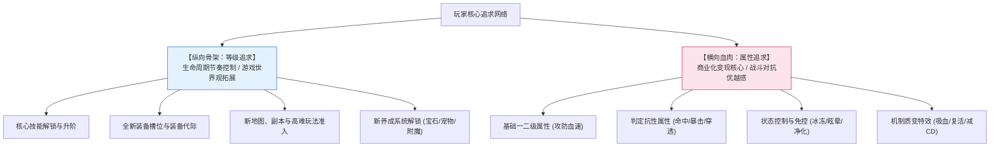
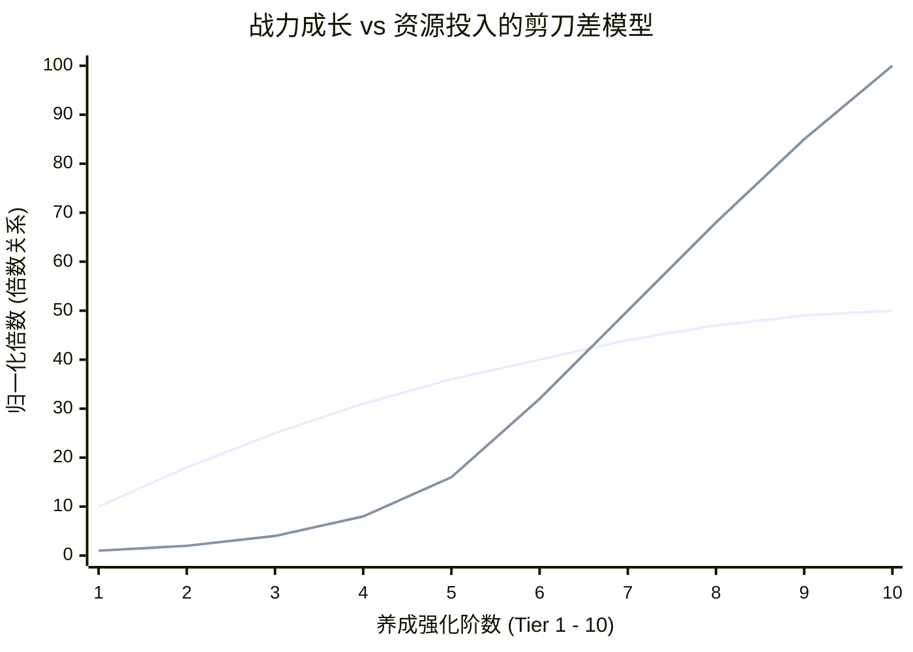
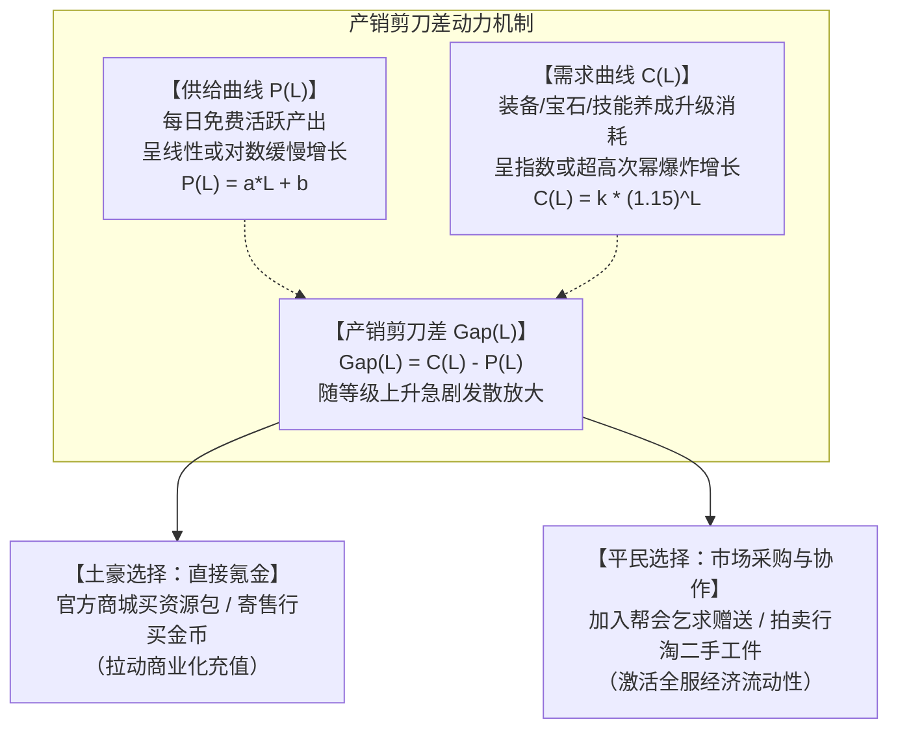

# 等级与属性追求双核驱动、战力成长阶梯与产销剪刀差设计

> 对应原书：**第 3.5 节 追求点设计**

玩家为什么愿意在虚拟世界中日复一日地投入成百上千个小时，甚至投入成千上万的真金白银？其底层驱动力来源于数值策划精心构建的**追求点（Pursuit Points）网络**。

《平衡掌控者》第 3.5 节将玩家的核心追求提炼为双核驱动体系：**以等级为骨架的纵向成长追求**，与**以属性战力为血肉的横向深度追求**。在此基础上，通过构建“产销剪刀差”来拉动大R付费与平民搬砖的生态循环。

---

## 一、双核驱动追求模型架构



---

## 二、纵向驱动：与等级相关的追求点设计（3.5.1 节）

等级追求的作用绝非单纯让数字从 1 变到 100，它是**解锁系统功能、阶段性赋予玩家成就感、引导版本内容消费的关键锚点**：

1. **技能机制解锁节点（Skill Gate）**：
   - 规则：将最华丽、最强力的“全屏大招”或“核心保命被动”放置在关键等级段（如 30 级解锁标志性大招，50 级觉醒转职特权技能）；
   - 心理效应：给玩家明确的短期目标（“今晚无论如何冲到 30 级学大招”）。
2. **装备代际更迭（Gear Tiers）**：
   - 规则：每 10 级或 20 级划分为一个装备档次（如 40 级穿伏魔套，50 级穿破天套）；
   - 心理效应：防止一套装备从头穿到尾产生疲劳感，强制推动老装备淘汰与新装备材料采集。
3. **养成子系统阶梯式开放（System Staggering）**：
   - 规则：严禁开局将所有系统一齐糊在玩家脸上（信息过载极易导致流失）；
   - 节奏：
     - Lv 10：开放装备强化；
     - Lv 25：开放帮会与日常跑环；
     - Lv 35：开放宝石镶嵌；
     - Lv 45：开放宠物炼妖洗炼；
     - Lv 60：开放神兵附魔与跨服竞技。

---

## 三、横向驱动：属性追求与战力成长阶梯（3.5.2 节）

属性是角色战斗力的直接具象化。在商业化数值设计中，战力成长必须严格遵循**边际效用递减法则（Law of Diminishing Marginal Utility）**。



### 1. 战力成长的三大平衡法则
- **法则一：战斗数值收敛，严禁属性无限指数膨胀**
  若土豪充值 10 万元能够获得平民 1000 倍的攻击力，土豪一个平砍击杀全服，游戏将退化为单机，平民集体弃坑，失去炫耀对象的土豪也会迅速退游。
  成熟的做法是：顶级大R的战力通常控制在平民玩家的 **$2.5 \sim 4.0$ 倍** 之间。大R能轻松 1 打 3 或 1 打 5，但在遭遇一个配合默契的 10 人精锐平民战队集火控制时，依然存在翻车风险。这种“有悬念的强”才是最具魅力的对抗生态。
- **法则二：消耗成本呈几何级数（指数级）攀升**
  强化 1 到 5 级仅需 100 颗强化石（平民 3 天可得）；而强化 9 到 10 级需要 10,000 颗强化石及防爆符（大R需充值数万元）。用指数级的资金消耗，兑换最后 $10\%$ 的边际战力领先。
- **法则三：机制质变替代纯数值堆砌**
  顶级追求不应只是“攻击力加 500”，而应提供机制质变（如技能附带“受击 $10\%$ 概率净化所有负面状态”、“攻击时削减敌方法力值”），满足大R的策略自豪感。

---

## 四、玩家生态分层模型与追求适配

一套健康的游戏生态必须让每一个付费层级的玩家都能找到舒适的定位：

```mermaid
quadrantChart
    title 游戏玩家五层生态金字塔
    x-axis 极度缺乏时间 --> 充裕自由时间
    y-axis 零付费意愿 --> 极高付费能力
    quadrant-1 顶级大R / 巨鲸 (Top 1%)
    quadrant-2 超大R / 跨服霸主 (Top 0.1%)
    quadrant-3 免费搬砖平民 (50%~60%)
    quadrant-4 中R / 小资玩家 (15%~25%)
    "超大R (神级霸权)": [0.15, 0.95]
    "大R核心 (主力战将)": [0.30, 0.82]
    "中R小资 (性价比控)": [0.55, 0.55]
    "微氪小R (首充月卡)": [0.70, 0.35]
    "免费平民 (生态基石)": [0.88, 0.10]
```

| 玩家层级 | 人数占比 | 核心心理诉求 | 专属追求点设计 | 对游戏生态的贡献 |
| :--- | :--- | :--- | :--- | :--- |
| **超R / 巨鲸** | $\le 0.1\%$ | 唯一霸权、全服敬仰、排行榜霸榜、统治跨服帮派 | 全服唯一称号、神级发光坐骑、定制城池雕像、顶阶宝石全满 | 贡献全服 $40\% \sim 50\%$ 营收 |
| **大R / 高付费** | $1\% \sim 3\%$ | 梯队领先、精英战力、大型副本不可或缺的核心输出 | 高阶极品词条套装、高资质满技能神兽、强化 $+15$ 封顶 | 贡献全服 $30\%$ 营收，担任公会核心骨干 |
| **中R / 小资** | $10\% \sim 15\%$ | 极致性价比、花小钱办大事、用智力与配装战胜粗糙大R | 终身卡、战令（Battle Pass）、基金返利、核心主力宠物单点养成 | 贡献全服 $15\% \sim 20\%$ 营收，构成中坚主力 |
| **小R / 首充** | $20\% \sim 30\%$ | 破冰爽感、拒绝被小怪卡关 | 6 元首充神兵、首充双倍返利、每日 1 元礼包 | 提升付费渗透率（ARPPU 基础） |
| **免费 / 搬砖玩家** | $50\% \sim 60\%$ | 休闲娱乐、以时间换战力、在市场买卖中体验赚钱快感 | 探索成就、生活技能制造、拍卖行倒买倒卖、通关全部主线剧情 | 提供活跃热度与流动性，是大R的陪玩基石 |

---

## 五、产销剪刀差（Scissors Gap）数理模型

什么是驱动玩家付费与促成社会化大分工的最底层引擎？答案是**产销剪刀差**。



### 1. 剪刀差数学表征
设角色在等级 $L$ 时：
- 单日全勤完成所有免费日常活动获得的资源供给为 $P_{\text{daily}}(L)$；
- 该等级段升阶核心装备所需的资源消耗为 $C_{\text{upgrade}}(L)$。

在成熟设计中：
$$P_{\text{daily}}(L) = \alpha \cdot L + \beta \quad (\text{线性增长})$$
$$C_{\text{upgrade}}(L) = \gamma \cdot (1 + r)^L \quad (\text{指数增长，其中 } r \approx 0.08 \sim 0.15)$$

- **低等级段（$L \le 30$）**：$P_{\text{daily}} > C_{\text{upgrade}}$，资源轻度富余，玩家感受轻松爽快，留存率高；
- **交叉点（$L \approx 40$）**：$P_{\text{daily}} \approx C_{\text{upgrade}}$，达到收支紧平衡，玩家开始产生“资源卡点”感受；
- **高等级段（$L \ge 60$）**：$C_{\text{upgrade}} \gg P_{\text{daily}}$，剪刀差 $\text{Gap}(L)$ 急剧撕裂。单靠玩家单日的自产自销，需要连续攒 30 天甚至半年才能升一级！

### 2. 剪刀差释放的心理张力与商业化转化
当剪刀差撕裂时，策划必须在此时给出清晰的“解压阀”：
- **付费通道**：商城同步推出“限时超值礼包”（原价 1000 元宝，现折扣 328 元宝直接给够升级材料）；
- **流通通道**：拍卖行提供平民挂单的材料，引导大R去寄售行兑换金币买空货架。剪刀差成功将个人矛盾转化为全服经济运转的内生推力！

---

## 六、知识库双链互通与学习路线

- 查看经验曲线与升级耗时 TTL 设定 $\rightarrow$ [[04-experience-curve-and-pacing]]
- 三币制如何将剪刀差转化为官方商城元宝收入 $\rightarrow$ [[05-currency-systems-and-isolation]]
- 在宏观生命周期各阶段如何动态调节剪刀差开口 $\rightarrow$ [[08-game-lifecycle-and-economic-phases]]
- 结合底层人物属性与装备强化规则落地实操 $\rightarrow$ [[09-system-rules-and-mechanics]]
- 产耗动态模型中推演大R与平民在剪刀差下的存量差异 $\rightarrow$ [[10-production-consumption-simulation-model]]
- 查看《大鲸鱼-深空放置》T1/T2/T3 舰船制造耗材剪刀差设计 $\rightarrow$ [[14-whale-eve-adaptation-guide]]
