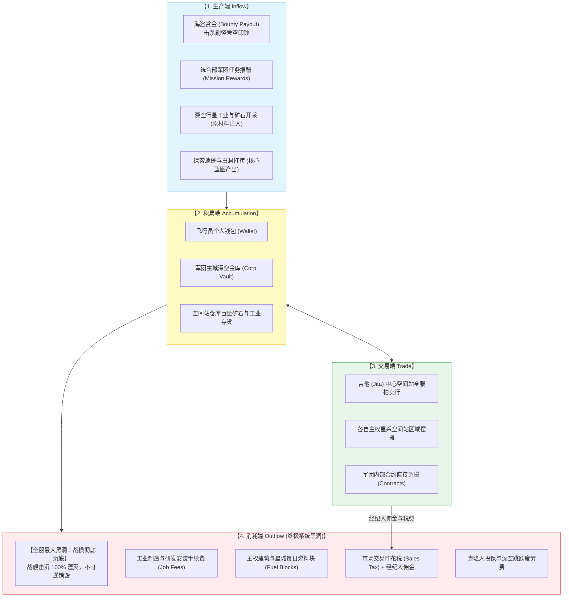
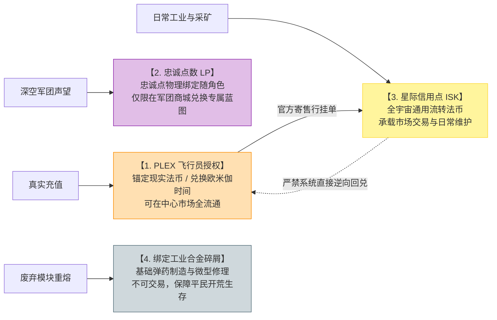
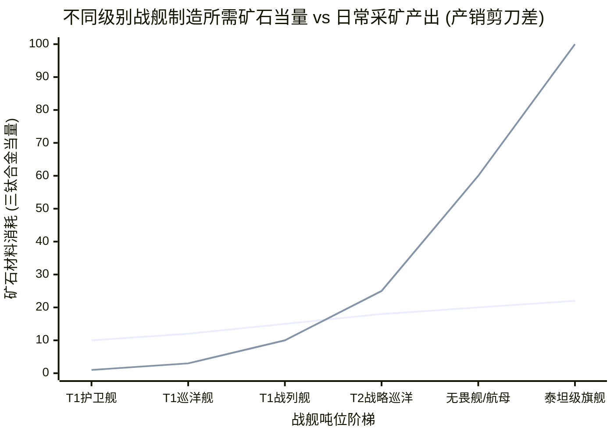
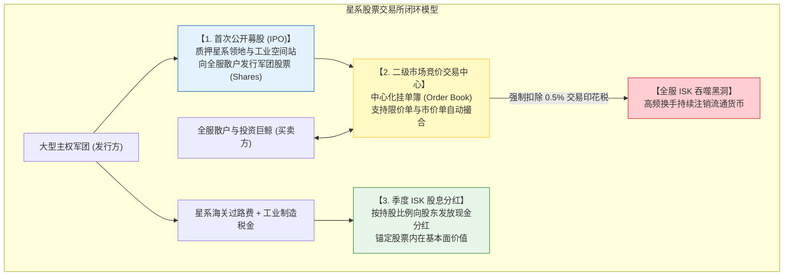

# 《平衡掌控者》在《大鲸鱼-深空放置》的落地映射实战指南

> 对应原书：**全书设计哲学与工业级落地实战**
> 适用工程：`@whale/core` 核心数值逻辑、工业制造链路与即将搭建的星际金融系统

在大型太空科幻放置游戏《大鲸鱼-深空放置》（Deepseek-EVE）中，玩家不仅在星海中驾驶战舰探索跃迁，更置身于一个以“采矿、精炼、工业组装、市场博弈、主权争霸”为核心的庞大虚拟经济体中。

EVE 体系以其深邃自由的硬核经济学著称，但也极易因数值失衡导致货币超发、资源枯竭或投机崩盘。《平衡掌控者》（似水无痕 著）所阐述的四阶段经济循环、多币制防火墙、产销剪刀差与宏观通胀预警理论，为《大鲸鱼-深空放置》的工业化落地提供了最坚实的理论武器。

---

## 一、星际信用点（ISK）的四阶段宏观流转闭环

根据 [[03-economic-loop-production-consumption]] 的理论，资产流动必须经历“生产 $\to$ 积累 $\to$ 交易 $\to$ 消耗”并维持存量守恒。

### 1. 生产端的水龙头控制
- **星系安等动态收益衰减（Security Status Scaling）**：
  - 高安星系（$0.5 \sim 1.0$）：受统合部保护，刷怪赏金与矿产丰度受到严格压制（基准倍率 $0.6 \sim 0.8$）；
  - 低安与 0.0 星系（$-1.0 \sim 0.4$）：充满自由交火风险，赏金倍率提升至 $1.5 \sim 3.0$。通过风险溢价（Risk Premium）平衡高收益，严防脚本在绝对安全区无限印钞。

### 2. 消耗端的超级王牌：战损完全湮灭机制（Permanent Ship Loss）
在普通游戏中，装备强化失败最多掉级；而在《大鲸鱼-深空放置》中，**战舰被击沉意味着船体与所有装配槽位模块永久灰飞烟灭**！
- 无论玩家之前投入了多少亿 ISK 制造这艘战列舰或无畏舰，一旦在深空遭遇伏击，其对应的矿石材料、制造工时与模块资产全部**彻底退出流通大盘，回归虚无**。
- 战损机制是全宇宙最无情的资产粉碎机，它天然赋予了矿工与工业家源源不断制造新战舰的永恒市场需求。

---

## 二、多币制与深空资产防火墙设计

根据 [[05-currency-systems-and-isolation]]，深空放置必须构筑物理隔离防线，防范黑客套现与通胀串扰：

- **PLEX 与 ISK 的单向流转**：
  大R充值获得 PLEX，可以在吉他市场挂单卖给平民，换取平民辛勤采集的矿石；平民通过日常攒下的 ISK 购买 PLEX 激活月卡时间。**系统绝不凭空将 ISK 回购为 PLEX**，确保官方现金流安全。
- **LP 点数的闭环沉淀**：
  统合部与海盗势力的 LP 严禁直接在玩家间转账，只能用于兑换“海军型衍生蓝图”，从而将战斗声望转化为实体军工资产。

---

## 三、工业制造链条与产销剪刀差设计

结合 [[07-player-pursuits-and-monetization]] 的剪刀差理论，《大鲸鱼-深空放置》的战舰科技树必须呈现陡峭的指数级材料消耗阶梯：

### 1. 剪刀差推进机制
- **轻型舰船（T1 护卫/驱逐）**：平民单日采矿量即可自造数艘，战损毫不心疼，保障基础 PvP 活力；
- **重型旗舰（无畏舰 / 泰坦）**：建造需要数十种高阶行星同位素化合物、数千亿三钛合金与数月的星城船坞装配工期。任何个人单打独斗都绝无可能造出泰坦！
- **社会化驱动**：剪刀差迫使成百上千名采矿矿工、运输航线护航员、工业精炼师组建大型主权军团，共同支撑超级战略旗舰的建造，孕育出宏大的玩家阵营史诗。

---

## 四、即将搭建的「星系证券与股票交易所系统」经济学设计方案

为吸纳全宇宙长线累积的巨额 ISK 存量，并为大型军团提供集资扩军的金融工具，我们规划搭建**星系股票交易所（Galactic Equity Exchange, GEE）**。

### 1. 挂牌上市准入门槛（IPO Listing Standard）
严防壳公司刷股骗钱，军团申请 IPO 必须满足硬性资质：
1. 实际控制至少 1 个主权星系超过 30 天；
2. 军团名下拥有至少一座已锚定并正常运转的星城（Citadel）；
3. 军团工业资产经系统审计净值超过 50 亿 ISK；
4. 军团管理层必须质押 $40\%$ 以上的自持受限股，设定 90 天禁售期（Lock-up Period）。

### 2. 交易印花税：全服资金的核心回收泵
- **机制**：股票每笔成交，买卖双方各扣除 **$0.5\%$ 的交易印花税（Stamp Duty）**，直接由交易所服务器永久注销；
- **宏观效果**：金融市场的换手率（Turnover Rate）远高于实体商品市场。每日数亿 ISK 的股票交易，将通过印花税沉底数百万 ISK，成为全服最优雅的货币水泵！

### 3. 股息分红（Dividend）与基本面估值锚定
- 避免股票沦为纯空气投机泡沫，股票必须与军团真实经济效益挂钩：
  $$\text{DividendPerShare} = \frac{\text{CorpTaxRevenue} \times \text{PayoutRatio}}{\text{TotalShares}}$$
- 军团控制的主权星系海关过路费、星城制造安装税，按月自动注入分红池；股东凭持股证明一键领取现金分红。业绩优秀的军团股票将成为全服抢手的“硬通货分红资产”。

### 4. 价格操纵防护与防倒金模型（Anti-Manipulation）
结合 [[06-trading-systems-and-anti-exploit]] 的反作弊思想：
- **涨跌停熔断限制**：股票单日价格波动限制在基准价的 $\pm 10\%$ 以内，触发熔断暂停交易 15 分钟；
- **持股集中度披露**：单一飞行员持股超过全服 $5\%$ 时强制全服公告，防止黑产暗中吸筹控盘；
- **关联账户对倒交易拦截（Anti-Wash Trading）**：同 IP、同设备指纹或存在频繁无偿转账历史的账号之间，严禁在股票挂单簿上发生交叉成交，彻底阻断利用冷门仙股非法倒金洗钱的通道！

---

## 五、知识库双链互通与学习路线

- 四阶段循环与存量守恒方程 $\rightarrow$ [[03-economic-loop-production-consumption]]
- 多币制与物理隔离防火墙 $\rightarrow$ [[05-currency-systems-and-isolation]]
- 交易税收杠杆与反作弊防倒金模型 $\rightarrow$ [[06-trading-systems-and-anti-exploit]]
- 产销剪刀差拉力构建 $\rightarrow$ [[07-player-pursuits-and-monetization]]
- 编制深空放置全量产耗总表 $\rightarrow$ [[10-production-consumption-simulation-model]]
- 当星系金价暴跌时的微调方案 $\rightarrow$ [[11-fine-tuning-economic-valves]]
- 运用 Python/VBA 模拟星系股票市场订单簿撮合 $\rightarrow$ [[12-vba-monte-carlo-simulation]]
- 搭建深空放置全服 Telemetry 监控大盘 $\rightarrow$ [[13-operations-analytics-and-telemetry]]
