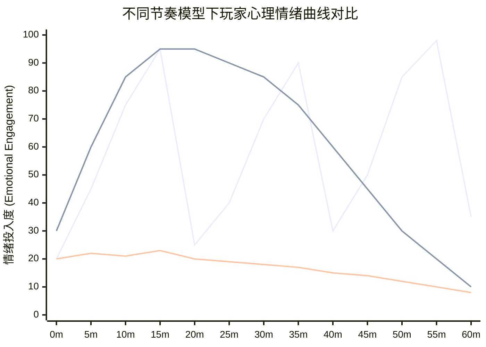

# 《大师谈游戏设计：创意与节奏》深度蒸馏

> **知识定位**：游戏成败，全在节奏。优秀的游戏不是机制的简单堆积，而是一首由“紧张与释怀（Tension & Release）”交织而成的交响乐。吉泽秀雄在南梦宫数十年传奇生涯中，淬炼出以“舒服”为内核、以“波浪节奏”为骨架的游戏设计心法。本篇系统解构其核心创意培育方法与节奏动力学，并系统性赋能于 [[project-overview|大鲸鱼-深空放置]] 的双重时间尺度、挂机心流维系与深空战术张弛架构。

---

## 结论先行

1. **核心创意的三要素闭环**：创意的起点是“**舒服（Pleasant / Comfort）**”，由**主题（Theme：世界观与玩家角色认知）**、**概念（Concept：用一句话说清的独特核心乐趣）**与**系统（System：支撑概念运转的规则与数值）**三位一体支撑。任何不能让核心概念变得更好玩的延伸创意，都应毫不留情地舍弃。
2. **张弛有度（Tension & Release）的情绪波浪**：单一的高强度刺激会导致玩家大脑多巴胺受体钝化（感官麻木），单一的低刺激挂机则会迅速滑入无聊与流失。必须构建“**紧张爬升 ➔ 峰值爆发 ➔ 彻底释怀 ➔ 舒适回味**”的周期性心流波浪。
3. **全链路的“附件节奏”定生死**：不仅游戏核心玩法有节奏，载入动画、菜单切换、结算画面、失败重试等“附件”同样主宰节奏。一旦界面切换卡顿、结算动画冗长不可跳过，玩家的心流将在 3 秒内被彻底腰斩。
4. **失败合理性与“险象环生（Near Miss）”效应**：玩家失败时，必须心服口服并认为“这是我的操作/判断失误，只要再试一次我就能赢”，绝不能让玩家感到“死于系统数值恶意欺诈”。同时，设计“最后一滴血锁血（1 HP Climax）”或“擦弹险胜”，能将成就感放大十倍。
5. **破解放置挂机枯燥感的密钥：双重时间节拍（Dual-Tempo Engine）**：放置游戏最大的死敌是“等待数值线性增长的漫长虚无”。必须通过“**在线微观快节奏（秒级短线挂单对冲、突发跳船救援、即时战术过载）**”与“**离线宏观长节奏（小时/天级的行星工业挖掘、空间站科研蓝图、季度分红）**”相交织，辅以不可预测的深空随机事件，创造永远跳动的生命力。

---

## 一、全书总览与心流节奏拓扑架构

```
┌─────────────────────────────────────────────────────────────────────────────┐
│                 吉泽秀雄 游戏创意与节奏心流 (Pacing & Rhythm) 拓扑           │
├─────────────────────────────────────────────────────────────────────────────┤
│ 1. 核心创意三角 (The Core Triangle)                                         │
│    - 内核原点：直觉上的“舒服” (触觉/听觉/心理的极致通透感)                  │
│    - 主题 (Theme)：深邃严酷的暗黑星海与资本巨鳄冷血逐利                     │
│    - 概念 (Concept)：“在微观订单簿高频博弈与宏观深空挂机间游刃有余的星舰指挥官” │
│    - 系统 (System)：双重时钟状态机、装备功率匹配、动态经济税率             │
├─────────────────────────────────────────────────────────────────────────────┤
│ 2. 情绪波浪动力学 (Tension & Release Dynamics)                              │
│    - 蓄压期 (Tension Buildup)：探索高危暗区、跃迁倒计时、订单簿深度被抽干   │
│    - 临界高潮 (Climax)：近防炮极速拦截、死前一瞬突破重围、空头瞬间平仓     │
│    - 释怀降温 (Release)：安全入港警报解除、战利品清点入库、矿仓交割结算   │
│    - 舒适整备 (Rest & Fitting)：研究配装、调整科研树、审阅财务报表         │
├─────────────────────────────────────────────────────────────────────────────┤
│ 3. 失败心理学与 Near Miss 强化                                              │
│    - 失败瞬时归因：清晰呈现致命原因 (如“护盾电容耗尽”、“过载烧毁模组”)      │
│    - 极度诱惑的“差一点就赢”：敌舰仅剩 2% 结构血皮、救生舱 0.5s 极限逃脱    │
│    - 极速重试通道：一键克隆重组、一键按预设蓝图装配，重返战场 ≤ 5 秒        │
├─────────────────────────────────────────────────────────────────────────────┤
│ 4. 全链路系统附件节奏 (System Accoutrements Pacing)                          │
│    - 0 阻塞界面流：高频页面切换 ≤ 100ms，杜绝假死加载                      │
│    - 结算的干脆利落：即时入账音效、长按全跳过 (Hold to Skip)               │
│    - 操作手感节奏：点击-微缩放-音效-数据变化四重奏                           │
└─────────────────────────────────────────────────────────────────────────────┘
```

---

## 二、情绪波浪（Tension & Release）理论模型

### 2.1 感官麻木与情绪衰减规律

吉泽秀雄在书中指出：**“人对持续的刺激具有天然的适应性与钝化机制。持续的高潮等于没有高潮，持续的危险等于麻木的疲惫。”**



- **错误模式 A（持续高压）**：如果让玩家在 0.0 星区连续遭遇长达 40 分钟的高压追杀，玩家最初会心跳加速，但很快就会由于神经紧张过度而产生烦躁、眩晕，最终直接 Alt+F4 退出游戏。
- **错误模式 B（扁平挂机）**：数值以秒为单位匀速增加 `+10/s`，玩家打开游戏就像看 Windows 任务管理器性能监视器一样毫无波澜，三分钟内产生严重困意。
- **大师模式（吉泽波浪）**：
  1. **紧张阶段（Tension）**：进入未知异常空间，雷达扫描到未知敌方信号正在逼近，环境 BGM 渐弱并引入低频心跳音，操作密度提升。
  2. **高潮爆发（Peak）**：双方主炮交火、电容过载、护盾剧烈闪烁，情绪拉满。
  3. **释怀阶段（Release）**：敌舰殉爆，警报骤停，换来极度空灵的静谧深空氛围音，界面弹出“威胁清除”清脆提示。
  4. **沉淀调整（Rest）**：返航母港，悠然漫步在工业舱单、装配界面与股票 K 线图中，身心得到彻底放松，为下一次波浪蓄能。

### 2.2 失败的艺术：合理性与 Near Miss 心理强化

吉泽秀雄特别强调：**“游戏失败的瞬间，是玩家距离放弃游戏最近的时刻，也是玩家情绪最脆弱的时刻。设计失败，比设计胜利更重要。”**

```
┌─────────────────────────────────────────────────────────────────────────────┐
│                       失败体验的工程化心理设计规范                           │
├─────────────────────────────────────────────────────────────────────────────┤
│  [致命错误设计: 玩家怒退]                                                   │
│  - 暴毙无预警：飞船在满血状态下瞬间被屏幕外的隐形狙击一枪秒杀              │
│  - 原因不透明：屏幕直接显示“Game Over”，玩家完全不知道自己哪里做错了        │
│  - 惩罚无归因：辛辛苦苦攒的 1 亿 ISK 全被系统无理由清空                    │
│  - 重试成本极高：必须重新看 30 秒开场动画，重新手动一件件点选 20 个装备     │
├─────────────────────────────────────────────────────────────────────────────┤
│  [大师级合理设计: 激起好胜心]                                               │
│  - 明确死前征兆：警报在 10 秒前已响彻舰桥：“电容即将耗尽，维修模块即将停机” │
│  - 险象环生 (Near Miss)：敌方战列舰结构仅剩 5%，再坚持 2 秒主炮就能冷却开火 │
│  - 深度归因复盘：死亡总结面板清晰指出：“致命伤：未配备动能抗性装甲增强器” │
│  - 极速复仇按钮：一键使用克隆体在空间站复活，一键加载保存好的配装预设方案   │
└─────────────────────────────────────────────────────────────────────────────┘
```

- **死前挣扎（Near Miss）的心理学价值**：
  - 当人因为“差之毫厘”而失败时，大脑分泌的多巴胺浓度几乎与“获胜”持平，并产生极其强烈的“**未完成情结（蔡格尼克效应 Zeigarnik Effect）**”，驱使玩家毫不犹豫地按下重试。

---

## 三、全链路系统附件节奏（Accoutrements Pacing）

游戏的主流程只占玩家视线的一半，另一半充斥着各种系统附件（UI、菜单、载入、过关）。这些附件的节拍决定了玩家潜意识里的“流畅感”。

### 3.1 菜单与交互界面的响应节奏

```mermaid
flowchart LR
    A[按下交互按键: 0ms] --> B[按键瞬时物理回弹反馈: <16ms 1帧]
    B --> C[界面元素缓动展开: 120ms Cubic-Bezier]
    C --> D[核心数据渲染到位: <150ms]
    
    style A fill:#1a233a,stroke:#00f0ff,stroke-width:2px
    style B fill:#1a233a,stroke:#ffaa00,stroke-width:2px
    style C fill:#1a233a,stroke:#00f0ff,stroke-width:2px
    style D fill:#1a233a,stroke:#00ff88,stroke-width:2px
```



1. **不可打断性是原罪**：
   - 绝不允许出现“必须等待 3 秒过关动画播放完毕才能点击返回主页”的设计。
   - 所有结算界面必须支持“点击任意处瞬间跳过（Instant Skip）”或“长按 0.5s 跳过”。
2. **操作的轻快感（Crispness）**：
   - 按钮点击后，必须伴随 0.95 倍缩放并在 80ms 内回弹至 1.0 倍，结合清脆的机械咔哒音频。吉泽秀雄称之为“像按压实体泡泡纸一样的触觉上瘾性”。

---

## 四、大鲸鱼项目落地映射实战架构

将吉泽秀雄的波浪节奏与创意三角深度融入《大鲸鱼-深空放置》的核心玩法引擎与工程实现中。

### 4.1 双重时间节拍（Dual-Tempo Engine）架构

为了完美调和“硬核战术/金融博弈”与“休闲放置”的天然冲突，设计双层异步时钟驱动引擎：

```
┌─────────────────────────────────────────────────────────────────────────────┐
│                 《大鲸鱼-深空放置》双重时间节拍状态机引擎                   │
├─────────────────────────────────────────────────────────────────────────────┤
│  [Macro Engine: 宏观慢节拍 (挂机长周期)]                                     │
│  - 节拍时基：1 Tick = 60 秒 (或离线积分结算)                               │
│  - 承载系统：                                                               │
│    • 行星采矿基地深层重金属提炼 (需要 8 小时饱和)                            │
│    • 旗舰造船厂泰坦龙骨组装 (排期 72 小时)                                  │
│    • 集团季度股息与矿石期货交割 (每 24 小时结算一次)                        │
│  - 心理职能：提供长效沉淀感、确定性安全感与挂机离开后的期待                │
├─────────────────────────────────────────────────────────────────────────────┤
│  [Micro Engine: 微观快节拍 (手操即时高潮)]                                  │
│  - 节拍时基：1 Tick = 50 毫秒 (20 Hz 刷新 / 即时响应)                       │
│  - 承载系统：                                                               │
│    • 股票实时订单簿 Level-2 高频多空挂单与闪电撤单                          │
│    • 空间站跃迁出坞瞬间的逃逸角速度对齐与加力超载                          │
│    • 护盾受重创瞬间手动开启“局部紧急修盾单元”与电容过载散热                │
│  - 心理职能：提供毫秒级多巴胺爆发、高难度操作掌控感与肾上腺素飙升          │
└─────────────────────────────────────────────────────────────────────────────┘
```

### 4.2 破解放置挂机枯燥感的四大节奏炸弹

单纯的数值挂机最容易在第 3 天变成死水。大鲸鱼系统通过吉泽秀雄的“为节奏增添变化”原则，植入四大动态扰动器：

#### 1. 突发黑天鹅经济事件（Black Swan Shocks）
- 当玩家离线挂机采矿时，系统不会机械地线性增长。可能会随机触发：“某星域矿物精炼厂突发超新星辐射事故，三钛合金全星区供应腰斩，价格在 15 分钟内飙升 300%！”
- 玩家上线后收到的不是平淡的收益弹窗，而是一封血红的**紧急内幕电报**，瞬间激起玩家抢先抛售存货或组织武装商队护送物资的高能决策。

#### 2. 深空信号捕获（Emergent Cosmic Signals）
- 战术扫描雷达每隔 15~45 分钟（泊松分布随机间隔，打破周期疲劳）自动捕获一次幽灵信号：
  - 可能是垂死海盗巡洋舰的黑匣子求救信标（低风险、高收益）。
  - 也可能是通往未知虫洞空间（Wormhole）的不稳定奇点，限时 10 分钟坍塌。
  - **有节奏地打断挂机平水期**，将玩家拉回微观高压战术操作。

#### 3. 最后一滴血锁血保护（1 HP Last Stand）与险象环生
- 在战舰核心结构被削减至 0 的瞬间，如果玩家舰船装备了【紧急损伤控制元件（Damage Control Unit）】，触发唯一被动技能：
  - **结构在 3.0 秒内锁死在 1 点生命值，同时所有主动武器过载上限提升至 150%，但散热过热损坏速度翻倍**。
  - 舰桥警报红光狂闪，警报器尖啸，UI 边缘产生剧烈的红黑渐变暗角脉冲。
  - 玩家必须在这生死攸关的 3 秒内做出决断：是孤注一掷与敌同归于尽，还是利用最后的电容启动紧急短距跃迁逃生？
  - 无论结果如何，这一瞬间都将成为玩家津津乐道的传奇谈资。

#### 4. 战利品开箱与入港清点的仪式感（The Rest Ritual）
- 舰船脱离战场入港停靠后，镜头从战舰外部平滑拉升至空间站全景，配乐瞬间切换至低沉悠扬的工业环境大提琴独奏。
- 货舱卸货采用吉泽秀雄提倡的“阶段性级联展开”：
  ```
  [普通矿石] ➔ 机械声倾泻入库
  [稀有蓝图] ➔ 闪烁金色光芒，伴随低音重击
  [缴获军官装备] ➔ 全息展开属性详情卡片，弹出战功勋章
  ```
- 让玩家沉浸在收获的释怀与回味中，彻底洗去战斗紧绷感。

---

## 五、延伸阅读与知识网络关联

- [[art-of-game-design-schell|《游戏设计艺术》（第3版）核心精要]]：从本质体验与心流通道角度互证波浪理论
- [[game-design-236-techniques|《游戏设计的236个技巧》实战微操手感剖析]]：将附件节奏与点击舒服感转化为具体毫秒级实现
- [[balance-master-game-economy|《平衡掌控者：游戏数值经济设计》全书精要]]：黑天鹅经济事件与实体产销闭环的深层耦合
- [[project-overview|大鲸鱼-深空放置 核心循环与技术基线]]：双重时间节拍引擎工程实现规范
