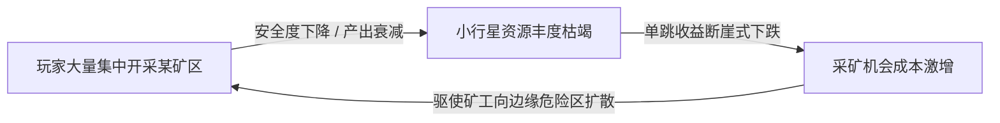
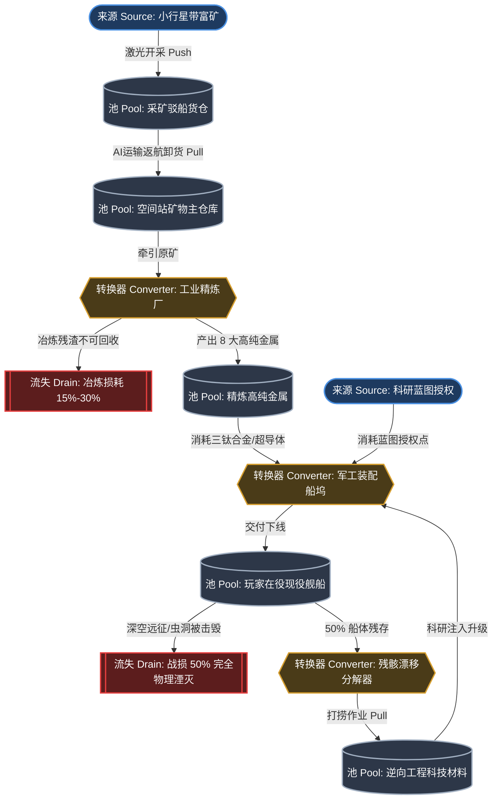

# 《游戏机制：高级游戏设计技术》Machinations 理论与系统动力学建模

> **理论定位**：在现代游戏架构设计中，游戏机制不是离散零碎的规则堆砌，而是一个复杂的、有生命的**系统动力学网络（System Dynamics Network）**。Ernest Adams 与 Joris Dormans 在其里程碑著作《Game Mechanics: Advanced Game Design》中提出的 **Machinations 形式化建模语言**，首次将控制论、微观经济学流转与状态机图论统一，使得游戏机制在编写第一行代码前即可完成定量仿真、瓶颈侦测与经济崩塌预警。
> 本篇系统解构 Machinations 核心理论，并为 [[project-overview|大鲸鱼-深空放置]] 的工业制造闭环与证券金融市场建立形式化系统动力学模型。

---

## 结论先行（Core Takeaways）

1. **机制即流动的状态空间**：游戏的本质是“**资源在节点间的受控流动与状态转换**”。任何复杂的系统（无论深空开矿、造船、战争、股票竞价），都可以还原为资源的生产、存储、损耗、转化与交易。
2. **反馈回路是玩法寿命的决定因子**：
   - **正反馈（Positive Feedback）**驱动扩张与爽感，但在无约束下必然引发“雪球效应（Snowballing）”并导致系统彻底失稳崩溃；
   - **负反馈（Negative Feedback）**提供阻尼与自稳定平衡，是防范经济恶性通胀与维持长周期玩法活力的唯一工程手段。
3. **涌现机制（Emergence）与渐进机制（Progression）的双螺旋协同**：
   - 纯渐进（线性关卡、固定技能树）内容消耗极快且缺乏重玩价值；
   - 纯涌现（沙盒规则碰撞、纯自由市场）极易让新手迷茫甚至迅速死锁；
   - 最佳实践是用**渐进机制构建认知阶梯与安全边界**，用**涌现机制承载终局自由度与生态演化**。
4. **大鲸鱼实体经济与金融系统必须维持完全闭环**：
   - 矿物从开采到制造再到战损，必须具备不可逆的**物理湮灭流失池（Sink）**，否则实体资产积压将反向摧毁生产激励；
   - 证券金融市场绝非虚空数字，必须充当**高净值巨鲸的资金蓄水池（Reservoir）**与**系统交易摩擦印花税的黑洞（Drain）**。

---

## 一、Machinations 核心元件与系统动力学图论

Machinations 框架通过图论网络抽象游戏内部经济。一个完整的系统动力学模型由**五大核心结构节点**、**两大连线通路**以及**三种控制修饰符**构成。

```
┌─────────────────────────────────────────────────────────────────────────────┐
│                       Machinations 核心元件拓扑图例                          │
├─────────────────────────────────────────────────────────────────────────────┤
│ 1. 节点元件 (Node Elements)                                                 │
│    [ Source (来源) ]    ────> 资源的起点，无限或受控生成 (例如：小行星带富矿)    │
│    ( Pool (蓄水池) )    ────> 资源的存储容器，有水位与容量 (例如：货仓/矿石库存) │
│    < Drain (流失/汇) >  ────> 资源的黑洞终点，彻底销毁 (例如：战损完全湮灭)    │
│    { Converter (转换) } ────> 按配比转化输入与输出 (例如：矿物精炼为金属)      │
│    [ Trader (交易者) ]  ────> 双向对价资产置换 (例如：市场买卖挂单撮合)       │
├─────────────────────────────────────────────────────────────────────────────┤
│ 2. 通路与连接 (Connections)                                                 │
│    ──( 资源通路 )──>     实线箭头，表示离散/连续资源的物理迁移 (推 Push/拉 Pull)│
│    ··( 状态连接 )··>     虚线箭头，表示数值对节点速率/容量的动态修饰与触发控制   │
├─────────────────────────────────────────────────────────────────────────────┤
│ 3. 门控与逻辑元件                                                           │
│    [ Gate (分支门) ]    ────> 条件/概率分流 (确定性分布、纯随机掷骰、优先级分支)│
│    [ End Condition ]    ────> 游戏胜负终局或周期重置触发器                     │
└─────────────────────────────────────────────────────────────────────────────┘
```

### 1. 五大核心节点定义与数学契约

#### ① 来源（Source）
- **语义**：外部输入端，代表游戏系统向玩家世界注入资源的水龙头。
- **物理映射**：小行星带开采产出、星系击杀海盗掉落、每日签到补贴。
- **数学表达式**：
  $$\frac{dR_{\text{in}}}{dt} = \alpha(t) \cdot f(\text{State})$$
  其中 $\alpha(t)$ 为基准产出率，$f(\text{State})$ 为受科技、技能和装备加成的状态函数。

#### ② 池（Pool / Reservoir）
- **语义**：状态暂存器。表示某种特定资源的瞬时存量，决定了系统当前的势能。
- **物理映射**：玩家钱包信用点（ISK）、空间站三钛合金储量、舰船耐久度（HP）、待训练技能点。
- **容量约束**：
  $$0 \le R(t) \le C_{\text{max}}$$
  当 $R(t)$ 达到上限 $C_{\text{max}}$ 时，引发溢出（Overflow）或反向阻塞上游牵引。

#### ③ 流失（Drain / Sink）
- **语义**：资源的终结者。任何进入该节点的资源都将从系统总账本中永久抹除，不可逆。
- **物理映射**：舰船在深空战损完全损毁、精炼矿渣损耗、跨星系跃迁同位素燃料消耗、市场挂单印花税。
- **核心价值**：流失节点是系统**对抗熵增与恶性通胀**的根本防波堤。

#### ④ 转换器（Converter）
- **语义**：守恒或非守恒的材料形态重构。将一组或多组输入资源按特定生产函数消耗，并产生一组新的产物。
- **物理映射**：工业精炼厂（消耗原矿 -> 产出矿物晶体）、造船船坞（消耗板材、推进器、超导体 -> 组装成突击巡洋舰）。
- **生产方程**：
  $$\{n_1 A_1, n_2 A_2, \dots\} \xrightarrow{\text{Efficiency } \eta} \{m_1 B_1, m_2 B_2, \dots\} + \text{Waste}$$

#### ⑤ 交易者（Trader）
- **语义**：双向交换节点。允许两个实体（玩家与系统、玩家与玩家）基于动态或静态汇率互换两类异构资源。
- **物理映射**：星系贸易中心、订单簿撮合买卖、LP 忠诚点军团商店。

---

### 2. 交互逻辑与流转驱动模式

Machinations 将资源的驱动方式严格划分为两种操作语义：

| 驱动模式 | 机制含义 | 系统动力学特征 | 游戏场景映射 |
| :--- | :--- | :--- | :--- |
| **推送（Push）** | 生产端主动将资源强行塞入下游节点 | 下游无容量时产生堵塞或直接丢失；系统刚性供给 | 采矿激光器每周期产出直接堆入矿石仓 |
| **牵引（Pull）** | 消费端根据需求主动向上游节点索取资源 | 需上游资源充足；按需索取，防止下游库存过载 | 工业流水线按蓝图配方从仓库牵引三钛合金 |

节点激活状态分为四大范式：
1. **被动式（Passive）**：默认状态，仅当受到外部推送或牵引时发生资源转移。
2. **交互式（Interactive）**：由玩家显式输入触发（如点击“开始装配”、“挂单出售”）。
3. **自动式（Automatic / Continuous）**：由游戏循环引擎（Tick）持续驱动，按时间步长恒定流转。
4. **生成即激活（On-Produce）**：一旦节点累积达到阈值即刻触发下游行为。

---

## 二、反馈回路（Feedback Loops）动力学控制论

游戏内部经济系统的稳健性完全取决于其**拓扑闭环结构中的反馈属性**。控制论之父维纳（Norbert Wiener）曾指出：“具有反馈的机制是生命系统与人造机器自适应调整的核心。”

### 1. 正反馈（Positive Feedback / 放大效应）


- **动力学特性**：系统扰动被自身放大，呈现**指数级发散（Exponential Growth）**。
- **设计价值**：
  - 创造核心驱动力与爽感（如“越有钱造越强的船，越强的船赚得越快”）。
  - 加速胜负分化，打破僵局，缩短单局对战时间。
- **工程风险（恶性雪球）**：
  - **垄断与阶级固化**：领先的先行者迅速吃空星系公共资源，后进玩家永无翻身可能。
  - **经济失控**：货币与物资存量突破阈值后，引发全服物价飞涨与货币贬值。

### 2. 负反馈（Negative Feedback / 自稳定平衡）



- **动力学特性**：系统的输出反向抑制输入，促使系统逼近稳态目标点（Equilibrium），呈现**阻尼振荡（Damped Oscillation）**。
- **设计价值**：
  - 保护新手，防止差距拉开过大。
  - 动态维持生态平衡，实现“看不见的手”对供需的自动调节。
- **大鲸鱼典型应用**：
  - **动态安全等级乘数（DBS）**：过度开采/刷怪导致安保等级骤降，海盗巡逻频次与强度几何级递增。
  - **递进式交易税率与挂单费**：单次挂单规模越大，超额累进印花税越高。

### 3. 反馈回路的七大工程调谐属性

在工业级数值平衡设计中，评估一个反馈回路必须量化以下 7 个维度：

| 属性维度 | 物理定义 | 调谐过高风险 | 调谐过低风险 |
| :--- | :--- | :--- | :--- |
| **1. 符号与极性 (Sign)** | 正反馈（+）还是负反馈（-） | 正反馈过多系统炸裂 | 负反馈过多游戏枯燥粘滞 |
| **2. 回路增益 (Gain)** | 输出变化量与输入变化量的比例 | 增益过高导致激进发散或剧烈震荡 | 增益过低导致机制形同虚设 |
| **3. 响应延迟 (Delay/Lag)** | 信号输入到系统输出生效的时间差 | **超大延迟会引发暴烈超调与系统崩溃** | 瞬时响应使博弈丧失操作与缓冲窗口 |
| **4. 动态范围 (Dynamic Range)** | 回路能够有效发挥调控作用的上下限 | 范围过宽扼杀边缘玩法 | 范围过窄导致系统迅速脱轨进入盲区 |
| **5. 衰减常数 (Damping Factor)** | 扰动发生后系统恢复基线稳态的速度 | 阻尼过大导致系统死寂，失去波动活力 | 阻尼不足导致持续简谐震荡 |
| **6. 确定性 (Determinism)** | 输出对输入的确定性函数关联度 | 绝对确定容易产生最优解与死板套路 | 纯随机性剥夺玩家策略掌控感 |
| **7. 玩家可感知度 (Transparency)**| 玩家是否能清晰理解当前所处的反馈阶段 | 过度暴露让机制失去神秘感，易被穷举算尽 | 完全黑盒使玩家感到被系统恶意针对 |

> [!IMPORTANT] 控制论黄金法则：延迟（Delay）是系统振荡的头号元凶
> 当负反馈回路存在显著的时间延迟时（例如：“市场上某种矿石短缺 -> 玩家看到高价投入造采矿船 -> 5 天后大规模造好并集中采矿 -> 市场矿石瞬间严重过剩爆仓 -> 价格暴跌全员血亏”），系统不仅无法稳定，反而会引发经典的**蛛网模型震荡（Cobweb Oscillation）**。消除延迟的工程手段包括：实时供给预警雷达、期货远期合约锁定、产能渐进释放阻尼。

---

## 三、离散机制与连续机制在时间流转中的演化

在架构底层，游戏引擎的时间切片直接决定了机制的演化形态。

```
时间离散化推进 (Discrete Time Slicing)
──────────────────────────────────────────────────────────────────
Tick 0 (0ms)        Tick 1 (1000ms)     Tick 2 (2000ms)
[矿石存量: 100]  ──>  [矿石存量: 120]  ──>  [矿石存量: 140]
      │                   │                   │
      └─ 离散事件结算 ────┴─ 离散事件结算 ────┴─ 离散事件结算
```

### 1. 离散机制（Discrete Mechanics）
- **特征**：状态变更由特定离散事件（Event Trigger）驱动。例如：玩家击毁一艘护卫舰掉落 1 件战利品；点击完成了一次技能点注入。
- **数学本质**：差分方程（Difference Equation）。
- **工程优势**：状态边界清晰、可完美复现、回放与序列化极为友好（完美适配存档与校验）。

### 2. 连续机制（Continuous Mechanics）
- **特征**：状态随着时间连续累积，体现为物理运动、速度、热量、流体压力或随时间连续衰减的护盾值。
- **数学本质**：微分方程（Differential Equation），由引擎按数值积分（Euler / Verlet）逼近求解：
  $$S_{t + \Delta t} = S_t + \frac{dS}{dt} \cdot \Delta t$$
- **在大鲸鱼中的收敛**：
  在 `@whale/core` 架构中，尽管底层物理或时间是微积分式的毫秒推演（`advanceGame(deltaMs)`），但宏观经济逻辑**全面离散化为定长窗口结算**。例如市场价格小史采样严格收敛到 30 分钟边界，避免浮点数无限精度导致的跨端不一致与状态膨胀。

---

## 四、双螺旋结构：涌现机制（Emergence）与渐进机制（Progression）

游戏设计的宏观架构由两条相互纠缠的螺旋线构成：**结构性渐进**与**系统性涌现**。

```mermaid
flowchart TD
    subgraph Progression [渐进轴 (Progression) - 确定性引导]
        P1[新手引导：破旧护卫舰] --> P2[主线任务：第一座工业精炼厂]
        P2 --> P3[科技解锁树：巡洋舰与主力舰制造授权]
        P3 --> P4[星域主权宣称与高安区通行证]
    end

    subgraph Emergence [涌现轴 (Emergence) - 动态自组织]
        E1[自由订单簿竞价与差价套利]
        E2[军团间跨星系物流护航与劫掠]
        E3[高流动性资金抱团做空企业股票]
        E4[深空星际大战引发的全服原材料挤兑与通胀]
    end

    P1 -.->|提供初始资本与规则认知| E1
    E1 -.->|产生财富沉淀，达成解锁门槛| P3
    P3 -.->|释放重工业蓝图，引爆市场流动性| E3
    E4 -.->|破坏实体资产，倒逼玩家探索更高阶星图| P4
```

### 1. 渐进机制的核心职责：建立安全认知阶梯
- **机制结构**：有向无环图（DAG），不可逆的状态单向跃迁。
- **玩家心理**：提供安全感、目标明确感、仪式感与阶段性多巴胺释放。
- **局限**：设计成本高昂（手工编排剧情、数值任务、场景），内容消费速度永远跑在生产速度前面。

### 2. 涌现机制的核心职责：提供无限的内容重玩度
- **机制结构**：网状拓扑环，基于简单的局部规则自下而上涌现出无法预料的宏观复杂性。
- **经典案例**：康威生命游戏（Game of Life）、《EVE Online》的泰坦陨落之战引发的市场物价震荡。
- **局限**：极度依赖系统的内在鲁棒性。若缺乏边界阻尼，微小的数值漏洞将被系统动力学无限放大，瞬间演化为死循环或支配性必胜策略（Dominant Strategy）。

---

## 五、大鲸鱼项目落地映射：实体工业链与证券资本市场拓扑建模

结合大鲸鱼项目实装的 `@whale/core` 核心架构与 `docs/balance-master-game-economy.md`，我们使用 Machinations 严格建模全游戏的两大命脉经济闭环：**实体物质流转链**与**金融证券流动性池**。

### 1. 实体物质循环：从原矿到战损完全湮灭

在《大鲸鱼-深空放置》中，物质绝不凭空创生，更不能只进不出。

#### 系统动力学流转图（Mermaid 机制拓扑）



#### 物质守恒与湮灭防线（Conservation Law）

为防止矿石库存出现无限积压导致物价归零，大鲸鱼在三处设置了不可逆的流失节点（Drain）：
1. **精炼损耗（Refining Waste Sink）**：
   $$M_{\text{out}} = M_{\text{ore}} \cdot \text{YieldRate} \cdot (1 - \text{WasteTax})$$
   基础精炼率仅 50%~75%，剩余部分作为工业废料永久剔除系统。
2. **战损完全湮灭（Total Annihilation Sink）**：
   在虫洞与高危星区交战中，战败舰船的 50% 资产（含舰体与高阶装备插槽）由引擎执行 `deleteFleetShip(uid)`，直接物理抹杀；仅有剩余 50% 转化为 `wreck`（空间漂移残骸）。
3. **残骸时效衰减（Wreck Drift Decay）**：
   漂移残骸拥有生存周期（`advanceWreckDrift`），超时未完成打捞将自动瓦解消失。

---

### 2. 证券金融系统：股市流动性池与印花税黑洞

股票与金融资产是放置游戏大后期吸收海量过剩流动性的超级蓄水池。

#### Machinations 证券拓扑架构

```
┌─────────────────────────────────────────────────────────────────────────────┐
│                       大鲸鱼深空交易所动力学模型                            │
├─────────────────────────────────────────────────────────────────────────────┤
│                                                                             │
│   [ 玩家活跃钱包 (ISK Pool) ] ──────────( 自由竞价撮合买入 )──────────┐      │
│                ▲                                                     │      │
│                │ 股息分红派息 (Cash Dividend)                        ▼      │
│       { 军团分红转换器 }                                  ( 证券托管池 )    │
│                ▲                                          [ Escrow Stock ]  │
│                │ 实体工业产值与利润注入                              │      │
│       [ 军团实体财阀产出 ]                                           │      │
│                                                                      ▼      │
│                                                            { 撮合结算匹配 } │
│                                                                      │      │
│   [ 挂单撤单防套利延迟 (Delay) ]                                    │      │
│                │                                                     ▼      │
│                └───────────── 交易印花税结算 ───────────> < 绝对流失黑洞 >   │
│                                (Stamp Tax: 1.5% - 3%)     [ ISK Drain ]     │
│                                                                             │
└─────────────────────────────────────────────────────────────────────────────┘
```

#### 关键机制流转与抗通胀阻尼

1. **资本沉淀蓄水池（Capital Siphon Reservoir）**：
   大后期巨鲸玩家手握数千亿 ISK 现金，如果任由这些资金冲击现货矿产市场，将导致新手彻底买不起基础矿物。证券交易所通过发行优质军团/高科技企业股份，将**流动性极高的热钱（Liquid ISK）锁定为长期持有的股权资产（Equities Stock）**。
2. **交易印花税流失黑洞（Stamp Duty Sink）**：
   每一笔撮合成交严格执行税率扣除（`packages/core/src/market/settlement.ts`）：
   ```typescript
   const gross = ceilFinalQuantity(take * order.price * mult);
   const net = netAfterTax(state, ctx, gross);
   const tax = gross - net; // 永久从经济系统中抹除的信用点
   state.wallet.isk += net;
   ```
   换手率越高，系统销毁的货币越多。高频量化交易者在制造流动性的同时，自发成为了全服最大的通货膨胀“负反馈稳定器”。
3. **股息现金流贴现模型（Dividend Discount Converter）**：
   股票底层绝非纯粹的空中博弈，其股息来自企业下辖采矿驳船与工业精炼厂的**实体利润分红**。实体经济繁荣 -> 股息提高 -> 股价上扬 -> 吸纳更多玩家投资实业，形成了良性健康的正向反馈。

---

## 六、系统动力学工程自检清单（Machinations Audit Checklist）

任何新增机制或数值调整，必须通过以下系统动力学审查：

```markdown
- [ ] 1. 每一个新设立的“来源（Source）”是否都找到了明确对冲的“流失（Drain）”？
- [ ] 2. 核心资源池（Pool）是否存在理论上的无上限膨胀路径？是否有硬性或软性容量天花板？
- [ ] 3. 系统中的主要正反馈回路（雪球机制）是否配置了带延迟约束的负反馈安全气囊？
- [ ] 4. 转换器（Converter）的转化效率在任何极限参数下均严格小于 1.0（杜绝永动机死循环套利）？
- [ ] 5. 交易者（Trader）的双向买卖价差与印花税是否足以覆盖套利机器人的跨星系无风险搬砖空间？
- [ ] 6. 渐进轴（任务/主线）的解锁速度是否与玩家在涌现轴（经济/采矿）的平均积累速度保持阻尼同步？
```

---

## 结语与相关链接

机制是骨架，数据是血液，动力学是灵魂。通过 Machinations 模型，我们为大鲸鱼奠定了“**因果明确、物料守恒、自适应平衡、抗通胀冲击**”的高级机制基石。

- [[balance-master-game-economy|上一篇：平衡掌控者：游戏数值经济设计]]
- [[game-programming-patterns|下一篇：游戏编程模式与单向核心引擎重构]]
- [[project-overview|项目总览：大鲸鱼-深空放置]]
- [[glossary-terms|领域词典：专用术语]]
