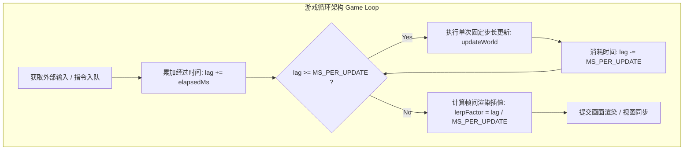
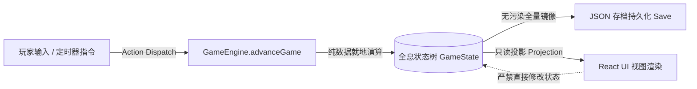

# 《游戏编程模式》全景重构与纯单向核心引擎架构

> **理论定位**：游戏开发是软件工程中最严苛的试验场——它要求在极限吞吐与毫秒级延迟下，编织数以万计相互纠缠的实体与复杂状态。Robert Nystrom 在其旷世名作《Game Programming Patterns》（游戏编程模式）中，将经典的 GoF 模式从过度设计的面向对象神坛拉回实战地面，并提炼出一套专属于游戏领域的**序列、行为、解耦与优化模式体系**。
> 本篇系统解构该书的核心模式精髓，并深度映射 [[project-overview|大鲸鱼-深空放置]] 的 `@whale/core` 核心引擎，揭开其纯单向数据流、确定性离线推演与百万级实体享元架构的技术底牌。

---

## 结论先行（Core Architectural Principles）

1. **解耦的终极目标是降低代码修改的边际成本**：好的架构不是设计模式的无节制堆砌，而是**“允许开发者廉价地做出改变（Cheap to change）”**。在快速迭代的原型期与线上运营期，过度抽象是扼杀开发效率的第一杀手。
2. **纯状态树是确定性推演与回溯的基石**：消除对象内部私有状态与隐式生命周期。将整个世界的状态浓缩为一棵**可完全 JSON 序列化的纯数据树（Single State Tree）**，引擎函数仅负责纯函数式或确定性变更，使“离线时间折叠”与“存档无损迁移”变得易如反掌。
3. **享元模式（Flyweight）击穿数据局部性瓶颈**：面对星海中成千上万艘舰船、无人机与货仓物品，必须严格切分**静态不可变的定义数据（Intrinsic State，由策划配置驱动）**与**动态轻量的运行时实例（Extrinsic State，仅包含 uid、坐标、耐久与槽位）**。
4. **单向数据流斩断循环依赖死锁**：坚持严格的 `User Action / Network Event -> Command Dispatch -> Engine advanceGame(deltaMs) -> State Mutation -> View Projection` 单向回路，杜绝任何跨子系统的双向乱飞事件总线。

---

## 一、全书总览与游戏模式全景拓扑

```
┌─────────────────────────────────────────────────────────────────────────────┐
│                       《游戏编程模式》全景模式矩阵                          │
├─────────────────────────────────────────────────────────────────────────────┤
│ 1. 架构与性能哲学 (Architecture & Philosophy)                               │
│    - 解耦的代价 (Cost of Decoupling)：抽象层开销 vs 代码可维护性            │
│    - 简单性原则 (Simplicity / YAGNI)：不为臆想的需求提前买单                 │
│    - 坏代码中的好代码：核心内循环极致性能，业务外围高灵活性                 │
├─────────────────────────────────────────────────────────────────────────────┤
│ 2. 序列型模式 (Sequencing Patterns)                                         │
│    - 游戏循环 (Game Loop)：可变步长 vs 固定物理步长 vs 追赶补偿 (Catch-up)  │
│    - 更新方法 (Update Method)：单帧世界切片，消除时间推进中的并发修改陷阱   │
│    - 双缓冲 (Double Buffer)：读旧写新，消除状态读写时序因果倒置 (Causality) │
├─────────────────────────────────────────────────────────────────────────────┤
│ 3. 行为型模式 (Behavioral Patterns)                                         │
│    - 字节码 (Bytecode)：沙箱虚拟机指令集，将高危逻辑与引擎底层物理隔离     │
│    - 子类沙盒 (Subclass Sandbox)：受控安全 API 暴露，防止派生类侵蚀系统     │
│    - 类型对象 (Type Object)：数据驱动实体，用配置对象取代深层继承爆炸       │
├─────────────────────────────────────────────────────────────────────────────┤
│ 4. 解耦型模式 (Decoupling Patterns)                                         │
│    - 组件模式 (Component)：组合优于继承，打破庞大臃肿的 God Object          │
│    - 事件队列 (Event Queue)：异步时间去耦，削峰填谷与广播解耦               │
│    - 服务定位器 (Service Locator)：全局基础设施依赖注入与 Null Object 防御  │
├─────────────────────────────────────────────────────────────────────────────┤
│ 5. 经典 GoF 模式的游戏重构                                                  │
│    - 命令模式 (Command)：操作对象化，支持确定性回放、撤销与时序重构        │
│    - 享元模式 (Flyweight)：内蕴共享与外蕴轻量分离，消灭内存冗余             │
│    - 观察者模式 (Observer)：无 GC 压力的轻量通知，防止悬空监听器内存泄漏   │
│    - 状态模式 (State)：层次/并发有限状态机 (FSM)，消灭失控的嵌套分支        │
└─────────────────────────────────────────────────────────────────────────────┘
```

---

## 二、架构、性能与游戏工程哲学

游戏架构师每天都在走钢丝：一侧是追求优雅、松耦合的学院派软件工程；另一侧是追求每秒 60 帧稳定吞吐、内存紧凑排布的硬件残酷现实。

### 1. 解耦的代价（The Cost of Decoupling）
Robert Nystrom 指出，解耦是软件工程的圣杯，但它并非免费的午餐：
- **认知复杂度增加**：为了找到一个逻辑的真正执行点，开发者必须在接口（Interface）、工厂（Factory）、定位器（Locator）之间来回跳跃（Spaghetti code -> Lasagna code）。
- **性能间接寻址开销**：每一次虚函数调用（Virtual dispatch）、指针解引用和动态事件分发，都会击碎 CPU 的指令缓存（L1/L2 Cache miss）与分支预测。
- **过度泛化的陷阱**：在需求尚不清晰时过早抽象，往往导致设计出的通用框架既笨重又无法适配真实变化。

### 2. 简单性原则与实用主义
- **坏代码中的好代码**：一个游戏在临近上线前，不可避免地会包含一些为了性能或特化体验而硬编码的“丑陋代码”。只要这块代码被严格限制在单一局部边界内（隔离沙盒），它就是优秀的工程取舍。
- **代码可弃用性（Code Throwawayability）**：编写可以被轻松删除、整体替换的代码，比编写能够应对未来 10 年未知需求的“全能代码”更为重要。

---

## 三、序列型模式（Sequencing Patterns）

序列型模式解决的是游戏引擎中最基本的问题：**时间如何流动，以及事物如何按顺序发生**。



### 1. 游戏循环（Game Loop）的演进阶梯
1. **纯忙等待循环（Busy Loop）**：`while(true) { processInput(); update(); render(); }` —— 速度完全失控，在快电脑上飞速，在慢电脑上卡死。
2. **可变时间步长（Variable Timestep）**：`update(elapsed)` —— 物理计算极易发生数值穿透与蝴蝶效应，不同帧率下物理表现不一致。
3. **固定内部物理步长 + 动态累加补偿（Fixed Timestep with Accumulator）**：
   - 保证物理推演绝对确定性（Deterministic Simulation）；
   - 支持丢帧追赶（Catch-up），在后台或休眠唤醒后平滑推进状态。

### 2. 更新方法（Update Method）
- **核心契约**：世界维护一个对象集合，每一帧遍历集合并对每个对象调用 `update()`。
- **并发修改陷阱（Concurrent Modification）**：在执行 `update()` 期间，若有实体死亡被销毁或生成新实体，直接修改数组将导致迭代器失效或元素被跳过。
- **解决方案**：引入操作暂存区（Dead List / Spawn List），在整个 Tick 遍历结束后集中执行增删。

### 3. 双缓冲模式（Double Buffer）
- **核心痛点**：若实体 A 的状态更新依赖于实体 B，而实体 B 又依赖实体 A。先更新 A 还是先更新 B 会导致完全不同的计算结果（时序因果悖论）。
- **模式解法**：维护“**当前缓冲区（Current Buffer）**”与“**下一帧缓冲区（Next Buffer）**”。计算时只读取 Current，将所有产出写入 Next；所有计算完毕后，以 $O(1)$ 的指针交换（Swap Buffers）瞬间完成状态跃迁。

---

## 四、行为型与解耦型模式深度提炼

### 1. 行为型模式（Behavioral Patterns）

```
┌─────────────────────────────────────────────────────────────────────────────┐
│                        行为型模式工程设计矩阵                               │
├─────────────────────────────────────────────────────────────────────────────┤
│ 1. 字节码 (Bytecode)                                                        │
│    - 结构：紧凑指令流 (Opcode + Operands) + 栈式虚拟机 (Stack Machine)       │
│    - 价值：将高危策划配置/AI行为脚本沙盒化，杜绝原生代码崩溃，支持热重载    │
├─────────────────────────────────────────────────────────────────────────────┤
│ 2. 子类沙盒 (Subclass Sandbox)                                              │
│    - 结构：基类提供大量 protected 原子操作，派生类仅实现一个 virtual run()   │
│    - 价值：收拢外部依赖，派生类无法直接访问全局系统，重构只需修改基类 API   │
├─────────────────────────────────────────────────────────────────────────────┤
│ 3. 类型对象 (Type Object)                                                   │
│    - 结构：实体类持有类型对象引用 (Entity -> EntityDef)                     │
│    - 价值：彻底消除 C++ / TypeScript 的深度继承爆炸，策划通过 JSON 派生新物种│
└─────────────────────────────────────────────────────────────────────────────┘
```

### 2. 解耦型模式（Decoupling Patterns）

#### ① 组件模式（Component）
- **原则**：单一责任与平坦化。将传统的巨大基类（如包含了渲染、音频、物理、AI、寻路、技能的 `Ship` 类）彻底拆分为相互独立的轻量组件：
  - `PhysicsComponent`：处理推力与位置；
  - `CombatComponent`：处理护盾与开火；
  - `InventoryComponent`：处理矿石与装备存储。
- **通信解耦**：组件间通过消息发布、宿主中介者（Mediator）或纯数据黑板共享状态。

#### ② 事件队列（Event Queue）
- **原则**：时间维度的彻底解耦。调用者触发事件时无需关心何时处理、由谁处理，只需将事件压入环形缓冲区（Ring Buffer）。
- **削峰填谷（Backpressure Mitigation）**：面对深空数千门火炮同时开火的极端瞬间，音频与特效队列能够执行合并（Coalescing）与降级丢弃，保护主循环不被撑爆。

#### ③ 服务定位器（Service Locator）
- **原则**：基础设施抽象化。游戏各模块不直接强依赖具体的物理引擎或音效库，而是向全局 Locator 请求 `AudioService`。
- **空对象保底（Null Object Pattern）**：
  在单元测试或无头服务器环境下，Locator 返回一个静默的 `NullAudioService`（方法体全空），杜绝运行期抛出 `NullPointerException`。

---

## 五、经典 GoF 模式的游戏化重构

经典《设计模式》诞生于企业级桌面办公软件时代，在游戏场景下必须进行工程重构：

### 1. 命令模式（Command）：操作对象化与确定性审计
- **重构要点**：不仅用于 UI 按钮点击，更作为**联机同步与离线校验的绝对契约**。
- **纯数据命令（Data Command）**：命令对象本身不包含复杂逻辑，而是一个扁平的 JSON 描述符（如 `{ type: 'REFINE_ORE', oreId: 'velator', qty: 5000 }`）。
- **收益**：
  - **无损回放（Replay System）**：记录初始存档 Seed + 纯命令流，即可 100% 精确复现数小时的战斗；
  - **撤销与重做（Undo/Redo）**：逆向执行对应补偿函数。

### 2. 享元模式（Flyweight）：百万级实体内存优化
- **重构要点**：严格区分内蕴状态（Intrinsic）与外蕴状态（Extrinsic）。
- **对比拓扑**：

```
传统面向对象 (臃肿内耗)
[ 舰船实例 1 ] ──> 包含名字、模型贴图、最大速度、槽位规则、当前HP、当前坐标 (数百KB)
[ 舰船实例 2 ] ──> 包含名字、模型贴图、最大速度、槽位规则、当前HP、当前坐标 (数百KB)

享元模式重构 (极速紧凑)
[ 全局静态配置表 ShipDef ] (仅此一份, 只读常驻)
   │  ├─ 名称: "守夜者级突击巡洋舰"
   │  ├─ 最大速度: 420 m/s
   │  └─ 装备插槽规格: [High x4, Mid x3, Low x3]
   │
   ├────── 被实例 1 引用 ──────> [ 运行时 Ship 1 ] (仅 uid, hp: 1200, x: 42.1, y: 18.5)
   └────── 被实例 2 引用 ──────> [ 运行时 Ship 2 ] (仅 uid, hp: 850,  x: 99.4, y: 3.2)
```

### 3. 观察者模式（Observer）：消除内存泄漏
- **经典痛点**：被观察者（Subject）持有一堆观察者的强引用。当观察者（如一个临时跳出的弹窗 UI）销毁时，若忘记调用 `removeObserver`，垃圾回收器（GC）将永远无法回收该 UI，造成典型的**幽灵监听器内存泄漏（Lapsed Listener Problem）**。
- **游戏级解法**：
  - 采用基于 WeakRef / 弱引用的观察者列表；
  - 或采用单向状态快照对比（State Diff / Reactive Selector），由 UI 框架自主声明订阅与卸载。

### 4. 状态模式（State）：状态机与分层下推
- **重构要点**：用状态对象替代海量的布尔标志位（`isMining`, `isReturning`, `isWarping`, `isDocked`）。
- **下推自动机（Pushdown Automata）**：使用栈结构存储状态历史。例如舰船当前处于 `Mining` 状态，突然遭遇海盗进入 `Fleeing` 状态；当危险解除，状态直接弹栈（Pop）恢复先前的 `Mining`，无需复杂的跳转判断。

---

## 六、大鲸鱼项目落地映射：`@whale/core` 核心架构深度解密

《大鲸鱼-深空放置》的核心库 `@whale/core` 彻底践行了上述设计模式哲学，构建起一套坚不可摧的纯单向数据流与确定性推演引擎。

### 1. 纯单向数据流与全息状态树（Single State Tree）

大鲸鱼彻底摒弃了“每个对象自己管自己数据”的分布式 OOP 架构，全游戏的所有运行时状态全部收敛在 `GameState` 这一棵平坦的纯数据树中（`packages/core/src/state.ts`）。



- **架构特性**：
  - **整体可序列化**：`JSON.stringify(state)` 即可瞬间生成无损存档；
  - **结构版本迁移契约**：`CURRENT_STATE_VERSION`（当前版本 31）。存档升级时通过链式迁移管道（`migrationV30ToV31`）纯函数式升迁，杜绝老旧脏数据。

---

### 2. `advanceGame(deltaMs)`：抹平在线与离线的时间折叠引擎

在 `packages/core/src/engine.ts` 中，核心驱动函数 `advanceGame` 是标准的**游戏循环与时间切片模式**落地：

```typescript
/**
 * 引擎心脏：时间的推进。
 * advanceGame 不关心"你是在线 1 秒还是离线 8 小时"，只按给定的毫秒数推进。
 * 在线时由 UI 循环每秒调用一次；离线唤醒时由读档模块一次性传入大数值毫秒推进。
 */
export function advanceGame(
  state: GameState,
  deltaMs: number,
  ctx: SimContext,
  opts?: AdvanceOptions
): void {
  // 1. 离线过长时采用时间分片（Time Slicing），防止单步微分过大导致逻辑失稳
  const stepMs = Math.min(deltaMs, MAX_SINGLE_STEP_MS);
  let remainingMs = deltaMs;

  while (remainingMs > 0) {
    const curStep = Math.min(remainingMs, stepMs);
    advanceGameStep(state, curStep, ctx, opts);
    remainingMs -= curStep;
  }
}
```

- **子系统流水线式解耦推进**：
  在 `advanceGameStep` 内部，各业务系统按照严格的因果依赖顺序单向调用：
  `advanceMining` -> `advanceRefining` -> `advanceManufacturing` -> `advanceMarket` -> `advanceWormhole` -> `advanceAi` -> `advanceEvents`。
  所有子系统只读 `ctx`（静态数据），按需读写 `state`（运行时数据），子系统之间杜绝直接交叉 import，彻底规避模块循环依赖。

---

### 3. 享元模式（Flyweight）在大鲸鱼中的彻底实施

大鲸鱼在设计之初就确立了 `@whale/data`（纯静态定义包）与 `@whale/core`（运行时动态包）的物理边界。

```typescript
// 1. 享元基元：只读不可变的静态数据 (存在于 SimContext 中，全服共享)
export interface ShipDef {
  readonly id: string;           // "ship-cruiser-01"
  readonly name: string;         // "星芒级巡洋舰"
  readonly baseHull: number;     // 4500
  readonly baseShield: number;   // 6000
  readonly slotHigh: number;     // 4
  readonly slotMid: number;      // 3
  readonly slotLow: number;      // 3
}

// 2. 运行时轻量实例：仅包含可变状态 (存在于 state.fleet.ships 数组中)
export interface ShipInstance {
  readonly uid: string;          // 动态分配唯一 UUID
  readonly defId: string;        // 享元指针：指向 ShipDef.id
  hp: {
    hull: number;                // 运行时当前结构值
    shield: number;              // 运行时当前护盾值
  };
  fitted: {                      // 实际装备的插槽引用
    high: (string | null)[];
    mid: (string | null)[];
    low: (string | null)[];
  };
  customName?: string;           // 玩家自定义船名
}
```

- **惊人的内存收益**：
  当玩家舰队拥有 500 艘各类巡洋舰与护卫舰时，内存中**绝对没有 500 份基础属性与描述文案**，仅仅是 500 个微型指针对象。计算战力时，由引擎通过 `ctx.ships.get(ship.defId)` 瞬间将静态规格与动态耐久/装配组合计算。

---

### 4. 命令派发与不可变审计账本（Command Dispatch & Ledger）

为彻底杜绝暗改与脏读，大鲸鱼的所有高价值资产转移均封装为带确定性校验的操作命令：

```typescript
// 资产买卖撮合指令落地的严格单向命令流
export function settleSell(
  state: GameState,
  ctx: SimContext,
  order: PlayerOrder,
  npc: NpcMarketOrder,
  take: number,
  idx: number,
): void {
  // 1. 前置确定性断言
  const def = ctx.marketGoods.get(order.good);
  if (!def) return;

  // 2. 状态原子操作
  const gross = ceilFinalQuantity(take * order.price * mult);
  const net = netAfterTax(state, ctx, gross);
  state.wallet.isk += net;

  // 3. 审计账本与第一任务钩子推进 (Command Ledger)
  bumpFirst(state, 'marketIncome', net);
  addLog(state, 'trade', logText, logId, params);
}
```

任何一笔钱或矿石的流动，都同步生成不可篡改的时间戳审计日志（`addLog`）与全服成就指标推进（`bumpFirst`），为后续的联机防作弊校验与客户端回放提供了坚实底座。

---

## 七、架构重构自检矩阵（Architecture Checklist）

在扩展 `@whale/core` 时，必须依照下述原则进行代码审查：

```markdown
- [ ] 1. 【状态纯洁性】：新增状态是否严格挂载于 `GameState` 树上？是否能够被纯 JSON 序列化？
- [ ] 2. 【享元分离】：新增的装备/舰船/星系数据，是否将静态规则放置于 `data` 层，运行时仅存 `id/uid`？
- [ ] 3. 【循环依赖防御】：子系统间是否严格按 `engine.advanceGame` 编排调用，严禁跨模块反向引用？
- [ ] 4. 【时间步长一致性】：新增逻辑是否以 `deltaMs` 为步长进行积分？是否支持毫秒级平滑切片？
- [ ] 5. 【双缓冲与快照】：在遍历数组更新期间，若存在生成/销毁操作，是否使用了缓冲队列暂存？
- [ ] 6. 【单向数据流】：UI 层是否彻底只读？所有用户操作是否一律封装为 Dispatch Command 提交给引擎？
```

---

## 结语与相关链接

没有最好的架构，只有最适合当前生命周期的工程取舍。《游戏编程模式》为大鲸鱼注入了工业级软件工程的骨架与灵魂，使我们能够在无限膨胀的深空宇宙中，始终保持代码的极简、轻盈与坚韧。

- [[game-mechanics-advanced-design|上一篇：游戏机制：高级游戏设计技术与系统动力学]]
- [[balance-master-game-economy|数值篇：平衡掌控者：游戏数值经济设计]]
- [[save-architecture|存档架构：GameState 数据树与迁移契约]]
- [[project-overview|项目总览：大鲸鱼-深空放置]]
