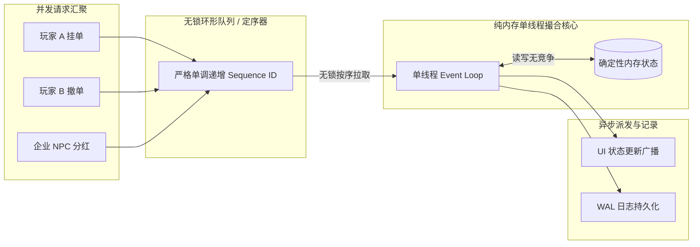

# 《高频交易系统：开发与实战》深度蒸馏

> **知识定位**：高频交易（High-Frequency Trading, HFT）代表了人类计算机软件在“吞吐极限、微秒级延迟与绝对确定性”维度的巅峰技艺。虽然游戏客户端不需要处理纳秒级的真实高频量化搏杀，但 HFT 系统背后的**“纯内存驻留、单线程无锁循环、定点数杜绝精度漂移、快照+增量事件回放”**的工程哲学，与 [[project-overview|大鲸鱼-深空放置]] 的 `@whale/core` 确定性离线模拟架构具有 100% 的同构性。

---

## 结论先行

1. **复合数据结构法则**：单靠数组或单靠哈希表都无法实现高效订单簿。生产级撮合引擎必须采用**“有序价格档位索引（红黑树/分段有序表） + 同档位先进先出双向链表（FIFO Doubly-Linked List） + 全局 O(1) 哈希索引”**的三位一体拓扑。
2. **O(1) 撤改单设计**：在撤单与改单极其频繁的金融世界中，必须通过 `HashMap<OrderId, OrderNode>` 结合双向链表节点的自引用指针（`prev` / `next`），实现**无需遍历任何列表即可在 $O(1)$ 时间内完成节点脱链与档位聚合更新**。
3. **单线程无锁哲学的胜利**：并发不等于高性能。LMAX 架构与现代 HFT 撮合核心均摒弃多线程锁竞争，采用**单线程顺序事件循环（Single-Threaded Event Loop）**，通过彻底消灭上下文切换（Context Switch）和 CPU 缓存失效（Cache Invalidation），换取无与伦比的确定性与极限吞吐。
4. **游戏 Core 的哲学契合**：大鲸鱼项目的 `@whale/core` 坚持“无 DOM、无浏览器依赖、纯数据流单向推进、快照存档隔离”，这与 HFT 的内存状态机设计完全契合。股票系统在引入客户端时，应坚持**定点数（Fixed-point）消除浮点漂移、纯内存结构与紧凑快照序列化**。

---

## 一、订单簿高性能数据结构模型

如果用单一大数组存储订单，每次插入需 $O(N)$ 移动内存，寻找买一卖一需线性扫描，这在海量订单面前是灾难。

```
                     ┌──────────────────────────────────────┐
                     │     HFT 复合订单簿整体物理拓扑       │
                     └──────────────────────────────────────┘

       [ 快速定位哈希表 HashMap<OrderId, OrderNode> ]
                      │                      │
                      │ (O(1) 直接指针引用)   │
                      ▼                      ▼
  【买方价格索引 (Bids Tree)】            【卖方价格索引 (Asks Tree)】
  (按价格降序：102.5 ➔ 102.0 ➔ ...)      (按价格升序：103.0 ➔ 103.5 ➔ ...)
       │                                      │
       ▼                                      ▼
  ┌──────────────┐                       ┌──────────────┐
  │ PriceLevel   │                       │ PriceLevel   │
  │ Price: 102.5 │                       │ Price: 103.0 │
  │ TotalQty: 1700                       │ TotalQty: 1100
  │ Head ──┐     │                       │ Head ──┐     │
  │ Tail ──┼──┐  │                       │ Tail ──┼──┐  │
  └────────┼──┼──┘                       └────────┼──┼──┘
           │  │                                   │  │
    ┌──────┘  └──────────────────┐         ┌──────┘  └──────────────────┐
    ▼                            ▼         ▼                            ▼
 ┌────────────┐  next   ┌────────────┐  ┌────────────┐  next   ┌────────────┐
 │ OrderNode  │ ──────> │ OrderNode  │  │ OrderNode  │ ──────> │ OrderNode  │
 │ #1001      │ <────── │ #1004      │  │ #1003      │ <────── │ #0998      │
 │ Qty: 500   │  prev   │ Qty: 1200  │  │ Qty: 300   │  prev   │ Qty: 800   │
 └────────────┘         └────────────┘  └────────────┘         └────────────┘
```

### 1. 层次分工明细

1. **价格档位层（Price Levels）**：
   - 每一个不同的价格对应一个 `PriceLevel` 实体。
   - 内部维护该档位的**总挂单量（TotalVolume）**、**订单总数（OrderCount）**，以及该档位订单双向链表的 `head` 与 `tail` 指针。
   - 所有档位组织在有序容器中，买盘最高价（Best Bid）与卖盘最低价（Best Ask）始终处于极端位置，定位复杂度为 $O(1)$ 或 $O(\log M)$（$M$ 为不同价格档位数量，通常远小于总订单数 $N$）。
2. **同档位时间队列层（Time Priority FIFO Queue）**：
   - 同一价格下，所有订单以**双向链表**串联。
   - 新订单追加到队尾（Tail，消耗 $O(1)$）；撮合成交时从队首提取（Head，消耗 $O(1)$）。
3. **全局订单索引表（Global Order Index）**：
   - 哈希映射表 `Map<OrderId, OrderNode>`。
   - 记录全系统所有活动的挂单节点。无论订单深埋在哪个价格档位、排在队列何处，均可通过订单 ID 在 $O(1)$ 时间内精准命中。

---

## 二、O(1) 复杂度的即时撤单与改单机制

在活跃市场中，撤单（Cancel）与改单（Modify/Replace）的频次往往占到总请求量的 80% 以上。

### 脱链（Unlink）逻辑

当收到 `CancelOrder(orderId)` 请求时：

```typescript
function cancelOrder(orderId: string): boolean {
  const node = this.orderIndex.get(orderId);
  if (!node) return false; // 订单已成交或不存在

  const level = node.priceLevel;

  // 1. 双向链表 O(1) 节点自我剔除
  if (node.prev) {
    node.prev.next = node.next;
  } else {
    level.head = node.next; // 原为队头
  }

  if (node.next) {
    node.next.prev = node.prev;
  } else {
    level.tail = node.prev; // 原为队尾
  }

  // 2. 更新档位聚合数据
  level.totalVolume -= node.qty;
  level.orderCount -= 1;

  // 3. 若该档位已无任何挂单，将该档位从价格索引树中移除
  if (level.orderCount === 0) {
    this.removePriceLevel(level.side, level.price);
  }

  // 4. 从全局哈希表清除
  this.orderIndex.delete(orderId);
  return true;
}
```

> [!TIP] 复杂度保证
> 整个撤单流程没有任何循环、没有数组内存整体平移，仅涉及固定次数的指针重连与数值扣减，时间复杂度是无可挑剔的 **严格 $O(1)$**。

---

## 三、撮合引擎工程架构哲学

### 1. 单线程事件循环与无锁设计（Lock-Free Single-Threaded Core）



- **锁的代价**：在多线程竞争环境下，互斥锁会导致 CPU 发生线程上下文切换，破坏 L1/L2 数据缓存行（Cache Line Invalidation）。
- **单线程优势**：现代 CPU 单核主频高达 4~5 GHz，单线程紧凑循环在纯内存中每秒可处理数百万次轻量撮合。消除了多线程数据竞态，引擎状态转移彻底变为**可复现的纯函数运算**。

### 2. 定点数运算（Fixed-Point Arithmetic）：杜绝浮点漂移

JavaScript/TypeScript 的原生数值为 IEEE 754 双精度浮点数（64位 float）。
```javascript
// 浮点数原罪
0.1 + 0.2 === 0.3; // false! 结果为 0.30000000000000004
```
在金融计算与游戏数值经济中，浮点漂移会导致资产凭空消失或莫名增加，最终损坏存档一致性。

- **定点数规约**：将所有计价单位放大固定倍数（如放大 $10^4$ 倍，代表精度到小数点后 4 位，即 1 点 = 0.0001 ISK）。
- 使用整数或 `BigInt` 进行加减乘除：
  $$\text{Price}_{\text{internal}} = \operatorname{round}(\text{Price}_{\text{float}} \times 10000)$$
  所有撮合比较、扣款、解冻与印花税计算，全部在整数域完成。

### 3. 对象池（Object Pooling）与内存零波动

在长时间放置挂机中，大量订单的创建与销毁会造成频繁的内存分配，触发浏览器的 V8 垃圾回收（Garbage Collection）微停顿。
- 预先分配 `OrderNode` 数组池。
- 订单销毁时清空字段并压入空闲栈（Free Stack），新订单申请时直接弹出复用，将 GC 停顿降为 0。

---

## 四、状态恢复与确定性审计：WAL 与内存快照

HFT 系统在遇到断电或灾难重启时，依靠两大法宝恢复状态：

1. **预写式日志（Write-Ahead Log, WAL）**：
   所有的订单操作在实际应用到内存状态机前，必须先按序写入不可修改的只追加日志（Append-only Log）。每个事件均携带绝对严格自增的 `SequenceNumber`。
2. **快照（Periodic Snapshot）与增量重放**：
   系统每隔固定周期（如每 10000 次操作或每整点游戏日）做一次全量内存镜像（Snapshot）。
   $$\text{CurrentState} = \text{Snapshot}_K + \sum_{i=K+1}^N \operatorname{ApplyEvent}(\text{Event}_i)$$
   灾难发生时，系统只需加载最近的快照 $K$，并从该快照点开始向后重放极少量的增量 WAL 事件，即可在毫秒级内完美重建现场。

---

## 五、《大鲸鱼-深空放置》项目核心映射

将 HFT 工程哲学应用到《大鲸鱼-深空放置》项目中，主要体现在以下维度：

### 1. 深度对齐 `@whale/core` 架构准则

- **无 UI 依赖、确定性模拟**：
  项目的核心代码 `packages/core/` 严格遵循“纯 TypeScript、零 DOM、无平台绑定”。挂机演算 `advance(state, deltaMs)` 的设计，本质上就是单线程确定性事件驱动模型。
- **快照与存档设计（Save Architecture）**：
  根据 [[save-architecture|存档结构与迁移边界]]，大鲸鱼的存档文件本质就是某一时隙的 `GameState` 完整内存快照。
  股票系统的数据结构必须能够天然支持 JSON 序列化与反序列化，避免复杂的循环引用导致序列化失败。

### 2. 纯内存紧凑股票订单簿实战代码

以下为适配大鲸鱼架构的纯内存确定性双边股票订单簿实现：

```typescript
/**
 * 确定性金融级股票订单簿 (TypeScript 实现)
 * 适配 @whale/core 的纯数据与确定性环境
 */

export interface StockOrder {
  id: string;
  stockId: string;
  side: 'buy' | 'sell';
  price: number;       // 定点数：实际价格 * 10000
  qty: number;         // 剩余股票数
  timestamp: number;   // 逻辑游戏时间戳 gameMs
}

export interface PriceBucket {
  price: number;
  totalQty: number;
  orders: StockOrder[]; // 采用紧凑列表承载 FIFO 队列
}

export interface StockMatchResult {
  tradeId: string;
  makerOrderId: string;
  takerOrderId: string;
  price: number;       // 定点数成交价
  qty: number;
  taxIsk: number;      // 扣除并直接销毁的系统印花税
}

export class DeterministicStockEngine {
  // 价格档位表：升序或降序
  public bids: PriceBucket[] = []; // 买盘：price 降序
  public asks: PriceBucket[] = []; // 卖盘：price 升序
  public orderLookup = new Map<string, { bucket: PriceBucket; order: StockOrder }>();

  /**
   * 提交限价单进行撮合与入簿
   */
  public executeOrder(incoming: StockOrder): StockMatchResult[] {
    const results: StockMatchResult[] = [];

    if (incoming.side === 'buy') {
      // 遍历卖方档位
      while (incoming.qty > 0 && this.asks.length > 0) {
        const bestAskBucket = this.asks[0];
        if (incoming.price < bestAskBucket.price) break; // 无法交叉，退出

        while (incoming.qty > 0 && bestAskBucket.orders.length > 0) {
          const maker = bestAskBucket.orders[0];
          const matchQty = Math.min(incoming.qty, maker.qty);

          // 计算系统印花税 (例如 2% = 0.02)
          const tradeAmount = Math.floor((bestAskBucket.price * matchQty) / 10000);
          const tax = Math.floor(tradeAmount * 0.02);

          results.push({
            tradeId: `TR-${incoming.timestamp}-${maker.id}`,
            makerOrderId: maker.id,
            takerOrderId: incoming.id,
            price: bestAskBucket.price,
            qty: matchQty,
            taxIsk: tax,
          });

          incoming.qty -= matchQty;
          maker.qty -= matchQty;
          bestAskBucket.totalQty -= matchQty;

          if (maker.qty === 0) {
            bestAskBucket.orders.shift();
            this.orderLookup.delete(maker.id);
          }
        }

        if (bestAskBucket.orders.length === 0) {
          this.asks.shift(); // 移除空档位
        }
      }

      // 剩余数量作为挂单留在买簿
      if (incoming.qty > 0) {
        this.insertRestingOrder(this.bids, incoming, false);
      }
    } else {
      // 卖单撮合对向买盘
      while (incoming.qty > 0 && this.bids.length > 0) {
        const bestBidBucket = this.bids[0];
        if (incoming.price > bestBidBucket.price) break;

        while (incoming.qty > 0 && bestBidBucket.orders.length > 0) {
          const maker = bestBidBucket.orders[0];
          const matchQty = Math.min(incoming.qty, maker.qty);

          const tradeAmount = Math.floor((bestBidBucket.price * matchQty) / 10000);
          const tax = Math.floor(tradeAmount * 0.02);

          results.push({
            tradeId: `TR-${incoming.timestamp}-${maker.id}`,
            makerOrderId: maker.id,
            takerOrderId: incoming.id,
            price: bestBidBucket.price,
            qty: matchQty,
            taxIsk: tax,
          });

          incoming.qty -= matchQty;
          maker.qty -= matchQty;
          bestBidBucket.totalQty -= matchQty;

          if (maker.qty === 0) {
            bestBidBucket.orders.shift();
            this.orderLookup.delete(maker.id);
          }
        }

        if (bestBidBucket.orders.length === 0) {
          this.bids.shift();
        }
      }

      if (incoming.qty > 0) {
        this.insertRestingOrder(this.asks, incoming, true);
      }
    }

    return results;
  }

  /**
   * O(1) 撤销未成交挂单
   */
  public cancelOrder(orderId: string): boolean {
    const entry = this.orderLookup.get(orderId);
    if (!entry) return false;

    const { bucket, order } = entry;
    const idx = bucket.orders.indexOf(order);
    if (idx !== -1) {
      bucket.orders.splice(idx, 1);
      bucket.totalQty -= order.qty;
    }

    this.orderLookup.delete(orderId);

    // 清理空桶
    if (bucket.orders.length === 0) {
      this.bids = this.bids.filter((b) => b !== bucket);
      this.asks = this.asks.filter((b) => b !== bucket);
    }
    return true;
  }

  private insertRestingOrder(buckets: PriceBucket[], order: StockOrder, ascending: boolean): void {
    let bucket = buckets.find((b) => b.price === order.price);
    if (!bucket) {
      bucket = { price: order.price, totalQty: 0, orders: [] };
      buckets.push(bucket);
      buckets.sort((a, b) => (ascending ? a.price - b.price : b.price - a.price));
    }
    bucket.orders.push(order);
    bucket.totalQty += order.qty;
    this.orderLookup.set(order.id, { bucket, order });
  }
}
```

---

## 六、知识图谱关联与延伸阅读

- 宏观经济产销闭环与通胀控制：[[balance-master-game-economy|《平衡掌控者：游戏数值经济设计》]]
- CLOB 市场微观结构与订单类型基础：[[matching-engines-for-dummies|《Matching Engines for Dummies》]]
- 项目架构总览与纯 Core 分离原则：[[project-overview|项目架构与模块边界]]
- 存档纯数据状态快照与迁移规则：[[save-architecture|存档结构与迁移边界]]
