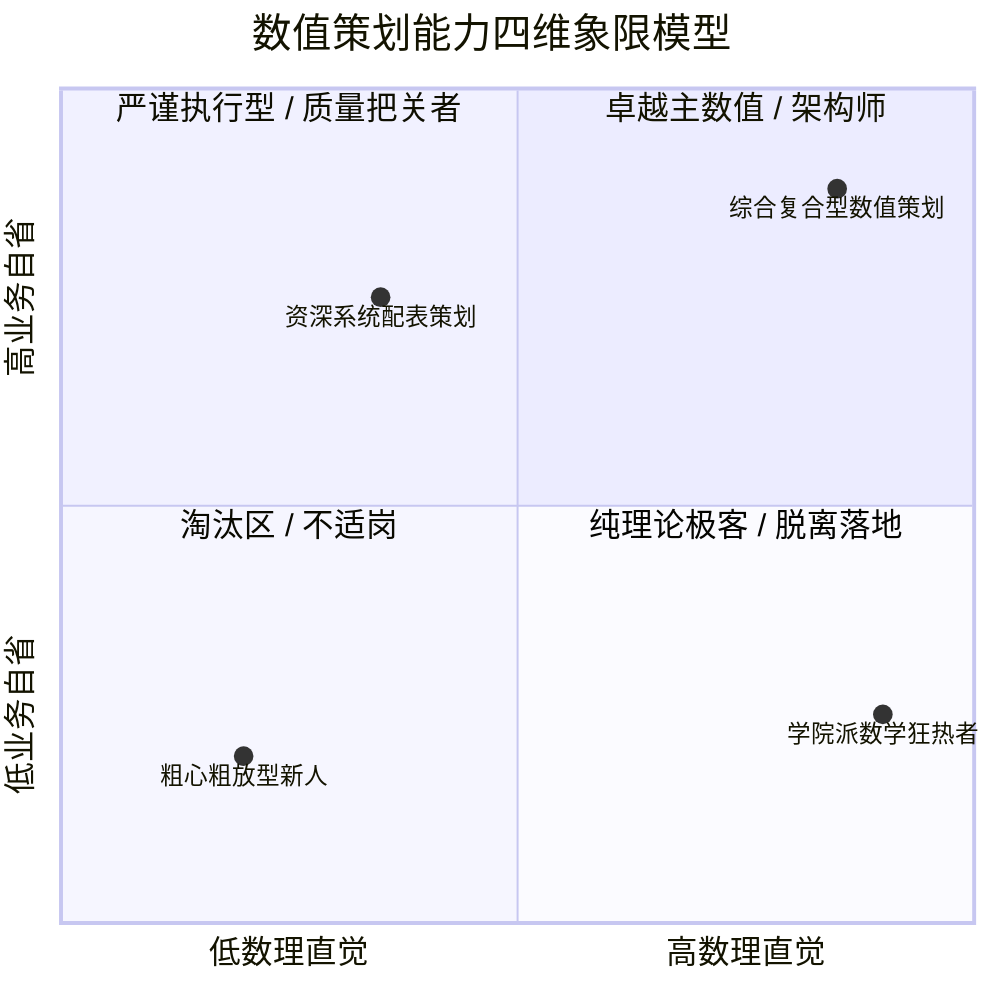
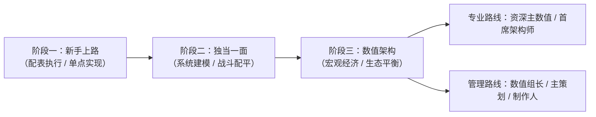
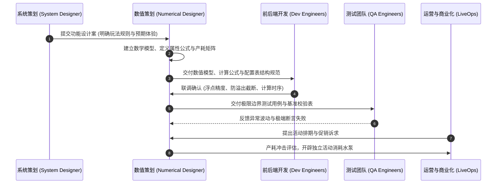

# 数值策划职业发展路径、研发全流程定位与求职面试真题方法论

> 对应原书：**第 1 章 数值策划的职业发展** 与 **第 7 章 求职中的那点事儿**

数值策划常被称为游戏研发团队中的“数学家”、“掌舵人”或“幕后黑手”。在《平衡掌控者》中，作者结合十余年一线研发管理经验指出：**数值策划的本质不是摆弄高深数学公式，而是运用逻辑推理、概率统计和系统动力学，为玩家构建稳定、爽快且具备长线生命力的虚拟世界规则。**

---

## 一、数值策划能力模型与核心素养 (Competency Model)

原书第 1.1 节将数值策划的核心素养拆解为四个关键维度：

1. **入行机缘与职业特质**：
   - 对数字极度敏感，习惯探究游戏底层机制（如伤害公式是减法、乘法还是除法减伤）；
   - 热爱拆解拆表，具备极强的逆向工程兴趣。
2. **求知欲与底层追问**：
   - 不满足于“数值跑得通”，必须搞清楚“为什么暴击率上限设为 75% 而不是 100%”、“为什么经验曲线在 60 级出现阶梯跃升”；
   - 持续学习 Excel 高级函数、VBA 脚本、Python 数据分析以及宏观经济学原理。
3. **自省与严谨性**：
   - **“配置表错一个零，全服停服回档”**：数值是直接落盘为数据资产的岗位，对容错率的要求远高于其他策划工种；
   - 具备自测闭环思维，提交配置前必须通过自动化脚本与模拟器自我推演。
4. **数理逻辑与抽象建模能力**：
   - 能够将策划案中模糊的感性描述（如“希望大招有毁天灭地的压迫感”）翻译为严密的数学函数与边界约束。

---

## 二、职业晋升路径与研发阶梯

原书系统梳理了数值策划由浅入深的三大成长阶段与双轨晋升方向：

### 1. 阶段一：新手上路（执行与规则消化）
- **核心职责**：根据主数值搭建的模型填表、配表，编写技能数据、怪物掉落表、商城道具配置。
- **关键卡点**：避免低级失误（漏填、越界、ID 冲突、外键失效）；掌握 Excel 必备工程技巧（详见 [[02-excel-numerical-engineering]]）。

### 2. 阶段二：独当一面（模块建模与子系统闭环）
- **核心职责**：独立承接一个甚至多个核心系统的完整数值规划。例如宠物系统资质洗炼、装备精炼强化曲线、副本通关产出平衡。
- **关键卡点**：建立模块级的产出与消耗平衡网；熟练运用蒙特卡洛仿真校验概率边界（详见 [[12-vba-monte-carlo-simulation]]）。

### 3. 阶段三：数值架构（全服宏观经济与生态把控）
- **核心职责**：掌控全服货币发行权与回收水泵；构建三币/四币隔离防火墙（详见 [[05-currency-systems-and-isolation]]）；设计玩家分层追求模型与产销剪刀差（详见 [[07-player-pursuits-and-monetization]]）；主导生命周期阶段调控（详见 [[08-game-lifecycle-and-economic-phases]]）。
- **终极考核**：全服物价稳定、生命周期内不恶性通胀、大R具备长期追求、平民具备生存土壤。

---

## 三、研发全流程定位与跨部门协同契约

数值策划绝非单打独斗，在敏捷研发管线中，数值处于枢纽地位：

### 协同契约关键军规
1. **与系统策划**：玩法机制不确定前，拒绝过早进行细部调参；机制变动必须同步评估数值影响。
2. **与程序开发**：
   - 严禁隐式转换，显式约定属性计算精度（整型放大还是双精度浮点）；
   - 公式防除以零、防负数溢出、防计算溢出（如战力计算超 $2^{31}-1$）；
   - 统一配置表导出格式与外键引用校验。
3. **与测试团队**：
   - 数值策划必须主动提供“极限边界用例”（如：暴击率堆到 200% 时收益、防御力无穷大时的免伤、背包满仓时的结算）。
4. **与运营团队**：
   - 严禁运营直接未经测算投放核心流通货币；所有商业化活动必须通过产耗总表对齐（详见 [[10-production-consumption-simulation-model]] 与 [[13-operations-analytics-and-telemetry]]）。

---

## 四、求职笔试经典真题与方法论深度拆解

原书第 7 章精选了国内大厂校招与社招的高频经典真题。这些题目不仅考查概率统计基础，更考查应聘者的数值建模思维。

### 真题 1：双模式抽卡保底概率与期望计算
> **题目**：
> 模式 A：单抽获得 S 级概率为 20%。若前 9 次均未抽中，第 10 次概率升至 25%，第 11 次升至 30%，每多抽一次增加 5%，直至抽中 S 级后概率重置为 20%。
> 模式 B：单抽概率为 20%。若连续 9 次未出 S，则第 10 次必出（100% 保底），抽中后重置为 20%。
> **问**：两种模式下，单次抽中 S 级的实际综合期望概率各是多少？

#### 模式 A 求解推导：
令 $T$ 为抽中第一个 S 级所需的抽数，单次抽中的条件概率分布为：
- $k \in [1, 9]$：$P(\text{中}|T \ge k) = 0.20$
- $k = 10$：$0.25$；$k = 11$：$0.30$；$k = 12$：$0.35$；...；$k = 25$：$1.00$（封顶必出）

累计不中概率 $q_k = 1 - p_k$：
- $k \le 9$ 时，持续不中概率 $Q_k = (0.8)^k$。
- 正好在第 $k$ 抽首次中 S 的概率 $P(T = k) = Q_{k-1} \times p_k$。
- 期望抽数 $E[T] = \sum_{k=1}^{25} k \cdot P(T = k) = \sum_{k=0}^{24} Q_k$。
通过求和可得 $E_A[T] \approx 4.67$ 抽，综合概率 $P_{\text{avg}} = \frac{1}{E[T]} \approx 21.41\%$。

#### 模式 B 求解推导：
- $k \in [1, 9]$ 抽中概率 $0.20$，连续 9 抽均不中的概率为 $0.8^9 \approx 0.1342$。
- 第 10 抽必出（概率 1.0）。
- 期望抽数 $E_B[T] = \sum_{k=0}^{9} 0.8^k = \frac{1 - 0.8^{10}}{1 - 0.8} = \frac{1 - 0.10737}{0.2} = 4.463$ 抽。
- 综合概率 $P_{\text{avg}} = \frac{1}{4.463} \approx 22.40\%$。
- **结论**：模式 B 的玩家体验综合出率（22.4%）高于模式 A（21.41%），且硬保底能给玩家更确定的心理预期。

---

### 真题 2：贝叶斯后验概率题（玩家真实性别判定）
> **题目**：
> 某游戏男女玩家比例为 $8:2$（男 $80\%$，女 $20\%$）。统计显示：$75\%$ 的男性玩家选择男性角色；$90\%$ 的女性玩家选择女性角色。
> **问**：在游戏中遇到一个女性角色，其操纵者真实为女性玩家的概率是多少？

#### 求解推导：
设事件 $A$ 为“玩家真实性别为女性”，事件 $B$ 为“玩家选择了女性角色”。
- 先验概率：$P(A) = 0.20$，$P(\bar{A}) = 0.80$。
- 条件概率：
  - 女玩家选女角色：$P(B|A) = 0.90$；
  - 男玩家选女角色（人妖号）：$P(B|\bar{A}) = 1 - 0.75 = 0.25$。
- 全概率公式计算全服女角色总体占比：
  $$P(B) = P(A)P(B|A) + P(\bar{A})P(B|\bar{A}) = 0.20 \times 0.90 + 0.80 \times 0.25 = 0.18 + 0.20 = 0.38$$
- 根据贝叶斯定理（Bayes' Theorem）求后验概率：
  $$P(A|B) = \frac{P(A)P(B|A)}{P(B)} = \frac{0.18}{0.38} = \frac{9}{19} \approx 47.37\%$$
- **数值启示**：即便女玩家中 90% 都选女角色，但由于基数中男玩家占比高达 80%，导致游戏中超过一半（$52.63\%$）的女性角色背后依然是男性玩家！

---

### 真题 3：马尔可夫链与斩杀线期望打击次数
> **题目**：
> 怪物初始生命值为 45 点。角色每次普通攻击固定造成 5 点伤害，且有 $50\%$ 的概率触发暴击，暴击时额外造成 5 点伤害（即单次总计造成 10 点伤害）。
> **问**：消灭该怪物所需的期望攻击次数是多少？

#### 求解推导（动态规划 / 马尔可夫吸收态反推）：
设 $E(h)$ 表示怪物剩余生命值为 $h$ 点时，彻底击杀所需的期望攻击次数。
状态转移方程为：
$$E(h) = 1 + 0.5 \times E(h - 5) + 0.5 \times E(h - 10)$$
边界条件：当 $h \le 0$ 时，$E(h) = 0$。

我们从 $h=5$ 开始逐步递推：
- $E(5) = 1 + 0.5 E(0) + 0.5 E(-5) = 1$
- $E(10) = 1 + 0.5 E(5) + 0.5 E(0) = 1 + 0.5(1) + 0 = 1.5$
- $E(15) = 1 + 0.5 E(10) + 0.5 E(5) = 1 + 0.5(1.5) + 0.5(1) = 2.25$
- $E(20) = 1 + 0.5 E(15) + 0.5 E(10) = 1 + 0.5(2.25) + 0.5(1.5) = 2.875$
- $E(25) = 1 + 0.5(2.875 + 2.25) = 3.5625$
- $E(30) = 1 + 0.5(3.5625 + 2.875) = 4.21875$
- $E(35) = 1 + 0.5(4.21875 + 3.5625) = 4.890625$
- $E(40) = 1 + 0.5(4.890625 + 4.21875) = 5.5546875$
- $E(45) = 1 + 0.5(5.5546875 + 4.890625) = 1 + 5.22265625 = 6.2227$

因此，击杀该怪物的期望攻击次数约为 **6.22 次**。

---

### 真题 4：D20 投骰期望伤害公式计算
> **题目**：
> 攻击判定投掷 20 面骰（点数 $X \in [1, 20]$ 等概率分布，即 $1D20$）。
> 每次攻击造成的伤害计算公式为：
> $$\text{DAM} = \max(\text{ATK} + 1D20 - \text{DEF}, 0)$$
> 其中 $\text{ATK}, \text{DEF} \in [1, 20]$ 为离散整数。
> **问**：伤害值 $\text{DAM}$ 的数学期望表达式及物理意义？

#### 求解推导：
令基准差值 $\Delta = \text{ATK} - \text{DEF}$，由于 $\text{ATK}, \text{DEF} \in [1, 20]$，故 $\Delta \in [-19, 19]$。
令实际投骰点数为 $X \sim U\{1, 20\}$，伤害表达式为 $\text{DAM} = \max(X + \Delta, 0)$。

- **情形 1**：若 $\Delta \ge 0$（攻击力不低于防御力）
  此时 $X + \Delta \ge 1 + 0 = 1 > 0$ 恒成立，无需截断：
  $$E[\text{DAM}] = E[X] + \Delta = 10.5 + (\text{ATK} - \text{DEF})$$
- **情形 2**：若 $\Delta < 0$（破防不足，防御高于攻击）
  设 $k = -\Delta > 0$（$k \in [1, 19]$）。
  只有当骰子点数 $X > k$ 时，才产生有效伤害 $X - k$；当 $X \le k$ 时，伤害被截断为 0。
  $$E[\text{DAM}] = \sum_{x=k+1}^{20} \frac{1}{20}(x - k) = \frac{1}{20} \sum_{i=1}^{20-k} i = \frac{(20-k)(21-k)}{40}$$
- **数值启示**：当防御力压制攻击力时，伤害呈现二次非线性衰减；当攻大于防时，恢复为纯线性收益。这是经典 DND 减法公式避免破防后产生“负伤害”的标准截断处理。

---

### 真题 5：赠券收集者问题（Coupon Collector's Problem）
> **题目**：
> 某套装由 4 件互不相同的部位组成。每次参与活动获得各部位装备的概率均等（各 $25\%$）。
> **问**：
> 1. 平均需要获得多少件装备才能集齐一套？
> 2. 若 4 个部位掉落概率不等（分别为 $10\%, 20\%, 30\%, 40\%$），集齐的期望抽取次数是多少？

#### 求解推导：
1. **等概率情形**：
   - 设 $X_i$ 表示已拥有 $i-1$ 件不同部位时，抽到第 $i$ 件新部位所需的抽取次数。
   - $X_i$ 服从几何分布，成功概率 $p_i = \frac{4 - (i-1)}{4}$。
   - 期望值 $E[X_i] = \frac{1}{p_i} = \frac{4}{5 - i}$。
   - 总期望 $E = \sum_{i=1}^4 E[X_i] = \frac{4}{4} + \frac{4}{3} + \frac{4}{2} + \frac{4}{1} = 1 + 1.333 + 2 + 4 = 8.333$ 次。
2. **不等概率情形**：
   - 设各部位抽取概率为 $p_1=0.1, p_2=0.2, p_3=0.3, p_4=0.4$。
   - 利用最小-最大恒等式（Min-Max Identity）或积分公式：
     $$E[T] = \int_0^\infty \left(1 - \prod_{i=1}^4 (1 - e^{-p_i t})\right) dt$$
   - 亦可直接用容斥原理展开：
     $$E[T] = \sum \frac{1}{p_i} - \sum \frac{1}{p_i + p_j} + \sum \frac{1}{p_i + p_j + p_k} - \frac{1}{\sum p_i}$$
     代入可得其期望值约为 **12.59 次**。
   - **数值启示**：只要卡池中存在一件 $10\%$ 的稀有部件，集齐一套的期望次数就从 8.3 次急剧拉长到 12.6 次。这就是典型的“长尾卡点”设计。

---

## 五、面试实战通关策略：群面与单面破局

原书第 7.1.3 与 7.2 节对面试细节给出了极其接地气的指导：

### 1. 无领导小组讨论（群面）的生死线
- **绝对禁忌**：
  - 严禁打断他人发言；
  - 严禁为了反对而反对，不要情绪化争执；
  - 严禁假大空、没有数据支撑的高谈阔论。
- **加分战术**：
  - **白板记录员/时间控制者**：主动理顺讨论框架，提醒发言时限；
  - **数据定海神针**：当全组争执不休时，主动引入量化模型（如：“我们先假设基准留存率是 40%，那么方案 A 与方案 B 的日活差异可以量化为……”），瞬间确立专业权威；
  - **复盘与补位**：汇报时主动为之前未充分发言的同学留出总结空间，展现团队领导力与大局观。

### 2. 专业单面（技术面与总监面）
- **自带作品集是降维打击**：
  - 准备一份精心排版的 Excel 数值拆解表（包含逆向反推、动态图表）或一段清晰的数值模拟代码（Python / VBA）；
  - 简历上写精通的游戏，必须能随口报出核心技能消耗、升级经验量级与经济循环闭环；
- **遇到答不上来的题目时的破局法**：
  - 切忌胡编乱造；
  - 展现**解题思路**比直接给出答案更重要：“这道题如果在生产环境中，我会分三步拆解：第一步先确定边界约束，第二步建立马尔可夫转移矩阵，第三步若解析解复杂，则用蒙特卡洛抽样 10 万次逼近……”

---

## 六、知识库双链互通与学习路线

- 掌握必备的数值配置工程技巧 $\rightarrow$ [[02-excel-numerical-engineering]]
- 理解宏观虚拟经济四阶段循环 $\rightarrow$ [[03-economic-loop-production-consumption]]
- 掌握蒙特卡洛代码实现以应对大厂面试机试 $\rightarrow$ [[12-vba-monte-carlo-simulation]]
- 查阅《大鲸鱼-深空放置》项目真实落地规范 $\rightarrow$ [[14-whale-eve-adaptation-guide]]
