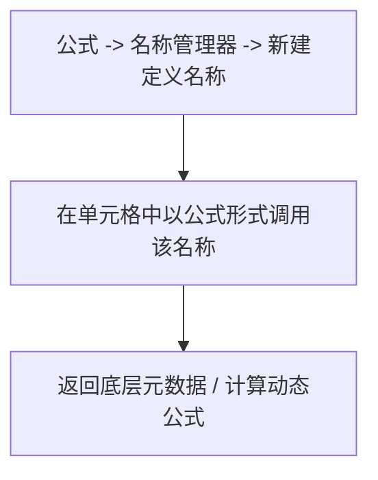
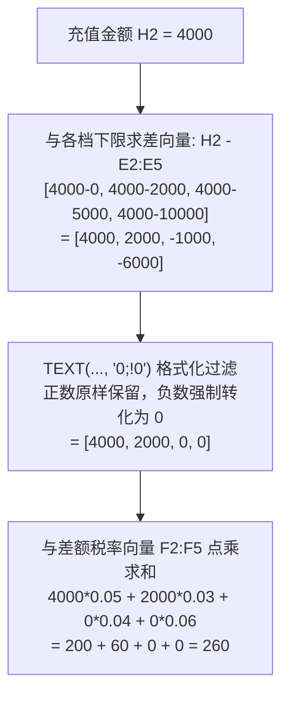

# Excel 数值工程宝典：高阶检索、动态数组、宏表函数与分级累进求和

> 对应原书：**第 2 章 Excel实战运用**

Excel 是数值策划的“第一生产力武器”。然而，绝大多数策划仅停留在 `SUM`、`AVERAGE` 和普通 `VLOOKUP` 的初级水平。在面对成百上千张配置表、数万行数据以及复杂的阶梯计算时，低劣的公式不仅性能低下，还会埋下灾难性的配置错误隐患。

《平衡掌控者》第 2 章系统总结了数值策划在工业级实战中必须掌握的 Excel 核心底层工程逻辑与高阶技巧。

---

## 一、Excel 编辑模式与底层引用体系

### 1. 编辑模式的底层状态（2.1 节）
Excel 状态栏通常显示四种状态：**就绪（Ready）、输入（Enter）、编辑（Edit）、定位（Point）**。
- **输入状态 vs 编辑状态**：
  - 新手在输入公式时按方向键，常发生“自动引用了其他单元格”的困扰，这是因为处于**输入状态**；
  - 按 `F2` 可在“输入”与“编辑”状态之间切换。在“编辑”状态下，方向键仅用于移动光标，不会误触其他单元格。
- **公式输入原则**：
  - 所有的公式字符（括号、逗号、双引号）必须在**英文半角**状态下输入；
  - 复杂嵌套公式善用 `Alt + Enter` 在公式编辑栏内换行，并使用空格缩进，保持代码级可读性。

### 2. R1C1 引用样式 vs A1 引用样式（2.4.1 节）
大部分人习惯使用 `A1`、`$B$5` 这种字母加数字的表示法，但在数值批量生成、VBA 脚本开发以及矩阵公式中，**R1C1 样式**具备绝对的逻辑优势。

| 样式表示法 | 相对引用示例 | 绝对引用示例 | 混合引用示例 | 逻辑意义 |
| :--- | :--- | :--- | :--- | :--- |
| **A1 样式** | `B3` | `$B$3` | `$B3` / `B$3` | 列标用字母，行号用数字；向右向下复制时难以肉眼直观看出相对位移 |
| **R1C1 样式** | `R[2]C[1]` | `R3C2` | `R[2]C2` / `R3C[1]` | `R` 代表 Row（行），`C` 代表 Column（列）；中括号 `[k]` 表示当前单元格相对偏移量（正为下/右，负为上/左） |

- **R1C1 的工程威力**：
  在整列填充公式时，A1 样式的公式每行各不相同（如第一行 `=A1+B1`，第二行 `=A2+B2`）；而在 R1C1 样式下，整列的公式完全一致，均为 `=RC[-2]+RC[-1]`！这在自动化检查公式一致性（Check Formula Consistency）时效率极高。

---

## 二、高阶查询与数据检索技术

### 1. 一对一逆向查询（2.2.1 节）
传统 `VLOOKUP(lookup_value, table_array, col_index, [range_lookup])` 存在天然死穴：**查找值必须位于目标区域的第一列，无法向左检索**。


#### 解决方案对比与工程落地：

- **方案 A：INDEX + MATCH（行业基准，强力推荐）**
  ```excel
  =INDEX($A$2:$A$7, MATCH(A10, $B$2:$B$7, 0))
  ```
  - 原理：`MATCH(A10, $B$2:$B$7, 0)` 精准返回目标 ID 在 B 列的相对行号；`INDEX` 根据该行号从 A 列取出对应名称。不受列位置排列影响，性能极佳。

- **方案 B：VLOOKUP + IF({1,0}) 虚拟重构数组**
  ```excel
  =VLOOKUP(A10, IF({1,0}, $B$2:$B$7, $A$2:$A$7), 2, FALSE)
  ```
  - 原理：利用 `IF({1,0}, Array1, Array2)` 在内存中强制重构一个双列内存表，第 1 列为 B 列（ID），第 2 列为 A 列（名称），从而骗过 VLOOKUP 的第一列限制。
  - 评价：构思精妙，但在超大数据集下因内存构造产生额外开销，可作为面试压轴展示。

- **方案 C：LOOKUP 向量万能匹配**
  ```excel
  =LOOKUP(1, 0/($B$2:$B$7=A10), $A$2:$A$7)
  ```
  - 原理：`($B$2:$B$7=A10)` 产生布尔数组，除以 0 后匹配项变成 `0`，其余项变为 `#DIV/0!` 错误值。`LOOKUP(1, ...)` 在忽略错误值后，自动匹配最后一个小于等于 1 的数值（即 0 所在位置）。

- **现代 Office 365 / WPS 拓展：XLOOKUP**
  ```excel
  =XLOOKUP(A10, $B$2:$B$7, $A$2:$A$7, "未找到")
  ```

---

### 2. 万能一对多查询（2.2.2 节）
在策划配表中，常遇到“一个策划负责多个系统”或“一个副本产出多种道具”，需要将匹配到的多条记录依次纵向罗列。

#### 经典数组公式（适用于所有旧版 Excel）：
```excel
{=INDEX($B$2:$B$100, SMALL(IF($A$2:$A$100=$D$2, ROW($A$2:$A$100)-ROW($A$2)+1, 4^8), ROW(A1)))}
```
*注：输入时需按 `Ctrl + Shift + Enter` 确认（CSE 数组公式）。*

- **公式逐层拆解**：
  1. `IF($A$2:$A$100=$D$2, ...)`：若匹配目标，则返回该行的相对行号 `ROW($A$2:$A$100)-ROW($A$2)+1`；否则返回一个巨大数 `4^8 = 65536`；
  2. `SMALL(..., ROW(A1))`：向下拖动时，`ROW(A1)` 依次变为 1, 2, 3，从而从小到大提取出符合条件的第 1 个、第 2 个、第 3 个行号；
  3. `INDEX`：从数据列取出对应内容；
  4. 配合外层 `IFERROR(..., "")` 屏蔽超出范围后的错误值。

#### 现代动态数组方案（新版推荐）：
```excel
=FILTER($B$2:$B$100, $A$2:$A$100=$D$2, "无产出")
```

---

### 3. 多对一与二维交叉查询（2.2.3 & 2.2.4 节）
- **多条件匹配（例如同时满足“职业=法师”且“等级=50”）**：
  ```excel
  =LOOKUP(1, 0/(($A$2:$A$100="法师") * ($B$2:$B$100=50)), $C$2:$C$100)
  ```
- **二维交叉检索（行=等级，列=属性类型）**：
  ```excel
  =INDEX($B$2:$F$100, MATCH(目标等级, $A$2:$A$100, 0), MATCH(目标属性, $B$1:$F$1, 0))
  ```

### 4. 区分大小写的查询（2.2.5 节）
Excel 的普通查找（VLOOKUP、MATCH）默认**不区分大小写**（例如 `"exp"` 与 `"EXP"` 视为完全相同）。在某些按英文代码命名的骨骼动画或技能字段中，必须严格区分大小写：
```excel
{=INDEX($B$2:$B$100, MATCH(TRUE, EXACT($A$2:$A$100, 查找目标), 0))}
```
- 原理：`EXACT` 严格比较两字符串（区分大小写），返回真实的布尔匹配数组。

### 5. 动态去除重复值（2.2.6 节）
从包含重复项目的技能池中动态提取唯一清单：
```excel
{=INDEX($A$2:$A$100, MATCH(0, COUNTIF($D$1:D1, $A$2:$A$100), 0))}
```
- 原理：`COUNTIF($D$1:D1, ...)` 统计数据区域中的元素是否已经在上方提取结果中出现过。若未出现则计数为 0，`MATCH(0, ...)` 即可精准定位下一个未出现项。
- 现代替代：`=UNIQUE($A$2:$A$100)`。

---

## 三、数学与统计工程函数（2.3 节）

### 1. 不重复排名（2.3.3 节）
当使用普通 `RANK` 函数时，若两名玩家战力相同，会出现并列第 3、随后直接跳到第 5 的情况（中国式排名跳号问题）。在排行榜奖励配置中，这会导致对应名次的奖励无法发出。
- **不重复平滑排名公式**：
  ```excel
  =RANK(A2, $A$2:$A$100) + COUNTIF($A$2:A2, A2) - 1
  ```
  - 原理：利用动态扩展区域 `COUNTIF($A$2:A2, A2)` 对相同分数进行前后位移补偿，确保相同战力按先后顺序依次获得不重复排名。

### 2. 档位划分与离散化（2.3.4 节）
在经验衰减或战力评价中，需要将连续的数值映射到离散的档位中：
- **LOOKUP 升序区间匹配**：
  ```excel
  =LOOKUP(目标战力, $E$2:$E$6, $F$2:$F$6)
  ```
  - 规则：档位下限表 $E$ 列必须**严格升序排列**。LOOKUP 会自动返回小于等于目标战力的最大下限所对应的档位评级。

### 3. 定位最后非空单元格（2.4.2 节）
在动态产耗追踪表中，随着测试天数增加，数据行持续追加，需要动态抓取最末一天的结存：
- **纯数值列最后非空**：`=LOOKUP(9E+307, A:A)`
- **纯文本列最后非空**：`=LOOKUP("々", A:A)`
- **全能通用型（含公式空字符 `""` 过滤）**：
  ```excel
  =LOOKUP(2, 1/(A:A<>""), A:A)
  ```

---

## 四、宏表函数：Excel 4.0 的强大遗产（2.5 节）

宏表函数是无需开启 VBA 即可调用底层 Excel 引擎的隐藏武器。**注意：宏表函数不能直接写在单元格内，必须通过“公式 -> 名称管理器 -> 新建名称”定义后调用。**



### 1. 批量抓取工作表名称列表（2.5.1 节）
大型工程文件中往往包含数十个系统的 Sheet（如 `Role`, `Equip`, `Pet`, `Gem` 等）。
1. 新建名称 `SheetNames`，引用位置填：
   ```excel
   =GET.WORKBOOK(1)
   ```
2. 在单元格中输入以下公式并向下拖动：
   ```excel
   =INDEX(SheetNames, ROW(A1))
   ```
   即可自动列出工作簿中所有工作表的名称，轻松制作自动化目录导航。

### 2. 获取单元格填充背景色（2.5.2 节）
策划在审核配置时常习惯用颜色（如黄色标疑、红色作废、绿色确认）标记。
1. 新建名称 `GetCellColor`，引用位置填：
   ```excel
   =GET.CELL(63, Sheet1!A1)
   ```
   *（参数 63 代表单元格背景填充色代码）*
2. 在目标列输入 `=GetCellColor`，即可提取该行的颜色数值，进而进行批量筛选和求和统计。

### 3. EVALUATE 动态公式解析（2.5.3 节）
在技能或伤害配置表中，策划常需要将公式作为字符串存储在表里（例如单元格内文本为 `"50*LV+1000"`）。程序能读，但在 Excel 里如何直接验算结果？
1. 新建名称 `EvalFormula`，引用位置填：
   ```excel
   =EVALUATE(Sheet1!B2)
   ```
2. 在单元格输入 `=EvalFormula`，Excel 会直接把字符串当成数学表达式计算出最终数字！

---

## 五、神级实战：分级累进求和模型（2.6.3 节）

在游戏商业化运营中，充值返利、梯级 VIP 积分、累进税率和阶梯经验等需求极度常见。

### 1. 业务场景设定
运营设定阶梯充值返利规则：
- $0 \sim 2000$ 元部分：返利 $5\%$；
- $2001 \sim 5000$ 元部分：返利 $8\%$；
- $5001 \sim 10000$ 元部分：返利 $12\%$；
- $10000$ 元以上部分：返利 $18\%$。

若一名玩家充值了 **$4000$ 元**，其应得返利并非 $4000 \times 8\%$，而是分段计算：
$$\text{返利} = 2000 \times 5\% + (4000 - 2000) \times 8\% = 100 + 160 = 260\text{ 元}$$

### 2. 传统做法的缺陷
许多人采用多层 `IF` 嵌套：
`=IF(H2>10000, ..., IF(H2>5000, ..., IF(H2>2000, ...)))`
**缺陷**：公式冗长晦涩，档位一旦从 4 档增加到 10 档，公式极易超出嵌套上限且极难维护排查。

### 3. 原书核心工程矩阵公式

构建基准区间表与**差额返利率**：
| 档位起始金额 ($E$ 列) | 基础返利率 | 差额返利率 ($F$ 列) |
| :--- | :--- | :--- |
| **0** | $5\%$ | $0.05 - 0 = 0.05$ |
| **2000** | $8\%$ | $0.08 - 0.05 = 0.03$ |
| **5000** | $12\%$ | $0.12 - 0.08 = 0.04$ |
| **10000** | $18\%$ | $0.18 - 0.12 = 0.06$ |

假设充值金额位于 `H2` 单元格，全表终极通用求和公式为：
```excel
=SUMPRODUCT(TEXT(H2 - $E$2:$E$5, "0;!0") * $F$2:$F$5)
```



### 4. 核心精妙点解析
- **`TEXT(..., "0;!0")` 的神奇魔力**：
  - Excel 的格式化代码分为四段：`正数格式;负数格式;零格式;文本格式`；
  - `"0;!0"` 中，第一段为 `0`（正数正常显示为整数），第二段为 `!0`（`!` 是强制转义字符，即将所有负数强制显示为字符 `"0"`）；
  - 从而用一个极简函数完成了所有 `IF(差值<0, 0, 差值)` 的批量条件判断！
- **差额返利率与全额累加的代数等价性**：
  $$4000 \times 0.05 + 2000 \times (0.08 - 0.05) = 2000 \times 0.05 + 2000 \times 0.08 = 260$$
  代数推导完全严谨，且支持无限扩展档位，无需改动公式结构！

---

## 六、知识库双链互通与学习路线

- 回到职业素养与研发协同契约 $\rightarrow$ [[01-career-and-game-dev-pipeline]]
- 运用 Excel 构建宏观四阶段经济循环 $\rightarrow$ [[03-economic-loop-production-consumption]]
- 将公式应用于产耗总表与时间轴模型 $\rightarrow$ [[10-production-consumption-simulation-model]]
- 当 Excel 公式难以解决复杂随机过程时，转入 VBA 蒙特卡洛仿真 $\rightarrow$ [[12-vba-monte-carlo-simulation]]
