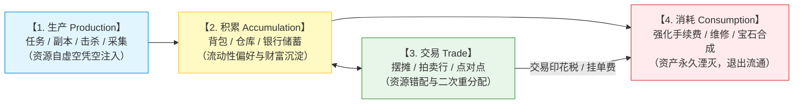
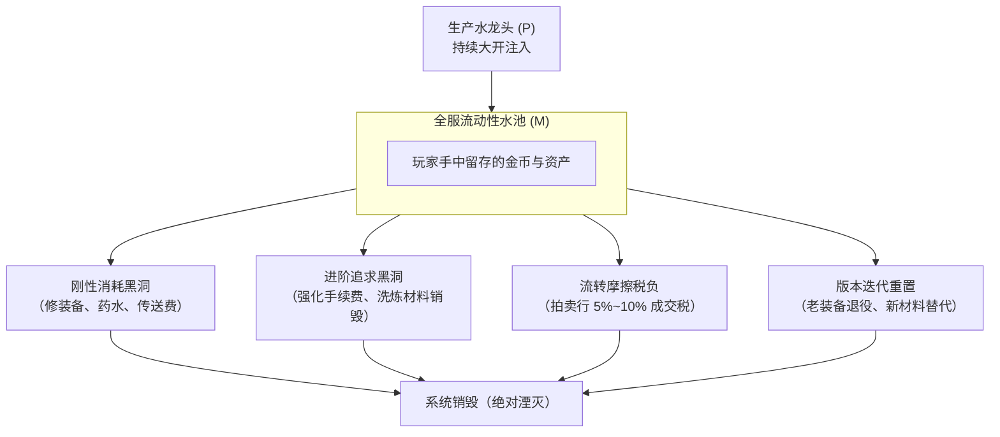

# 生产-积累-交易-消耗四阶段循环与全服存量守恒法则

> 对应原书：**第 3.1 节 经济系统概述**

梅耶·阿姆谢尔·罗斯柴尔德曾言：*“只要能控制一个国家的货币发行，我不在乎谁制定了法律。”* 在 MMORPG 虚拟世界的构建中，这一法则同样冰冷而绝对：**只要能控制游戏中的经济系统，谁负责关卡或剧情都不再重要。**

经济系统是多人在线游戏的血脉。一套平庸的经济系统会导致物价在开服三个月内飞涨百倍、平民破产离场、大R失去购买动力、全服沦为鬼服；而一套严密的经济系统，能通过内生的市场调节机制支撑游戏长达数年甚至十数年的稳定运营。

---

## 一、虚拟经济系统的四阶段宏观流转模型

《平衡掌控者》第 3.1 节将游戏经济活动划分为四大核心环节，这四大环节构成了资源流动的完整闭环：

---

## 二、第一环节：生产（Production）——水龙头的设计艺术

在真实世界中，财富来自物质资料的加工与生产；而在虚拟世界中，**一切财富均由服务器代码“凭空印制”产生**。因此，生产端是游戏经济系统最大的系统风险源头。

### 1. 产出渠道的分类与属性
| 渠道类型 | 代表形式 | 控制力等级 | 产出特征 | 策划调控手段 |
| :--- | :--- | :--- | :--- | :--- |
| **强受控产出** | 主线任务、每日活跃日常、副本次数限制、活动成就 | **极高**（上限封顶） | 产出总量为常数或日预算上限，不随玩家在线时长线性无限暴增 | 调整每日接取次数、限制副本疲劳度/门票 |
| **弱受控产出** | 野外自由打怪掉落、无上限生活采集、野外挖矿 | **中等**（易受外挂脚本冲击） | 产出量与挂机时长严格正相关，极易成为打金工作室的温床 | 收益衰减机制、疲劳度递减、动态反外挂人机验证 |
| **系统赠送与补偿** | 开服福利、停服维护补偿、全服节日邮件 | **瞬时冲击高** | 瞬时向服务器注入巨额流动性 | 优先发放**绑定资产**，严防流通货币直接通过补偿流入市场 |

### 2. 主动生产 vs 被动生产
- **主动生产（Active Production）**：玩家必须付出高密度的实时操作、智力决策或社交协作（如高难团队副本、竞技场、帮会战）。这种产出必须匹配高质量的正反馈和高价值沉淀。
- **被动生产（Passive / Idle Production）**：离线挂机经验、家园自动采矿等。被动产出必须严格设定**边际收益递减**（Diminishing Returns）和**存储容量上限**，防止玩家“不登游戏依然富可敌国”。

---

## 三、第二环节：积累（Accumulation）——财富沉淀与阶层分化

资源被生产出来后，并不会立刻被消耗，而是进入玩家的背包、个人仓库和公会金库中进行沉淀。

### 1. 玩家的流动性偏好（Liquidity Preference）
根据凯恩斯经济学，玩家囤积货币与材料出于三大动机：
1. **交易动机（Transaction Motive）**：满足日常买药、修装备、传送等基础刚性开销；
2. **谨慎动机（Precautionary Motive）**：防范未来版本更新或突发强化需求；
3. **投机动机（Speculative Motive）**：商人玩家囤积居奇，低价吸纳、等待大更新物价上涨时抛售套现。

### 2. 财富沉淀过剩的危害
当玩家预期未来没有优质追求点或物价将持续贬值时，会选择停止消费，转而无限囤积金币或硬通货材料。一旦全服人均储蓄量超过日常流通所需周转资金的数十倍，任何轻微的市场波动都会引发恐慌性抛售，击垮拍卖行价格中枢。

---

## 四、第三环节：交易（Trade）——资源流动与社会分工

交易并不直接产生新的资源总量，但交易能够**极大提升全服资源的配置效率与玩家留存率**。

### 1. 核心经济学本质：时间与金钱的互换
- **大R / 高付费玩家**：拥有充裕的现实货币，但极度缺乏游戏时间；
- **免费玩家 / 搬砖玩家**：拥有大量空闲时间，愿意投入劳动力采集初级原材料，但缺乏充值元宝；
- **交易系统的社会价值**：通过市场交易，平民将劳动力转化为游戏内流通金币，再通过寄售行换取元宝购买商城基础道具；大R则用元宝购买平民采集的矿石、草药快速冲级装备。二者各取所需，形成健康的共生生态。

### 2. 货币流通速度（Velocity of Money）与费雪方程式
借用宏观经济学经典的费雪方程式（Equation of Exchange）：
$$M \cdot V = P \cdot Y$$
- $M$：全服流通中的货币存量；
- $V$：货币流通速度（单位时间内的平均换手率）；
- $P$：虚拟物品的平均物价指数；
- $Y$：全服商品与服务的总交易量。

**关键结论**：
即便全服货币存量 $M$ 保持不变，若交易系统设计过于频繁便捷（$V$ 急剧升高），全服所表现出的名义物价指数 $P$ 同样会大幅飙升！因此，交易系统必须通过设置交易锁、公示期、冷却时间来平抑 $V$ 的剧烈脉冲。详见 [[06-trading-systems-and-anti-exploit]]。

---

## 五、第四环节：消耗（Consumption）——唯一的生存防线

**“生产创造了虚拟世界的生机，而消耗决定了虚拟世界的寿命。”** 如果说生产是向水池中注水的水龙头，那么消耗就是唯一的排水底阀。

### 消耗体系的四大护城河：
1. **刚性常态消耗**：
   - 随在线时长和战斗行为自然磨损的成本（耐久修理、药水消耗）；
   - 特点：单次金额极低，但频度极高、受众为全服 100% 玩家，构成全服消耗的基本盘。
2. **非线性进阶消耗**：
   - 装备强化、宝石合成、宠物炼妖。特点是随着目标阶层上升，消耗呈指数级剧增（例如 10 级宝石需要 512 颗 1 级宝石与巨额合成金币）。
   - 这是专为中高付费玩家设计的超大容量资金回收池。
3. **交易税收摩擦力（Tax Friction）**：
   - 摆摊与拍卖行按成交金额抽取 $5\% \sim 10\%$ 的交易税。
   - 这一设计极其精妙：**交易越频繁，全服被系统抽走的货币就越多**，形成内生的自动稳定器（Automatic Stabilizer）。
4. **报废与迭代消耗**：
   - 换代装备无法拆解出 100% 的原始投入，强制进行折损回收。

---

## 六、全服资产存量守恒动力学方程与通胀预警

### 1. 存量守恒状态方程
在任意时间区间 $[t, t+\Delta t]$ 内，全服有效货币与流动资产的净增量 $\Delta M$ 严格遵循守恒定律：
$$\Delta M = \sum_{i=1}^n P_i(\Delta t) - \sum_{j=1}^m C_j(\Delta t) - T_{\text{tax}}(\Delta t)$$

- **健康状态（紧平衡微通胀）**：
  $$\Delta M > 0 \quad \text{且} \quad \frac{\Delta M}{M} \approx g_{\text{player}}$$
  （货币存量增速与新玩家涌入及战力总体规模增速相匹配，物价温和上涨，兼顾刺激生产与保值预期）。
- **恶性通胀（崩盘前兆）**：
  $$\sum P_i \gg \sum C_j + T_{\text{tax}} \implies \Delta M \to +\infty$$
  流通池被天量金币淹没，高价值物品（如极品装备）价格冲破货币存储上限，玩家放弃系统金币，退化为以物易物。
- **通货紧缩（流动性冻结）**：
  $$\Delta M < 0$$
  玩家手中的金币不够支付基本的修装备和传送费用，市场无人敢买东西，交易冰封。

---

## 七、知识库双链互通与学习路线

- 深入掌握经验产出与等级节奏 $\rightarrow$ [[04-experience-curve-and-pacing]]
- 理解多币制如何构建物理防火墙阻断流动性泛滥 $\rightarrow$ [[05-currency-systems-and-isolation]]
- 查看交易系统的税收与防倒金拦截细节 $\rightarrow$ [[06-trading-systems-and-anti-exploit]]
- 落地实操：搭建全系统产耗总表与时间轴模型 $\rightarrow$ [[10-production-consumption-simulation-model]]
- 当产耗失衡时如何微调水龙头与回收阀门 $\rightarrow$ [[11-fine-tuning-economic-valves]]
- 查阅《大鲸鱼-深空放置》ISK 闭环与工业战损回收方案 $\rightarrow$ [[14-whale-eve-adaptation-guide]]
