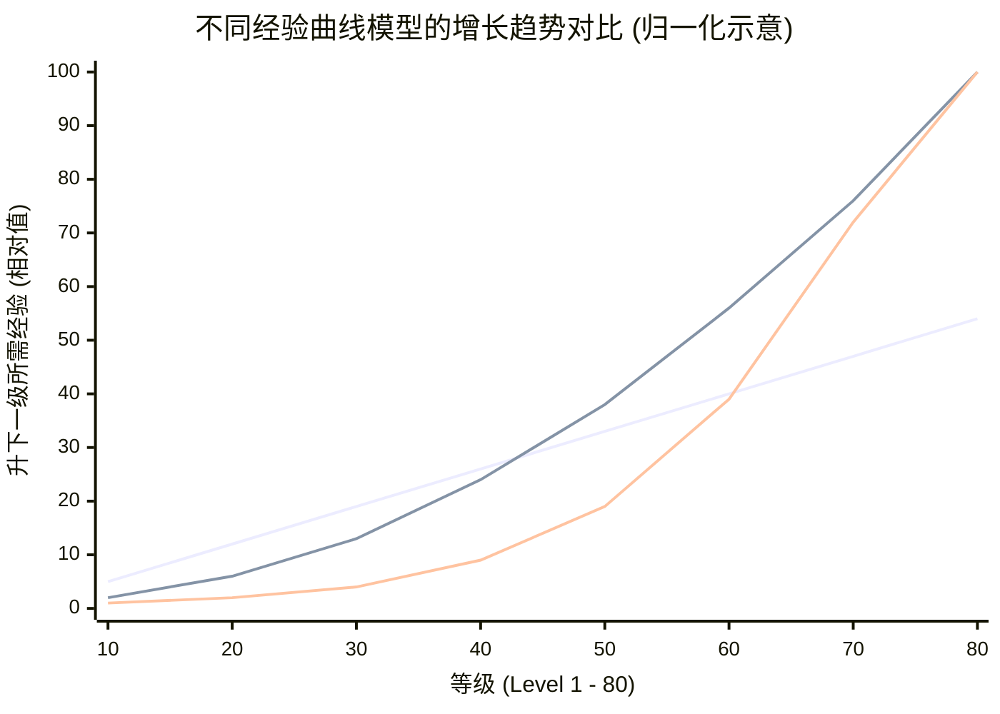
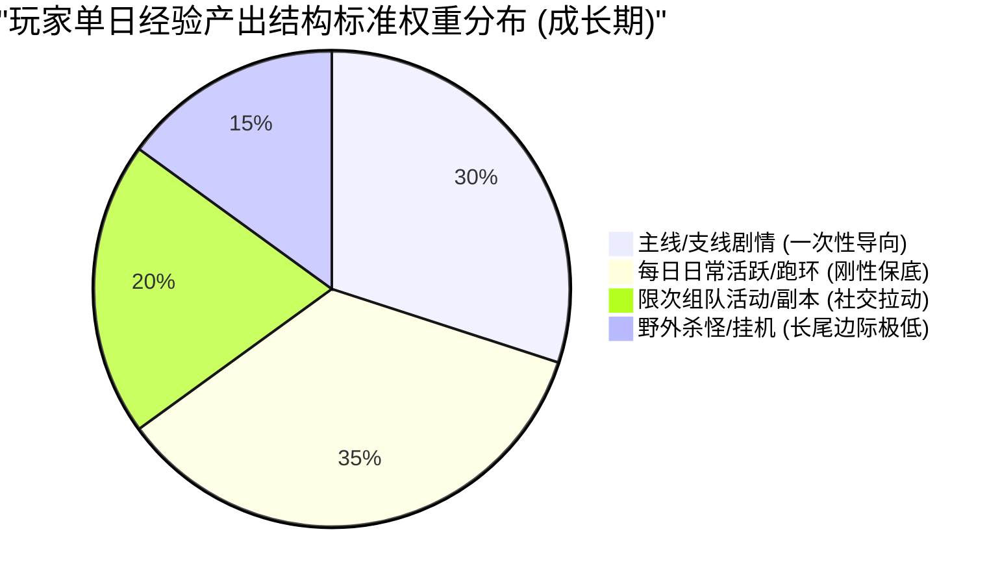
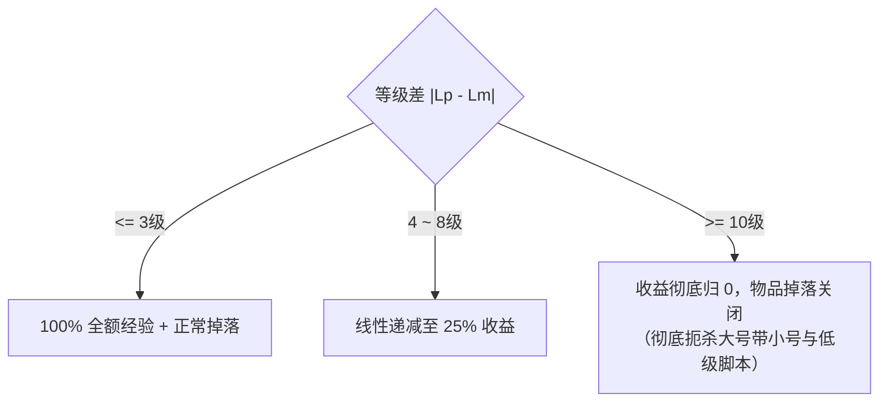
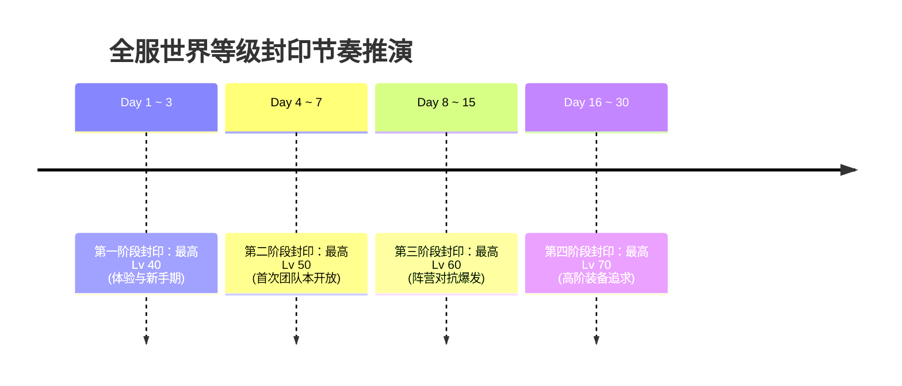

# 经验值公式曲线、升级节奏控制、收益衰减与防刷断层设计

> 对应原书：**第 3.2 节 经验相关设计**

等级（Level）是角色扮演游戏（RPG）中最基础、最直观的成长标尺。经验值系统不仅仅是一串冷冰冰的数字，它更是策划用来**精确调控玩家在线时长、规划内容消耗速度、引导系统功能解锁，以及防止玩家过快耗尽游戏寿命的节拍器**。

《平衡掌控者》第 3.2 节将经验体系拆解为两个核心侧面：**升级所需经验值模型（需求侧）** 与 **获取经验值渠道与衰减规则（供给侧）**。

---

## 一、升级所需经验值的数学模型（3.2.1 节）

如何设计从 1 级升到 100 级每级所需的经验值？原书对比了行业常见的四大数理曲线：

### 1. 常见经验函数形态评析
| 函数类型 | 数学通式 | 曲线特征 | 优缺点与适用场景 |
| :--- | :--- | :--- | :--- |
| **一次线性函数** | $E(L) = a L + b$ | 恒定斜率，每级递增固定经验值 | **严重不推荐**。后期打高阶怪物经验膨胀后，几分钟即可升一级，等级迅速失去含金量 |
| **二次/三次多项式** | $E(L) = a L^3 + b L^2 + c L + d$ | 加速度平缓受控，前期陡峭后期平滑 | **行业最主流方案**。能够在中后期保持稳定的升级耗时，易于精细化控制 |
| **纯指数函数** | $E(L) = a \cdot (1 + r)^L$ | 发生几何级数爆炸增长 | **需极度谨慎**。容易导致后期升级所需经验变成天文数字，单靠数值除法也无法拯救，常用于小体量挂机放置游戏 |
| **分段混合拟合函数** | $E(L) = \begin{cases} f_1(L) & L \le 20 \\ f_2(L) & 20 < L \le 60 \\ f_3(L) & L > 60 \end{cases}$ | 各阶段拥有独立的主导参数 | **MMORPG 标杆做法**。根据新手期、成长期、满级冲刺期设置断点与阻尼 |

### 2. 标杆分段经验拟合公式
在实际商业项目中，成熟主数值通常采用分段多项式结合阻尼因子：
$$E(L) = \text{Round}\left( A \cdot L^k + B \cdot L + C \cdot 1.05^{(L - L_0)}, 0 \right)$$
- $L \in [1, 30]$：$k = 1.8$，$C = 0$（纯平滑多项式，保证低级别快速升级）；
- $L \in [31, 60]$：$k = 2.2$，$C = 0$（升级节奏适度拉长，进入核心日常循环）；
- $L \in [61, 80]$：$k = 2.6$，激活指数修正项 $C > 0$（制造等级高墙，促使玩家由追求等级转向追求装备与战力）。

---

## 二、标准升级耗时模型（TTL: Time to Level）

经验值绝对数值本身没有意义，**它所对应消耗的真实时间（TTL）才是设计的本质**。

### 1. 时间预算分配矩阵（Time Budgeting）
策划首先规划玩家在各等级段的平均游戏天数，再反推经验供给量：

| 等级区间 | 对应游戏生命周期 | 每日有效游戏时长 | 升该区间所需总耗时 | 累计进度 (开服天数) | 玩家心理体验特征 |
| :--- | :--- | :--- | :--- | :--- | :--- |
| **Lv 1 ~ 20** | 体验期 (Onboarding) | $1.5 \sim 2$ 小时 | 约 $1 \sim 2$ 小时 | **第 1 天前半段** | 几分钟升一级，功能频繁解锁，多巴胺高度兴奋 |
| **Lv 21 ~ 35** | 新手期 (Early Game) | $2 \sim 3$ 小时 | 约 $4 \sim 6$ 小时 | **第 1 ~ 2 天** | 接触首个门槛副本，开始建立阵营与公会社交 |
| **Lv 36 ~ 50** | 成长初期 (Mid-Early) | $2.5 \sim 3$ 小时 | 约 $15 \sim 20$ 小时 | **第 3 ~ 7 天** | 升级速度放缓为 $1 \sim 2$ 天升一级，日常活跃定型 |
| **Lv 51 ~ 70** | 成长中后期 (Mid-Late) | $2 \sim 2.5$ 小时 | 约 $60 \sim 80$ 小时 | **第 8 ~ 30 天** | 出现 2~4 天升一级的瓶颈感，转向追求宝石与宠物 |
| **Lv 71 ~ 80** | 巅峰冲刺 (End Game) | $1.5 \sim 2$ 小时 | 约 $120 \sim 150$ 小时 | **第 31 ~ 90 天** | 极度漫长的成长长尾，形成稳定的公会争霸格局 |

---

## 三、经验产出渠道结构树（3.2.2 节）

为了保证所有玩家（硬核肝帝与休闲玩家）都能在可控的步调内推进，经验产出必须采用“多轨并行、权重分层”的设计：

1. **主线与支线任务（Primary / Side Quests）**：
   - 属性：**一次性固定资产投放**。
   - 作用：引导玩家熟悉世界观与新地图，强制保证新手第一天直达核心玩法门槛。
2. **每日日常与跑环任务（Daily Loops）**：
   - 属性：**周期性强受控投放**。
   - 作用：提供每日经验的基本盘（约占 $35\%$），且任务经验随角色当前等级 $L$ 动态自适应缩放：
     $$E_{\text{daily}}(L) = \alpha \cdot E(L)$$
     保证玩家即便漏掉野外刷怪，仅做日常也能跟上全服大部队。
3. **限次组队副本与限时活动（Group Dungeons）**：
   - 属性：**高效率社交激励**。
   - 机制：设立固定每日接取次数（如每日 2 次）；提供公会成员/好友组队加成（$+10\% \sim +20\%$），构建强粘性关系链。
4. **野外刷怪（Mob Grinding）**：
   - 属性：**弹性自由时间填充**。
   - 策略：单只野怪经验极低，必须配合**收益递减与疲劳度**，严防脚本打乱全服节奏。

---

## 四、收益衰减曲线与防刷断层机制

如果允许高等级玩家无限制屠杀低级地图野怪，或者允许脚本全天候挂机，游戏生态将迅速崩溃。

### 1. 等级压制与经验收益衰减公式（Level Differential Penalty）
设玩家等级为 $L_p$，怪物等级为 $L_m$，等级差为 $\Delta L = L_p - L_m$：

$$K_{\text{decay}}(\Delta L) = \begin{cases} 
1.0 & |\Delta L| \le 3 \quad (\text{正常挑战区间}) \\ 
1.0 - 0.15 \times (|\Delta L| - 3) & 4 \le |\Delta L| \le 8 \quad (\text{轻度压制区间}) \\ 
0.25 & 9 \le |\Delta L| \le 10 \quad (\text{重度惩罚}) \\ 
0.0 & |\Delta L| > 10 \quad (\text{彻底归零，且掉落锁死}) 
\end{cases}$$

- **双向惩罚机制**：
  - **大打小（$L_p \gg L_m$）**：经验衰减至 0，关闭任何装备与金币掉落，杜绝高战垄断低级资源点；
  - **小打大（$L_m \gg L_p$）**：若相差超过 5 级，引入命中率惩罚与伤害免疫，防止低级玩家利用特定地形 BUG 越级击杀高级领主越级冲级。

---

## 五、服务器等级封印与后发追赶机制（World Level & Catch-up）

为解决“头部硬核玩家光速耗尽版本内容，而中后入坑玩家永远追赶不上”的矛盾，《平衡掌控者》详细阐述了现代 MMORPG 必备的断层防护体系：

### 1. 服务器等级封印（World Level Cap）
- 当玩家达到当前封印等级时，角色经验条锁死，无法再升级；
- **溢出经验转化机制**：封印期间获得的经验按特定兑换比转换为其他不可逆资源：
  $$\text{溢出经验} \times \beta \implies \text{角色心法/潜能点} \quad \text{或} \quad \text{帮会建设资材}$$
  使硬核玩家的投入得到认可，同时避免了等级数值与平民脱节。

### 2. 后发玩家追赶补偿（Catch-up Buff）
对于新入坑或因现实原因请假的后发玩家，系统根据其等级与当前世界等级 $L_{\text{world}}$ 的差距，自动附加**世界经验加速状态**：

$$\text{ExpBuff} = \begin{cases} 
+0\% & (L_{\text{world}} - L_p) < 3 \\ 
+50\% & 3 \le (L_{\text{world}} - L_p) < 6 \\ 
+100\% & 6 \le (L_{\text{world}} - L_p) < 10 \\ 
+200\% \sim +300\% & (L_{\text{world}} - L_p) \ge 10 
\end{cases}$$

- 辅以日常副本的“侠义值加成”：鼓励满级老玩家带处于追赶阶段的新人通关，构建和谐互助的服务器社群氛围。

---

## 六、知识库双链互通与学习路线

- 理解经济系统的四阶段循环 $\rightarrow$ [[03-economic-loop-production-consumption]]
- 掌握多币制与经济隔离防线 $\rightarrow$ [[05-currency-systems-and-isolation]]
- 查看等级追求与战力追求的剪刀差拉力构建 $\rightarrow$ [[07-player-pursuits-and-monetization]]
- 结合游戏生命周期把握经验节奏调控点 $\rightarrow$ [[08-game-lifecycle-and-economic-phases]]
- 线上遇到升级节奏过快或卡级抱怨时的微调手法 $\rightarrow$ [[11-fine-tuning-economic-valves]]
- 查看《大鲸鱼-深空放置》技能点（SP）与科研时长排队模型 $\rightarrow$ [[14-whale-eve-adaptation-guide]]
