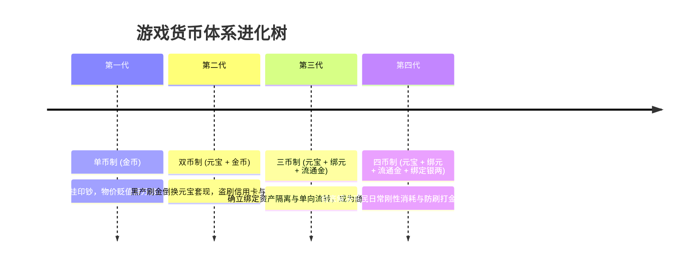
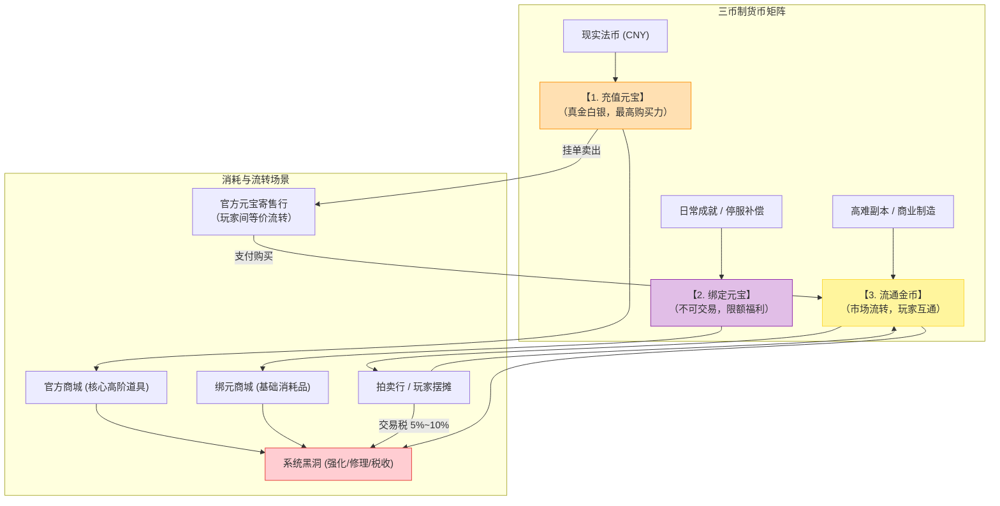
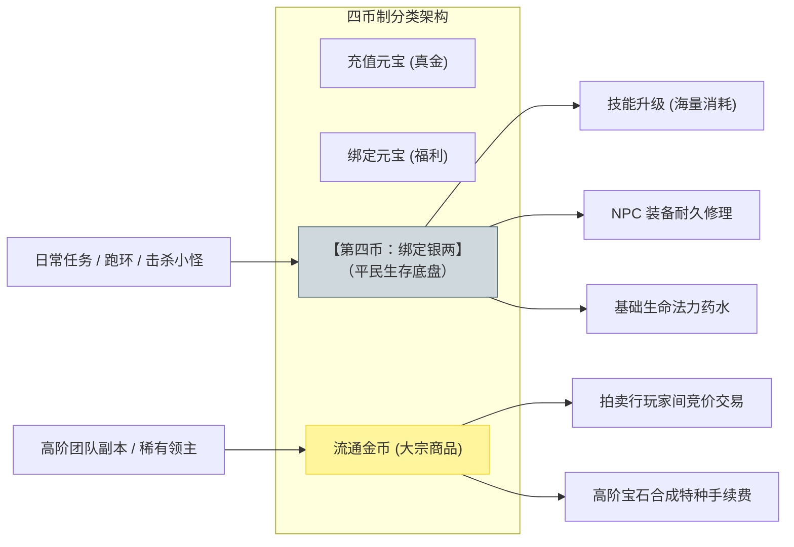
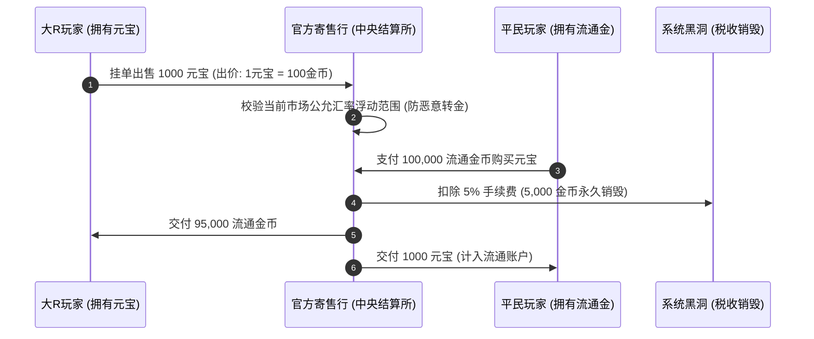

# 三币制与四币制深度剖析：绑定与流通隔离、流动性阻断与汇率防御壁垒

> 对应原书：**第 3.3 节 币制体系**

货币是虚拟经济的血液与计量尺度。在网络游戏发展史上，**货币体系设计失误是导致游戏运营过早夭折的最常见死因**。如果货币体系存在漏洞，工作室外挂刷取的巨量金币将在几周内摧毁官方商业化商城，引发灾难性通货膨胀。

《平衡掌控者》第 3.3 节深刻揭示了现代 MMORPG 货币设计的进化史：从朴素的**单币制、双币制**，演进到兼顾商业化变现、平民生存与防黑产攻击的**三币制**与**四币制**。

---

## 一、游戏货币演进史与历史性阵痛

1. **单币制的死局**：
   - 游戏内仅有一种金币，既用于买药修装备，又用于购买商城时装与极品神装；
   - 结果：外挂工作室成千上万个小号 24 小时不间断打怪印钞，流通盘迅速被淹没，平民手里的辛苦积蓄贬值成废纸，官方充值通道彻底废弃。
2. **双币制的漏洞**：
   - 引入充值货币“元宝”与游戏产出“金币”；
   - 若允许玩家通过黑市或简陋的寄售行双向自由兑换，工作室通过外挂刷金换取充值元宝，不仅截断了官方现金流，还会吸引跨国黑卡洗钱组织，造成毁灭性打击。

---

## 二、三币制深度剖析（3.3.1 节）

为了在保证官方充值收入的前提下让平民玩家获得良性循环，行业诞生了**三币制**：

### 1. 三大货币的职能与权限
| 货币名称 | 来源渠道 | 交易权限 | 购买力范围 | 核心设计使命 |
| :--- | :--- | :--- | :--- | :--- |
| **充值元宝** (Diamonds) | 玩家真实充值（1 元 = 10 元宝） | **全流通**（可通过官方寄售行挂单变现） | 购买全商城所有高阶稀有道具、坐骑、时装、转职道具 | 承载游戏商业化营收底盘，锚定真实法币价值 |
| **绑定元宝** (Bound Diamonds) | 运营活动、维护补偿、主线成就、封测回馈 | **绝对禁止交易**（随角色物理绑定） | 仅能购买“绑元商城”内的基础道具（绑定强化石、双倍药、扩充背包等） | 作为营销让利杠杆，刺激平民留存与活跃，不稀释大R的充值资产 |
| **流通金币** (Circulating Gold) | 高门槛副本、高级生活制造、击杀稀有领主 | **玩家间自由流转**（拍卖行/摆摊） | 购买玩家出售的装备、半成品材料、宝石；支付高额强化手续费 | 扮演社会化大分工的润滑剂，促成大R与平民之间的劳务置换 |

### 2. 核心防火墙法则：流动性单向阻断
- **法则一：系统绝不凭空将金币回兑为元宝**
  平民在官方寄售行用金币买到的元宝，**必须是大R玩家事先充值挂牌出售的存量元宝**！系统在中间仅充当撮合交易的记账中介，绝不自行印制元宝。
- **法则二：绑定资产不可逆污染原则**
  使用“绑定元宝”购买的任何材料，其生成的最终产物（如合成的宝石、强化的装备）**立刻永久打上“已绑定”标签**，绝对禁止再次上架拍卖行流向其他玩家，防止小号刷绑元洗成可变现资产。

---

## 三、四币制：终极平衡的进化形态（3.3.2 节）

在三币制运转中，策划往往会陷入两难死锁（The Catch-22 Dilemma）：
- 如果为了保证平民有钱修装备、点技能而大量发放“流通金币”，打金工作室就会用小号海量刷取，倒卖套现；
- 如果为了防外挂而大幅削减“流通金币”产出，正常平民玩家就会连基本的药水都买不起，直接穷死在新手村。

为了彻底化解这一矛盾，**四币制（引入第四种货币：绑定银两 / 绑定金币）**应运而生：

### 1. 绑定银两（第四币）的革命性价值
- **解绑生存刚需与投机套利**：
  将“玩家角色自身的技能学习、装备修理、任务开销、基础药水”划归**绑定银两**结算。策划可以极为慷慨地通过日常跑环海量投放银两，让最底层的平民玩家也能衣食无忧；
- **锁死打金工作室的生路**：
  工作室即便拥有 10 万个脚本小号，刷出来的全是无法交易的“绑定银两”，既无法倒卖给大R，也无法在拍卖行扫货，黑产打金的收益彻底归零！
- **流通金币的纯粹化**：
  流通金币不再承担日常买药等杂活，专注于“拍卖行高价值物品交易”与“高端装备打孔镶嵌特种手续费”，产出被严格收拢在防挂机机制极强的高难度团队副本中。

---

## 四、官方寄售行机制与汇率防御壁垒（3.3.3 节）

在三币与四币体系下，必须为合法的大R与平民提供安全的货币兑换通道，即**官方元宝寄售行（Currency Exchange）**。

### 1. 汇率浮动机制与涨跌停限制
- **市场公允汇率 $R_{\text{avg}}$**：系统取前 24 小时寄售行实际成交的加权平均价格作为基准汇率；
- **涨跌停熔断机制**：玩家今日挂单出价，严禁偏离 $R_{\text{avg}}$ 的 $\pm 10\% \sim \pm 15\%$。
  - **防御意义**：黑客盗号后，企图利用寄售行将价值 10 万金币的垃圾挂出 1000 万天价进行定向转移，将被系统熔断机制直接拦截！

### 2. 中央银行做市商干预模型（Central Bank / Market Maker）
在服务器运营中，常因版本大更新或偶发事件导致金价剧烈震荡：
- **场景 A：开服初期大R争榜，金价暴涨（单位元宝换取的金币锐减）**：
  官方系统注入金币储备平抑物价，避免平民过早被大R剥削产生弃坑感；
- **场景 B：开服两个月后金币过剩，金价雪崩（物价飞涨）**：
  系统启动“金币回购基金”，通过官方寄售行回收玩家手中的金币，或在游戏内开启限时“消耗金币抽取限定坐骑/称号”的吸金黑洞，将过剩的流动性彻底抽干。

---

## 五、知识库双链互通与学习路线

- 宏观四阶段经济循环原理 $\rightarrow$ [[03-economic-loop-production-consumption]]
- 查看交易系统的拍卖行税收杠杆与防倒金模型 $\rightarrow$ [[06-trading-systems-and-anti-exploit]]
- 把握大R与平民在不同货币下的追求分层 $\rightarrow$ [[07-player-pursuits-and-monetization]]
- 结合系统底层规则设计货币消耗网 $\rightarrow$ [[09-system-rules-and-mechanics]]
- 产耗动态模型中货币维度的进出台账搭建 $\rightarrow$ [[10-production-consumption-simulation-model]]
- 当金价贬值过快时的阀门微调手段 $\rightarrow$ [[11-fine-tuning-economic-valves]]
- 查看《大鲸鱼-深空放置》ISK 信用点与军工资产的流动性防火墙 $\rightarrow$ [[14-whale-eve-adaptation-guide]]
