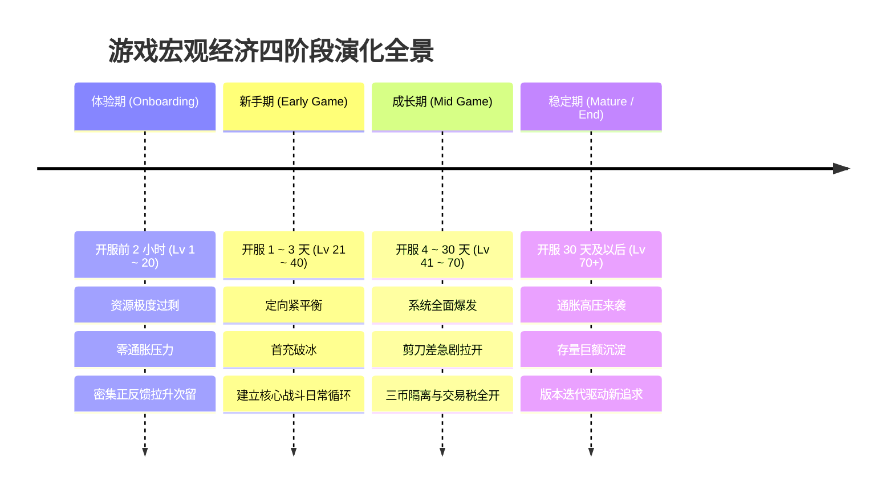
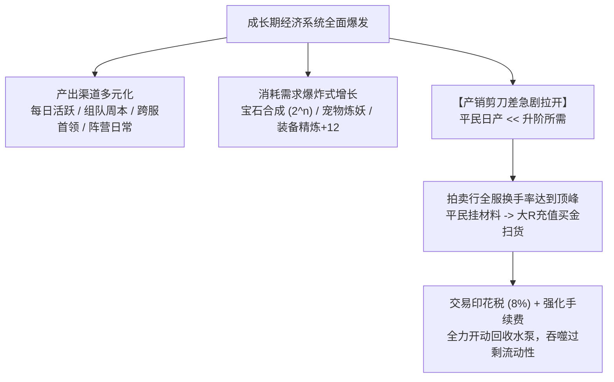
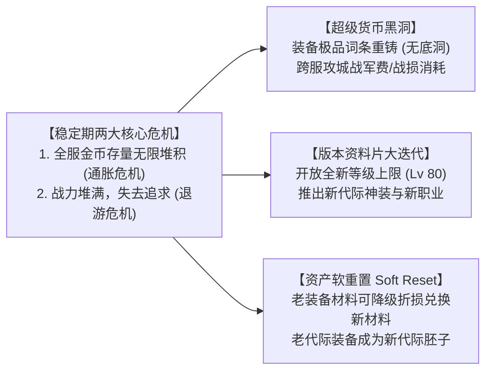

# 游戏宏观生命周期的四个阶段与数值经济调控法则

> 对应原书：**第 3.6 节 阶段划分与定位**

任何网络游戏都不可避免地经历自身的生命周期。游戏在开服第 1 天、第 7 天、第 30 天和第 180 天，其玩家的心理诉求、市场供需结构以及宏观经济运行机制有着天壤之别。**企图用一套僵死不变的数值产耗参数贯穿游戏全程，是导致项目崩盘的头号祸因。**

《平衡掌控者》第 3.6 节将 MMORPG 的宏观生命周期精炼划分为四大阶段：**体验期、新手期、成长期、稳定期**，并为每个阶段制定了针对性的数值调控法则。

---

## 一、生命周期四阶段全景演化图谱

---

## 二、第一阶段：体验期（Onboarding / 尝鲜期）（3.6.1 节）

### 1. 阶段定位与特征
- **时间跨度**：角色创建后的前 $1 \sim 2$ 小时，等级通常在 $1 \sim 20$ 级；
- **核心矛盾**：**玩家流失率最高、注意力极其分散**。稍有挫败感或枯燥感，玩家便会直接卸载离开。

### 2. 数值与经济调控军规
- **规则一：资源极度过剩与绝对慷慨**
  - 生命药水、任务消耗品免费成箱赠送，金币供给量十倍于消耗量；
  - 严禁在体验期设计任何卡级、卡装备、缺铜币买不起药的卡点！
- **规则二：超高频的多巴胺正反馈**
  - 升级耗时控制在 $1 \sim 3$ 分钟一级，平均每两分钟弹出一个华丽的“系统解锁”或“神装获取”特效；
  - 战斗数值设计为碾压模式：角色普通攻击具有大范围 AOE 伤害，怪物攻击力被刻意压制至无法对玩家造成致命威胁。
- **规则三：零通货膨胀压力与单机化隔离**
  - 体验期所产出的全部金币和装备**均为 100% 账号绑定**，暂不开放公共拍卖行与玩家间交易；
  - 确保即便黑产使用成批小号快速过完体验期，也无法将资产转移，阻断羊毛党。

---

## 三、第二阶段：新手期（Early Game / 引导期）（3.6.2 节）

### 1. 阶段定位与特征
- **时间跨度**：开服第 $1 \sim 3$ 天，等级通常在 $21 \sim 40$ 级；
- **核心矛盾**：**从“单机式爽快”过渡到“网络游戏的核心日常循环”**，引导玩家建立社交关系并完成商业化破冰。

### 2. 数值与经济调控军规
- **规则一：资源调转为“定向紧平衡”**
  - 金币、技能书和基础强化石开始出现轻微短缺；玩家无法再“无脑升级所有技能”，必须开始权衡主次；
  - 这种定向短缺旨在培养玩家对资源价值的认知。
- **规则二：设立首个团队门槛副本（Skill Check）**
  - 推出需要 3~5 人组队通关的机制型副本。Boss 开始具备红圈预警、狂暴计时与集火打断机制；
  - 逼迫玩家脱离纯自动挂机，主动在公会频道喊话组队，沉淀核心好友社交链。
- **规则三：首充商业化破冰（First Purchase Conversion）**
  - 顺势推出“6 元首充即送绝版金色神兵 + 三天直升礼包”；
  - 恰逢玩家在新手期副本遭遇轻微数值卡点，首充武器提供的高额战力能瞬间解除卡点，形成极强的付费愉悦感。
- **规则四：初级市场启动**
  - 开放摆摊与拍卖行基础功能，引导玩家将副本产出的未绑定初级材料挂牌出售，体验“第一桶金”的快感。

---

## 四、第三阶段：成长期（Mid Game / 爆发期）（3.6.3 节）

### 1. 阶段定位与特征
- **时间跨度**：开服第 $4 \sim 30$ 天，等级跨越 $41 \sim 70$ 级；
- **核心矛盾**：**游戏全系统的全面爆发与产销剪刀差的极度撕裂**。大R追求战力登顶，平民追求搬砖自给自足。

### 2. 数值与经济调控军规
- **规则一：产销剪刀差拉力拉满**
  - 详见 [[07-player-pursuits-and-monetization]]。单件装备从精炼 $+7$ 升到 $+10$ 的材料需求量翻 10 倍，促使大R走向寄售行买金，促使平民组建固定搬砖队。
- **规则二：四币隔离防火墙全力运转**
  - 严格限制流通金币的产出场景，平民日常消耗由“绑定银两”托底（详见 [[05-currency-systems-and-isolation]]）；
  - 拍卖行上架保管费与成交税（$5\% \sim 10\%$）满负荷工作，成为抵御通胀的第一道防洪大堤。
- **规则三：建立第一阶段服务器等级封印（Level Cap）**
  - 在第 7 天（Lv 50）和第 15 天（Lv 60）分别施加世界封印，避免头部狂热肝帝耗尽内容，给予梯队中后段玩家喘息和追赶的机会（详见 [[04-experience-curve-and-pacing]]）。

---

## 五、第四阶段：稳定期（Mature / End Game / 长线运营期）（3.6.4 节）

### 1. 阶段定位与特征
- **时间跨度**：开服 30 天以后，全服主力玩家均达到当前封印上限或满级；
- **核心矛盾**：**经济通胀压力骤增，常规属性追求遭遇边际效应递减，玩家容易因目标缺失而流失。**

### 2. 宏观危机应对与数值调控军规

- **调控法宝 A：打造无底洞式的长尾定制化消耗**
  - 引入**装备附加随机词条重铸（Affix Reroll）**、**神兽资质深度突破**与**全服荣誉外显（专属动态发光称号、全服跑马灯竞标）**；
  - 这些系统的特点是：资源消耗无上限，但只提供微小的百分比属性或纯外显虚荣，专为超R巨鲸打造资产粉碎机。
- **调控法宝 B：启动中央银行金币回购与宏观干预**
  - 密切监控全服 CPI 虚拟物价指数与人均金币储蓄量（详见 [[13-operations-analytics-and-telemetry]]）；
  - 当金价出现大幅贬值拐点时，开启限时“消耗巨额流通金币抽取全服限量稀有坐骑”的官方回收活动，瞬间抽干水池内数亿过剩流动性。
- **调控法宝 C：版本资料片大更新与资产软重置（Soft Reset）**
  - 每隔 $3 \sim 6$ 个月推出大型新资料片，开放新的等级上限与新装备代际；
  - **切忌粗暴硬重置（Hard Reset）**：老装备严禁直接变废铁，必须支持“继承打孔等级”、“拆解返还 $70\%$ 基础强化材料”或“作为新装备打造的必备胚子”，切实保护老玩家的历史投资。

---

## 六、知识库双链互通与学习路线

- 四阶段循环宏观经济理论 $\rightarrow$ [[03-economic-loop-production-consumption]]
- 升级时间 TTL 与世界等级封印具体参数 $\rightarrow$ [[04-experience-curve-and-pacing]]
- 追求点与产销剪刀差的设计细节 $\rightarrow$ [[07-player-pursuits-and-monetization]]
- 在产耗模型中按 Day 1 ~ Day 180 时间轴推演四阶段演进 $\rightarrow$ [[10-production-consumption-simulation-model]]
- 当稳定期金币贬值时如何微调水龙头与抽水泵 $\rightarrow$ [[11-fine-tuning-economic-valves]]
- 查看《大鲸鱼-深空放置》早期开荒至终局泰坦战舰的生命周期阶段调控 $\rightarrow$ [[14-whale-eve-adaptation-guide]]
