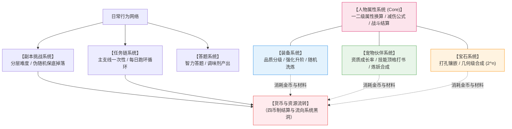
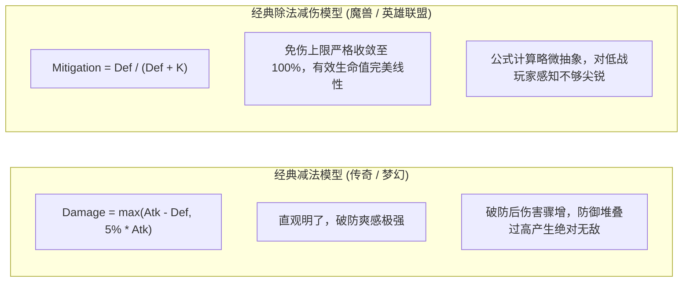
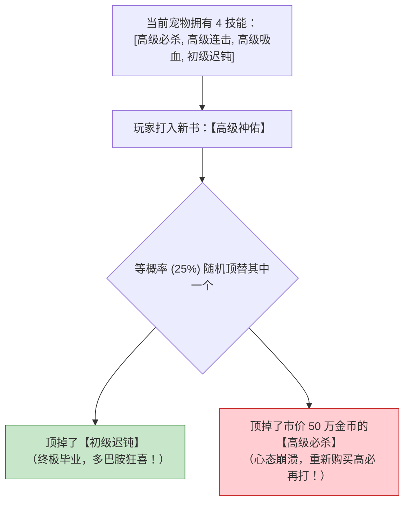

# MMORPG 底层系统架构：人物属性、装备、宠物、宝石、副本与任务规则

> 对应原书：**第 4.1 节 整体架构设计** 与 **第 4.2 节 系统规则概述**

如果说宏观经济模型是 MMORPG 的“骨骼与循环系统”，那么各子系统的具体玩法与数值规则就是虚拟世界的“肌肉与器官”。在搭建全服产耗总表之前，必须先明确底层系统规则的数学逻辑。

《平衡掌控者》第 4 章以一款经典的 MMORPG 为蓝本，完整呈现了涵盖人物属性、装备精炼、宠物炼妖、宝石合成、副本掉落与任务链的工业级规则规范。

---

## 一、MMORPG 底层系统架构全景关系网（4.1 节）

---

## 二、人物属性系统与战斗减伤模型（4.2.1 节）

### 1. 一二级属性转化矩阵
- **一级核心属性**：力量（Strength）、敏捷（Agility）、智力（Intelligence）、体质（Constitution）；
- **二级战斗属性**：生命上限（HP）、魔法上限（MP）、物理攻击（P.Atk）、法术攻击（M.Atk）、物理防御（P.Def）、法术防御（M.Def）、暴击率（Crit Rate）、抗暴率（Crit Res）、命中（Hit）、闪避（Dodge）。

#### 经典职业转化矩阵规范：
| 一级属性 (投入 1 点) | 战士 (Warrior) 转化结果 | 法师 (Mage) 转化结果 | 刺客 (Assassin) 转化结果 |
| :--- | :--- | :--- | :--- |
| **力量 (Str)** | $+2.0$ 物攻，$+0.5$ 物防 | $+0.2$ 物攻 | $+1.2$ 物攻 |
| **智力 (Int)** | $+5.0$ MP，$+0.2$ 法防 | $+2.5$ 法攻，$+12.0$ MP，$+0.8$ 法防 | $+0.2$ 法防 |
| **敏捷 (Agi)** | $+0.1\%$ 命中 | $+0.1\%$ 闪避 | $+1.5$ 物攻，$+0.25\%$ 暴击，$+0.15\%$ 闪避 |
| **体质 (Con)** | $+15.0$ HP，$+1.0$ 物防，$+0.5$ 法防 | $+8.0$ HP，$+0.3$ 物防 | $+10.0$ HP，$+0.5$ 物防 |

### 2. 战斗减伤模型（Damage Mitigation Formula）
原书深入探讨了经典减法公式与除法公式的数理差异：

#### 除法模型的优雅数理推导：
令防御力减伤比率为 $\text{Rate}_{\text{def}} = \frac{\text{Def}}{\text{Def} + K}$，其中常数 $K = 50 \times \text{Level} + 1000$。
实际受到的最终伤害为：
$$\text{Damage} = \text{Damage}_{\text{raw}} \times (1 - \text{Rate}_{\text{def}}) = \text{Damage}_{\text{raw}} \times \frac{K}{\text{Def} + K}$$

引入**有效生命值（Effective HP, EHP）**概念：
$$\text{EHP} = \frac{\text{HP}}{1 - \text{Rate}_{\text{def}}} = \text{HP} \times \left(1 + \frac{\text{Def}}{K}\right) = \text{HP} + \text{HP} \times \frac{\text{Def}}{K}$$
- **核心结论**：每提升 1 点防御力 $\text{Def}$，为角色带来的有效生存承伤能力（EHP）提升是**绝对纯线性的**！彻底消除了减法公式容易导致的“不破防即无敌”或“被破防即秒杀”的数值灾难。

---

## 三、装备系统：品质、精炼阶梯与降级保护（4.2.2 节）

### 1. 装备槽位与品质分级
- **十大核心槽位**：武器、头盔、衣服、护手、裤子、靴子、项链、腰带、戒指（左）、戒指（右）；
- **六级品质系数表**：
  | 装备品质 | 视觉外显颜色 | 基础属性倍率 | 附加随机词条数 | 分解回收价值 |
  | :--- | :--- | :--- | :--- | :--- |
  | **普通 (Normal)** | 白色 | $1.00 \times$ | 0 条 | 少量绑定银两 |
  | **优秀 (Good)** | 绿色 | $1.20 \times$ | 1 条 | 基础强化石碎屑 |
  | **精良 (Rare)** | 蓝色 | $1.50 \times$ | 2 条 | 完整初级强化石 |
  | **史诗 (Epic)** | 紫色 | $2.00 \times$ | 3 条 | 中级强化石 + 紫色结晶 |
  | **传说 (Legendary)** | 橙色 | $2.80 \times$ | 4 条 | 高级强化石 + 传说神魂 |
  | **神话 (Mythic)** | 红色 | $4.00 \times$ | 5 条 (必带特技) | 极品原石 + 神话徽章 |

### 2. 强化精炼阶梯与概率分布矩阵
装备强化等级从 $+1$ 延伸至 $+15$，原书给出了极具心理学洞察的成功率与惩罚设计：

| 强化等级 | 基础成功率 | 失败惩罚机制 | 保护措施与安全锁 | 单次消耗强化石 | 单次消耗流通金币 |
| :--- | :--- | :--- | :--- | :--- | :--- |
| **+1 ~ +3** | $100\%$ | 无惩罚 (不掉级) | **新手保底安全区** | 2 颗初级石 | 1,000 金币 |
| **+4 ~ +6** | $70\% \to 50\%$ | 失败仅扣除材料，等级保持不变 | 无需保护符 | 5 颗初级石 | 5,000 金币 |
| **+7 ~ +9** | $40\% \to 25\%$ | **失败回退 1 级** | **第一道安全锁（+7 永不跌落）** | 10 颗中级石 | 20,000 金币 |
| **+10 ~ +12** | $20\% \to 10\%$ | **失败直接跌回 +7** | 可使用“神工防爆符”保级 | 15 颗高级石 | 80,000 金币 |
| **+13 ~ +15** | $8\% \to 3\%$ | **失败直接跌回 +10** | **第二道安全锁（+10 永不跌落）** | 25 颗神级石 | 300,000 金币 |

- **安全锁的心理学精髓**：
  若允许从 $+14$ 连续失败直接掉回 $+0$，绝大多数大R会经历强烈的“毁灭性挫败感”从而当场弃坑删游；在 $+7$ 和 $+10$ 设立坚不可摧的“安全底线”，既锁定了大R的前期投资，又让追求 $+15$ 充满博弈乐趣。

---

## 四、宠物系统：资质乘数与打书覆盖算法（4.2.3 节）

### 1. 宠物属性计算模型
宠物属性并非固定值，而是由**基础属性、资质（Aptitude）与成长率（Growth）**共同决定：
$$\text{PetAttr} = \left(\text{BaseAttr} + \text{Level} \times \text{Aptitude} \times \text{Growth}\right) \times \text{TraitBonus}$$
- **资质洗炼**：消耗“洗髓丹”重置资质区间（如攻击资质 $1200 \sim 1600$）。追求极致满资质是典型的长尾大容量消耗点。

### 2. 经典技能打书覆盖算法（Skill Book Overwrite）
宠物拥有 $N$ 个技能格子。当玩家使用一本新技能书时：
- 若当前技能未满，有一定几率先直接开启新格子；
- 一旦格子达到基础上限（如 4 技能），再打新书时，**新技能将等概率随机覆盖已有技能库中的任意一个技能**！

- **数学本质：马尔可夫吸收态模型**
  将一只宠物从 4 个初级技能全部洗成 8 个顶级全红技能，其期望消耗的顶级技能书数量高达 **$40 \sim 60$ 本**。这一机制为游戏内高级技能书提供了近乎无限的市场需求。

---

## 五、宝石系统：几何级数合成与打孔镶嵌（4.2.4 节）

### 1. 几何级数合成模型（$2^n$ 规律）
宝石系统是典型的离散数值模型。两颗低阶宝石加手续费合成一颗高一阶宝石：
$$Q(N) = 2^{N - 1} \times Q_1$$

| 宝石品阶 | 累积所需 1 级宝石数量 | 累积所需合成金币手续费 | 单颗宝石属性提升 | 战力性价比评级 |
| :--- | :--- | :--- | :--- | :--- |
| **1 级宝石** | 1 颗 | 0 | $+10$ 攻击 | 极高 (新手必备) |
| **4 级宝石** | 8 颗 | 7,000 金币 | $+40$ 攻击 | 很高 (平民标配) |
| **7 级宝石** | 64 颗 | 127,000 金币 | $+100$ 攻击 (带共鸣) | 良好 (中R追求) |
| **10 级宝石** | 512 颗 | 1,023,000 金币 | $+180$ 攻击 (发光特效) | 较低 (大R专属) |
| **12 级宝石** | 2048 颗 | 4,095,000 金币 | $+250$ 攻击 (全服登顶) | 极低 (超R土豪) |

- **策划微调抓手**：如果全服材料过剩，可将合成公式改为**“3 合 1”**，则 10 级宝石所需初级宝石将瞬间跃升为 $3^9 = 19,683$ 颗，容量扩大近 40 倍！

---

## 六、副本掉落与任务链数值机制（4.2.7 & 4.2.8 节）

### 1. 副本伪随机掉落引擎（PRD: Pseudo-Random Distribution）
纯真随机（Independent Uniform Random）极易出现“连续 20 次不出极品”或“连续 2 次出极品”的极端离散现象，严重摧毁玩家体验。工业级网游必须使用**伪随机 PRD 模型**：
$$P(N) = C \times N$$
- 设基础目标概率为 $P_0$（如橙装概率 $10\%$），计算对应的基准常数 $C \approx 0.0147$；
- 第一次击杀未掉落，下一次掉落概率递增为 $2C$；第 $N$ 次未出则升为 $N \times C$；
- 一旦掉落成功，计数器 $N$ 立即重置为 1。
- **优点**：杜绝了极端非酋玩家，掉落间隔高度围绕期望值收敛，极大平抑了玩家的情绪波动。

### 2. 每日跑环任务链的累进公式
日常跑环（如 20 环师门任务、100 环江湖历练）采用阶梯累进激励公式：
$$E_{\text{quest}}(i) = E_{\text{base}} \times \left(1 + \frac{i \pmod{10}}{10}\right) \times \text{LevelMulti}$$
$$R_{\text{gold}}(i) = G_{\text{base}} \times \left(1 + 0.1 \times \lfloor i / 10 \rfloor\right)$$
- 每 10 环为一个循环节，第 10 环和最终环必定触发超额“翻倍宝箱”，引导玩家完整体验整套任务链，防止中途弃环。

---

## 七、知识库双链互通与学习路线

- 宏观经济循环与系统回收水泵 $\rightarrow$ [[03-economic-loop-production-consumption]]
- 战力追求阶梯与产销剪刀差设计 $\rightarrow$ [[07-player-pursuits-and-monetization]]
- 将本章所有系统产出与消耗汇总编制全服总表 $\rightarrow$ [[10-production-consumption-simulation-model]]
- 线上运营中针对装备强化与宝石合成的微调技巧 $\rightarrow$ [[11-fine-tuning-economic-valves]]
- 针对打书洗炼与强化成功率的蒙特卡洛仿真代码 $\rightarrow$ [[12-vba-monte-carlo-simulation]]
- 查看《大鲸鱼-深空放置》舰船装配、衍生模块与战力防御公式映射 $\rightarrow$ [[14-whale-eve-adaptation-guide]]
