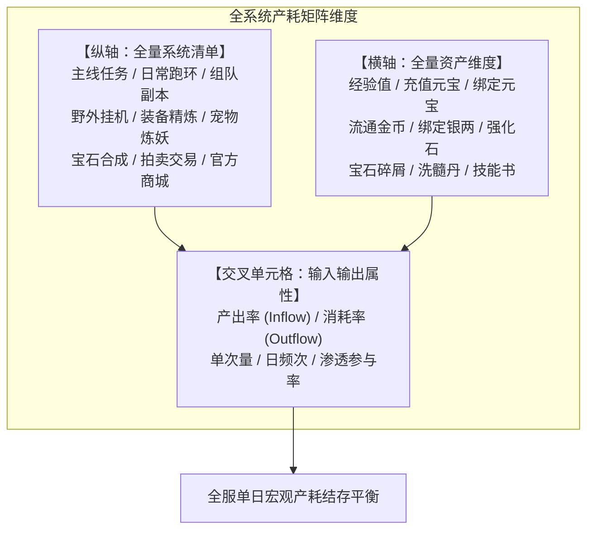
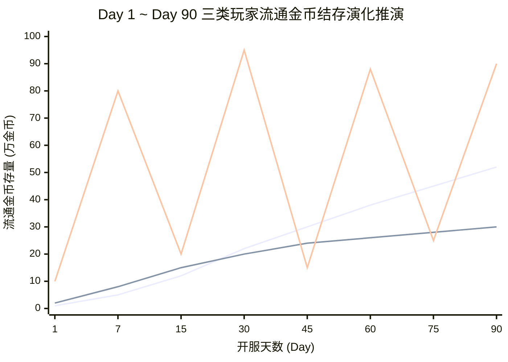
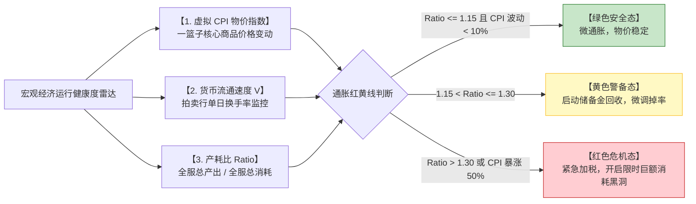

# 产耗模型工程化实操：全系统产耗总表、时间轴留存推演与通胀动态预警

> 对应原书：**第 4.3 节 产耗模型**

如果说系统规则定义了虚拟世界的微观交互，那么**产耗模型（Inflow-Outflow Simulation Model）就是掌握全服虚拟经济生死存亡的宏观沙盘**。缺乏产耗模型的数值设计如同盲人开飞机，任何一个系统的超量投放都可能在数周内引发全服货币崩溃。

《平衡掌控者》第 4.3 节系统讲解了如何从零搭建**全系统产耗总表**、如何在时间轴上推演不同层级玩家的财富积累曲线，以及如何通过**虚拟物价 CPI 与产耗比指标**实现宏观经济通胀的提前预警。

---

## 一、全系统产耗矩阵总表架构（4.3.1 节）

产耗总表是整个游戏数值工程的核心总账（Master Ledger）。它将所有玩法系统与所有核心资产类型编织为一个紧密的输入输出矩阵：

### 全系统宏观产耗矩阵示范表（以开服第 15 天玩家均级 Lv 60 测算）：
| 系统模块 | 参与渗透率 | 经验产出/日 | 绑定银两产/耗 | 流通金币产/耗 | 强化石产/耗 | 宝石碎屑产/耗 |
| :--- | :--- | :--- | :--- | :--- | :--- | :--- |
| **主线/支线任务** | $10\%$ (阶段衰减) | $+50,000$ | $+20,000$ | $0$ | $+5$ 颗 | $0$ |
| **每日跑环任务** | $85\%$ (核心全勤) | $+120,000$ | $+150,000$ | $0$ | $+10$ 颗 | $+20$ 个 |
| **组队限次周本** | $70\%$ (活跃玩家) | $+80,000$ | $+30,000$ | **$+5,000$** | $+15$ 颗 | $+50$ 个 |
| **野外挂机刷怪** | $40\%$ (长尾时间) | $+30,000$ | $+40,000$ | $+1,000$ (限额) | $+2$ 颗 | $0$ |
| **装备精炼强化** | $60\%$ (日常强化) | $0$ | $-80,000$ | **$-3,000$** | **$-30$ 颗** | $0$ |
| **宝石打孔合成** | $45\%$ (战力提升) | $0$ | $-50,000$ | **$-2,000$** | $0$ | **$-60$ 个** |
| **宠物洗炼打书** | $25\%$ (进阶追求) | $0$ | $-30,000$ | **$-1,500$** | $0$ | $0$ |
| **拍卖行交易税** | $50\%$ (市场换手) | $0$ | $0$ | **$-1,200$ (销毁)**| $0$ | $0$ |
| **单日全服人均净增**| — | **$+280,000$** | **$+30,000$** | **$-1,700$ (净收紧)**| **$-8$ 颗 (净紧缺)**| **$+10$ 个 (微结余)**|

> **主数值洞察**：在此设计下，流通金币与强化石呈现“轻度紧缩”状态，促使玩家走向拍卖行交易，大R必须充值元宝兑换金币才能满足强化缺口；而绑定银两与经验值保持温和增长，保证平民正常生存。

---

## 二、基于时间轴的资源留存推演（4.3.2 节）

产耗不是静态的切片，它是一个持续 180 天甚至更久的动态演化过程。

### 1. 三类典型玩家分层时间轴画像
系统根据付费能力与在线时长设定三类基准测试代理人（Agents）：
- **玩家 A：免费平民玩家（Free Player）**
  - 在线时长：每日 $2.5$ 小时（肝满全部日常）；
  - 付费金额：$0$ 元；
  - 行为特征：所有资源自给自足，多余未绑定材料挂拍卖行变现，追求平稳。
- **玩家 B：中R小资玩家（Dolphin Player）**
  - 在线时长：每日 $2.0$ 小时；
  - 付费金额：首充 $6$ 元 + 终身月卡 $30$ 元/月 + 战令 $98$ 元；
  - 行为特征：追求极高资源性价比，专注培养单核主力宠物与核心套装。
- **玩家 C：大R土豪玩家（Whale Player）**
  - 在线时长：每日 $1.0 \sim 1.5$ 小时（时间极度宝贵）；
  - 付费金额：首周充值 $10,000$ 元，后续每周充值 $2,000$ 元；
  - 行为特征：在寄售行海量抛售元宝换金币，在拍卖行扫清一切高阶强化石与极品神兽。

### 2. 时间轴上的流动性规律
- **平民金币曲线**：开服初期因强化刚需金币短缺；进入成长期（Day 15）后，随着装备更新放缓，金币结存呈对数逐渐攀升；
- **大R金币曲线**：呈现极具辨识度的“锯齿脉冲波”——充值瞬时买入数千万金币，随后在装备强化、打孔、合宝石中迅速砸入系统黑洞清零，然后再充值，直接拉动全服资金回收。

---

## 三、宏观通胀预警模型与指标监控体系

全服宏观经济是否健康？绝不能靠拍脑袋，必须建立基于微观经济学的量化预警雷达。

### 1. 虚拟 CPI 消费者物价指数（Consumer Price Index）
选取游戏中 5 种不随版本更迭贬值的“核心大宗硬通货”组成标准商品篮子：
1. 1 级攻击宝石（权重 $w_1 = 0.30$）
2. 初级强化石（权重 $w_2 = 0.25$）
3. 高级必杀技能书（权重 $w_3 = 0.20$）
4. 黑铁原矿石（权重 $w_4 = 0.15$）
5. 宠物洗髓丹（权重 $w_5 = 0.10$）

计算基准日与第 $t$ 日的一篮子物价：
$$\text{CPI}(t) = \sum_{k=1}^5 w_k \times \frac{P_k(t)}{P_k(0)} \times 100$$
- $\text{CPI} \in [90, 115]$：**绝对健康区间**，商品购买力坚挺；
- $\text{CPI} > 130$：**轻度通胀预警**，金币已出现贬值苗头；
- $\text{CPI} > 160$：**严重通货膨胀**，玩家在拍卖行开始拒收金币，要求以物易物。

### 2. 全服宏观产耗比指标（Inflow-Outflow Ratio）
$$\text{Ratio}_{\text{gold}}(t) = \frac{\sum_{i} \text{Inflow}_i(t)}{\sum_{j} \text{Outflow}_j(t) + \text{Tax}(t)}$$
- **黄金收支比率**：数值策划应追求 $\text{Ratio} \approx 1.05 \sim 1.10$。保持极轻微的货币扩张，以对冲新玩家入坑带来的交易需求扩张；
- 一旦该比值连续 7 天超过 $1.25$，说明系统水龙头注水过猛，必须立即按照 [[11-fine-tuning-economic-valves]] 的阀门调控手段执行干预！

---

## 四、知识库双链互通与学习路线

- 四阶段经济循环与存量守恒理论基础 $\rightarrow$ [[03-economic-loop-production-consumption]]
- 多币制如何保障四币各自的产耗平衡 $\rightarrow$ [[05-currency-systems-and-isolation]]
- 底层各子系统的具体产耗数值依据 $\rightarrow$ [[09-system-rules-and-mechanics]]
- 产耗失衡时的微调抓手与实战策略 $\rightarrow$ [[11-fine-tuning-economic-valves]]
- 利用 VBA 蒙特卡洛随机模拟运行全服 1000 玩家产耗模型 $\rightarrow$ [[12-vba-monte-carlo-simulation]]
- 运营后台实时 Telemetry 监控大盘搭建 $\rightarrow$ [[13-operations-analytics-and-telemetry]]
- 查看《大鲸鱼-深空放置》ISK 单日产耗台账与工业矿石供求平衡推演 $\rightarrow$ [[14-whale-eve-adaptation-guide]]
