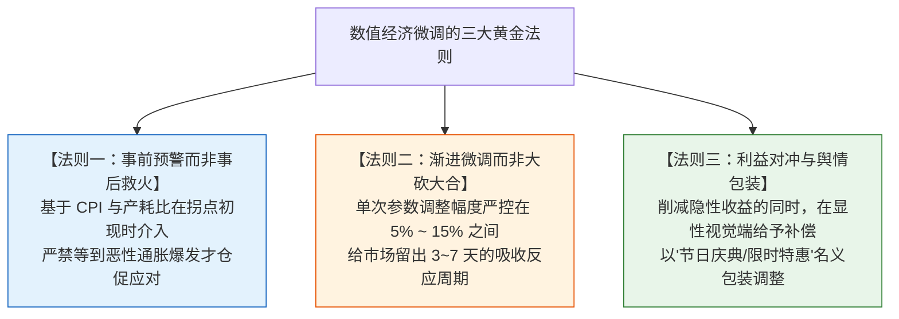
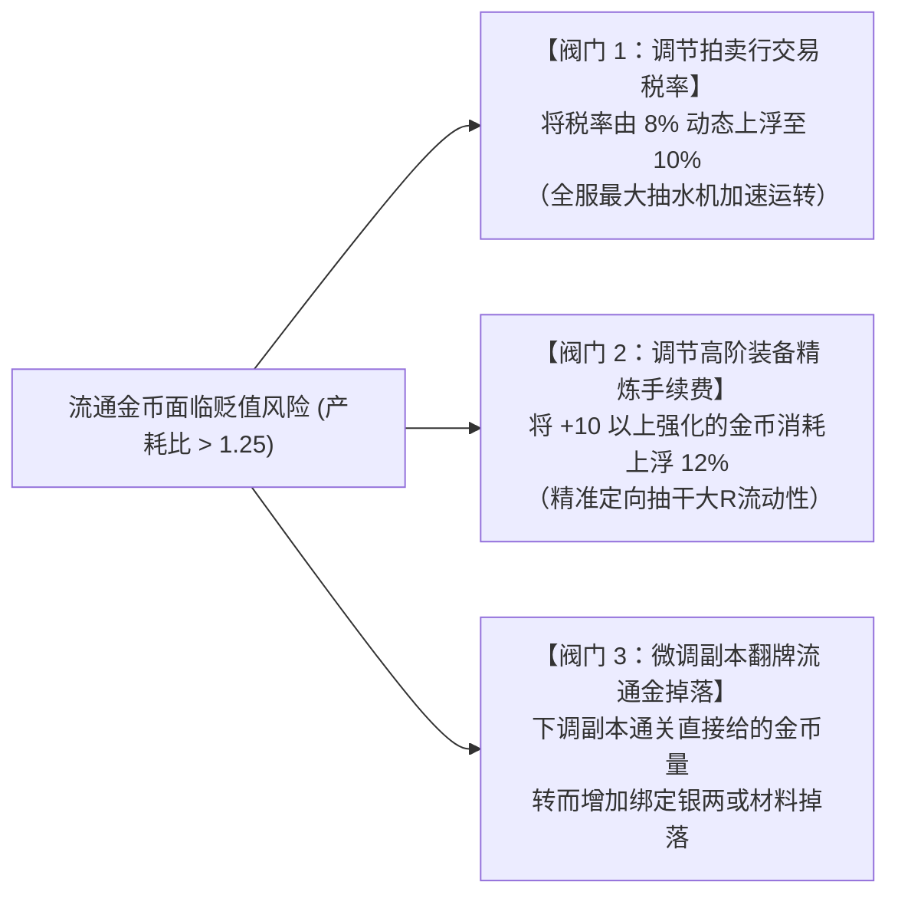
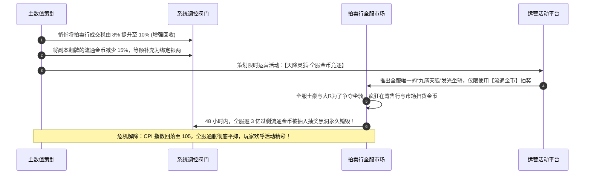

# 产耗投放动态调整阀门：经验、货币、装备与长尾资源的微调艺术

> 对应原书：**第 4.4 节 调整产耗投放**

一款游戏上线后，真实玩家的行为永远会突破策划在办公室里的理想假设：可能是某种职业组合击杀效率超标导致材料产出过快，也可能是打金脚本集中刷取特定日常引发货币贬值。

面对偏离预期的经济运行态势，平庸的策划会惊慌失措地“一刀切大砍 50%”，结果引发玩家贴吧抗议、大规模退款甚至退游海啸；而资深的主数值懂得**将各个系统视为精密的水利管网，通过旋转隐藏在底层的微调阀门（Economic Valves），润物细无声地将经济拉回健康轨道**。

---

## 一、宏观经济微调的三大黄金法则

《平衡掌控者》第 4.4 节开宗明义地提出了数值调控必须恪守的铁律：

---

## 二、六大子系统的微调阀门与实操手册（4.4.1 ~ 4.4.6 节）

### 1. 经验值调整阀门（4.4.1 节）
- **触发病症 A：玩家冲级过快，版本内容被提前耗尽**
  - **错误手法**：直接大幅提高升级所需经验值（会导致正在升级的玩家心理严重失衡）。
  - **正确微调**：
    1. 保持升级经验数值不变，**调低野外刷怪经验占比（$-10\% \sim -15\%$）**，强化疲劳度衰减；
    2. 提前开启第一阶段**世界等级封印**（详见 [[04-experience-curve-and-pacing]]），将溢出经验自动引流至“角色潜能点”或“帮派资材”；
    3. 微调主线任务的递交等级断点，增加跑图对话与探索成就。
- **触发病症 B：新手在 Lv 39 ~ 40 出现断层卡级，流失率飙升**
  - **正确微调**：
    1. 在该等级段的主线任务中追加一次性“经验丹”奖励；
    2. 提高当日限次副本的首通经验翻倍倍率。

---

### 2. 货币调整阀门（4.4.2 节）
货币是全服物价的核心锚点。调控必须区分**流通金币**与**绑定银两**：

- **平民银两短缺时的应急阀门**：
  若平民普遍反映“连修装备、买药水都不够钱”，严禁增发流通金币！**唯一正确的做法是：成倍增加日常师门跑环赠送的【绑定银两】**，彻底解绑生存刚需与外部流通盘（详见 [[05-currency-systems-and-isolation]]）。

---

### 3. 装备系统调整阀门（4.4.3 节）
- **触发病症：高阶橙装产出过剩，拍卖行价格暴跌，大R打本失去动力**
  - **微调抓手 A：掉落权重矩阵微调**
    在掉落表中使用“权重比”而非固定概率：
    $$P_{\text{drop}}(\text{Orange}) = \frac{W_{\text{orange}}}{\sum W_i}$$
    无需大动干戈，仅需将 $W_{\text{orange}}$ 由 100 微调至 85，掉落率即平滑回落，玩家感知完全平滑。
  - **微调抓手 B：提高装备精炼消耗速率**
    微调高阶强化的材料消耗数量，或在周末开放限时“强化成功率 $+5\%$ 特惠周”，利用心理暗示促使大R集中消耗巨量装备胚子与强化石，瞬间出清全服过剩库存。
  - **微调抓手 C：优化装备分解回收比率**
    增加分解高阶废装返还的绑定稀有附魔结晶，引导玩家将闲置装备主动分解，阻止其流入公共拍卖行砸盘。

---

### 4. 宝石系统调整阀门（4.4.4 节）
- **微调抓手 A：商城每日限购额度（Quota Control）**
  - 若大R宝石成型过快，缩减商城每日可购买的 1 级宝石包上限（如从每日限购 50 颗微调为 30 颗），拉长付费周期。
- **微调抓手 B：运营活动兑换比例浮动**
  - 节日活动中，调整“活动代币兑换 3 级宝石”所需的代币数量，利用积分杠杆回收多余的游戏内流通物资。
- **微调抓手 C：打孔镶嵌特种手续费**
  - 针对 7 级以上高阶宝石的镶嵌与摘除，设置需要消耗少量流通金币的手续费，进一步加强水泵抽水。

---

### 5. 宠物系统调整阀门（4.4.5 节）
- **微调抓手 A：洗髓丹产出投放微调**
  - 洗髓丹是典型的易耗消耗品。若全服洗髓丹积压滞销，适当调宽极品资质的随机波动区间（例如将攻击资质上限从 1500 扩展到 1550），瞬间激活全服大R的再洗炼狂潮！
- **微调抓手 B：高级技能书掉落源头收紧**
  - 技能书打书覆盖是巨大的黑洞。通过微调高级藏宝图挖出高级必杀、高级神佑的权重，牢牢稳固高阶宠物的身价天花板。

---

### 6. 日常道具调整阀门（4.4.6 节）
- **微调抓手：刚性磨损速率（Erosion Rate）**
  - 战斗药水 CD 冷却时间、生命值回复数值；
  - 角色死亡耐久度掉落比例（从 $5\%$ 调整至 $8\%$）；
  - 传送符与回城石的商店售价。这些细微调整能以每天数万次的频次作用于全服，产生极为惊人的宏观累积回收效应。

---

## 三、微调实战案例：平抑通胀危机的“组合拳”设计

假设全服运营至第 45 天，后台监控显示：**全服流通金币存量连续三周暴增，CPI 虚拟物价指数冲至 145，拍卖行黑铁矿石价格较开服翻倍。**

- **经典复盘分析**：
  主数值没有采取任何会引发玩家反感的“粗暴改动”，而是运用“微调税率 + 币制分流 + 包装消耗活动”的精密组合拳，在短短两天内不仅化解了通胀危机，还拉升了活跃度与大R的付费欲望。这就是最高水准的数值平衡艺术！

---

## 四、知识库双链互通与学习路线

- 理解全服经济四阶段循环 $\rightarrow$ [[03-economic-loop-production-consumption]]
- 把握四币隔离在微调中的防线价值 $\rightarrow$ [[05-currency-systems-and-isolation]]
- 结合底层系统规则了解强化与合成公式 $\rightarrow$ [[09-system-rules-and-mechanics]]
- 在产耗模型中实时预警需要微调的临界点 $\rightarrow$ [[10-production-consumption-simulation-model]]
- 运营活动设计如何与数值微调形成合力 $\rightarrow$ [[13-operations-analytics-and-telemetry]]
- 查看《大鲸鱼-深空放置》矿物精炼损耗与舰船生产成本的微调方案 $\rightarrow$ [[14-whale-eve-adaptation-guide]]
