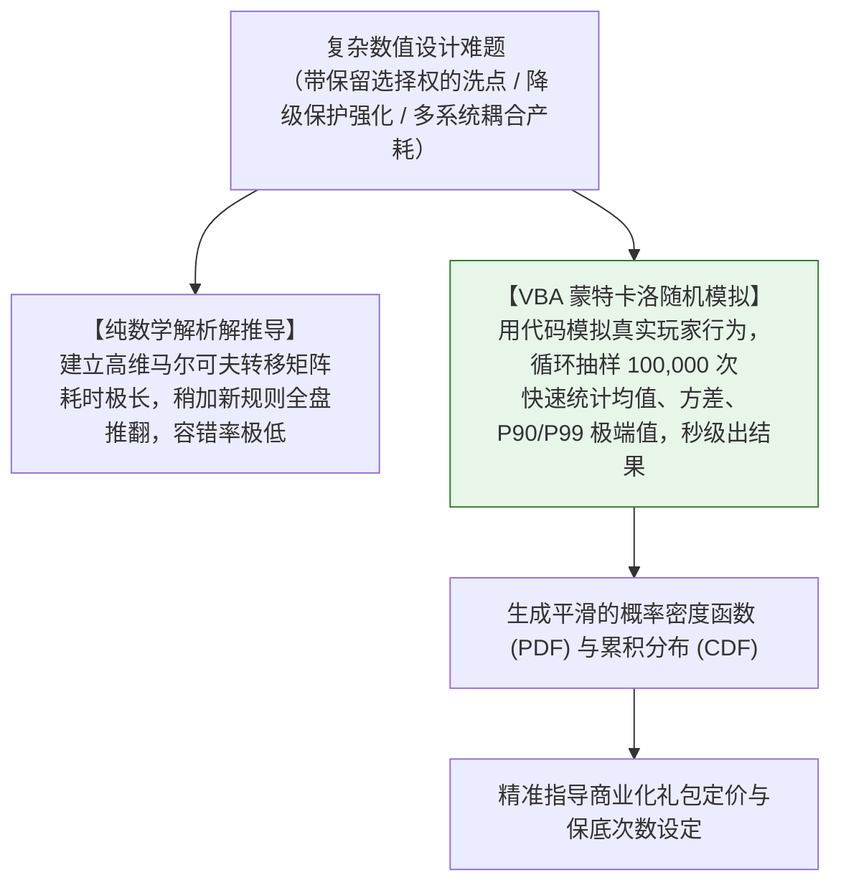
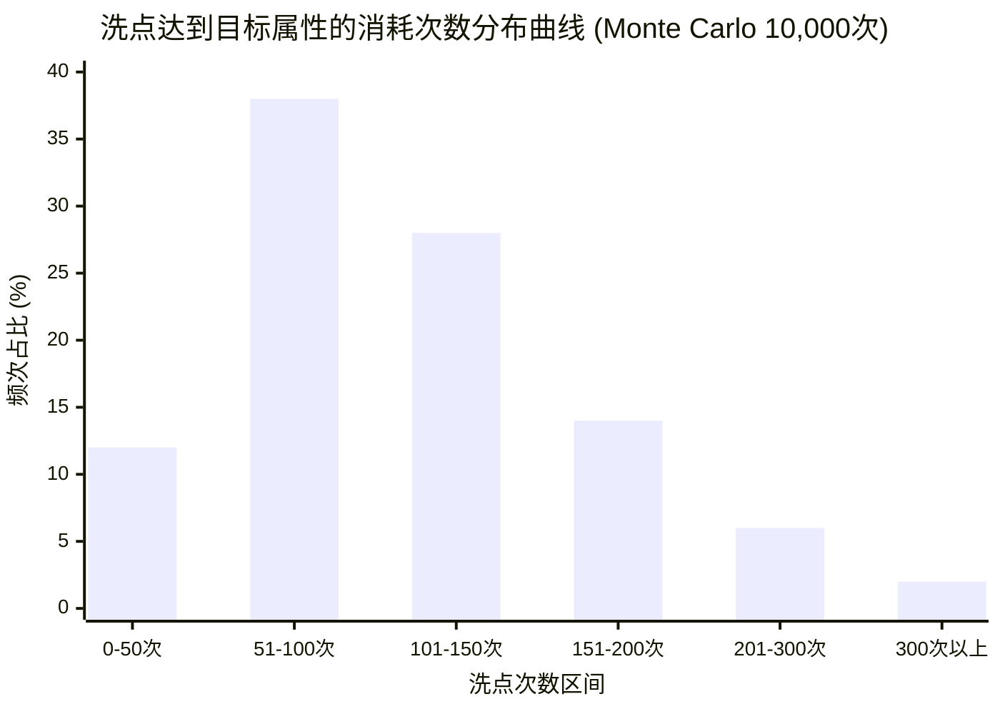
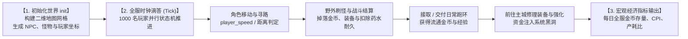

# VBA 与蒙特卡洛随机模拟：洗点强化概率分布推演与全服宏观经济模拟器

> 对应原书：**第 5 章 VBA模拟案例**

在数值设计中，纯理论数学公式（如二项分布、几何分布）在面对**多重条件分支、保留/放弃选择权、动态保底机制以及多玩家交互的非线性场景**时，解析解推导将变得异常繁琐甚至数学不可解。

《平衡掌控者》第 5 章指出：**掌握 VBA 与蒙特卡洛（Monte Carlo）计算机随机模拟，是数值策划摆脱低级配表、走向高级数值工程的分水岭。** 通过计算机在内存中快速运行数万次随机抽样，主数值可以在游戏上线前精准测算出洗点毕业成本的概率分布区间、P95 非酋天花板，以及全服宏观经济运行 365 天后的资产沉淀状态。

---

## 一、为什么数值策划必须掌握蒙特卡洛模拟？



- **核心优势**：
  1. **极强的容错与适应性**：规则无论是“失败降级”、“失败加成功率”还是“满 10 次必出”，代码只需加一行 `If` 判断即可，无需重新解微积分；
  2. **精准捕获非酋体验（Tail Risk）**：数学均值会掩盖个体的极端痛苦。均值 10 次成功的强化，第 99 百分位（P99）玩家可能需要 85 次。只有蒙特卡洛模拟才能暴露出这种导致玩家删游的极端风险。

---

## 二、案例一：属性洗点系统成长模拟器（5.1 节）

### 1. 系统业务规则与数据抽象（5.1.1 ~ 5.1.3 节）
- 角色拥有生命值（HP）属性，初始值为基准值；
- 每次消耗 1 颗“洗髓丹”和固定金币进行洗点，洗点增量 $\Delta \text{HP}$ 在区间 $[\text{MinDelta}, \text{MaxDelta}]$ 内等概率随机波动；
- **玩家博弈决策**：
  - 若洗出的新生命值 $\text{HP}_{\text{new}} > \text{HP}_{\text{current}}$，玩家点击“保存”，更新当前属性；
  - 若 $\text{HP}_{\text{new}} \le \text{HP}_{\text{current}}$，玩家点击“放弃”，保留原属性不损失；
- **终极目标**：洗到设定的目标生命值 $\text{TargetHP}$（例如满资质的 $90\%$ 或 $100\%$）。

### 2. VBA 蒙特卡洛洗点仿真核心代码实现（5.1.4 节）
原书给出了可直接在 Excel 中运行的仿真工程代码：

```visualbasic
' ==============================================================
' 模块名称：WashPointSimulation
' 功能说明：基于蒙特卡洛模拟角色洗点达到目标值的期望次数与成本分布
' ==============================================================
Option Explicit

Sub Simulate_Wash_Point()
    Dim st As Worksheet
    Set st = ThisWorkbook.Sheets("洗点模拟")
    
    ' 读取策划配置的基础参数
    Dim playerLevel As Integer
    Dim initialHP As Double, targetHP As Double
    Dim round1_down As Integer, round1_up As Integer
    Dim singlePillCost As Double, singleGoldCost As Double
    Dim simTimes As Long, i As Long
    
    playerLevel = st.Range("B2").Value
    initialHP = st.Range("B3").Value
    targetHP = st.Range("B4").Value
    round1_down = st.Range("B5").Value     ' 最小随机增量 (如 -5)
    round1_up = st.Range("B6").Value       ' 最大随机增量 (如 +8)
    singlePillCost = st.Range("B7").Value  ' 单次洗炼丹消耗 (如 2 颗)
    singleGoldCost = st.Range("B8").Value  ' 单次金币消耗 (如 1000 金币)
    simTimes = st.Range("B9").Value        ' 模拟抽样样本量 (如 10000 次)
    
    ' 初始化结果输出区域
    Dim resultRow As Long
    resultRow = 2
    st.Range("D2:G" & (simTimes + 10)).ClearContents
    
    Randomize  ' 激活高随机性种子
    
    ' 开始蒙特卡洛大样本循环
    For i = 1 To simTimes
        Dim currentHP As Double
        Dim washCount As Long
        currentHP = initialHP
        washCount = 0
        
        ' 单个玩家的洗点探索循环，直至达成目标属性
        Do While currentHP < targetHP
            washCount = washCount + 1
            
            ' 生成随机浮动增量: Int((upper - lower + 1) * Rnd + lower)
            Dim deltaHP As Integer
            deltaHP = Int((round1_up - round1_down + 1) * Rnd + round1_down)
            
            ' 模拟玩家决策：唯有属性正向提升时才确认保存
            If (currentHP + deltaHP) > currentHP Then
                currentHP = currentHP + deltaHP
            End If
            
            ' 设定防死循环安全阈值
            If washCount > 50000 Then Exit Do
        Loop
        
        ' 记录该样本的模拟统计数据
        st.Cells(resultRow, 4).Value = i                     ' 样本编号
        st.Cells(resultRow, 5).Value = washCount             ' 洗点消耗次数
        st.Cells(resultRow, 6).Value = washCount * singlePillCost  ' 洗炼丹总消耗
        st.Cells(resultRow, 7).Value = washCount * singleGoldCost  ' 金币总消耗
        
        resultRow = resultRow + 1
    Next i
    
    MsgBox "蒙特卡洛模拟完成！共执行 " & simTimes & " 次样本推演。", vbInformation, "系统提示"
End Sub
```

### 3. 模拟结果数据分析与工程应用（5.1.5 节）
通过对 10,000 次模拟结果进行分档统计（结合 [[02-excel-numerical-engineering]] 的 `FREQUENCY` 函数）：



- **数据洞察**：
  - 均值（Mean）：期望洗点次数为 **108 次**；
  - 中位数（Median）：**96 次**；
  - **P90 警戒线**：有 $10\%$ 的玩家需要消耗超过 **190 次**；
  - **P99 极端非酋**：有 $1\%$ 的玩家需要消耗超过 **340 次**！
- **商业化决策支持**：
  如果商城出售的“洗髓大礼包”只包含 100 颗洗炼丹，将有超过 $40\%$ 的付费大R买了礼包后洗不满属性，从而引发差评；数值策划据此在底层增加**“洗炼累计满 150 次必定直接赋予满属性”的软保底**，既保护了非酋大R，又守住了收入底线。

---

## 三、案例二：全服宏观经济与行为模拟器（5.2 节）

原书第 5.2 节展示了一个极其宏伟的工程实践：**在 Excel VBA 中构建一个简易的图形化 RPG 世界，推演全服玩家在地图上的寻路、打怪、接交任务与产耗全生命周期！**



### 1. 核心架构与变量体系（5.2.2 & 5.2.3 节）
- **玩家代理人类（Player Agent）**：
  - `player_x, player_y`：玩家在虚拟地图中的二维浮点坐标；
  - `player_speed`：移动速度常数；
  - `player_level`：角色等级；
  - `player_gold`：随身携带的货币资产；
  - `player_state`：状态机（`0: 空闲`, `1: 寻路中`, `2: 战斗中`, `3: 回城交互`）；
- **世界环境常量**：
  - `map_width, map_height`：虚拟世界长宽网格；
  - `task_total`：每日跑环总环数（20 环）；
  - `monster_respawn_cd`：野怪击杀后的刷新冷却时间。

### 2. 全服行为模拟核心主循环代码节选（5.2.4 节）

```visualbasic
' ==============================================================
' 模块名称：MacroEconomySimulation
' 功能说明：全服玩家宏观行为演化与货币产耗主循环
' ==============================================================
Public Sub Run_Macro_Economic_Simulation()
    Dim dayIndex As Integer, totalDays As Integer
    Dim playerIndex As Integer, totalPlayers As Integer
    Dim serverTotalGoldInflow As Double, serverTotalGoldSink As Double
    Dim serverTotalGoldStock As Double
    
    totalDays = 365      ' 推演全服运营 1 整年
    totalPlayers = 1000  ' 模拟全服 1000 名核心留存玩家
    serverTotalGoldStock = 0
    
    ' 按自然天进行宏观时间推进
    For dayIndex = 1 To totalDays
        serverTotalGoldInflow = 0
        serverTotalGoldSink = 0
        
        ' 遍历全服所有活跃玩家
        For playerIndex = 1 To totalPlayers
            Dim dailyGoldEarned As Double, dailyGoldSpent As Double
            
            ' 1. 执行日常跑环任务产出 (按等级动态缩放)
            dailyGoldEarned = Execute_Daily_Quests(playerIndex)
            
            ' 2. 模拟野外打怪与副本掉落
            dailyGoldEarned = dailyGoldEarned + Simulate_Combat_Drops(playerIndex)
            
            ' 3. 模拟日常刚性消耗 (装备耐久修理 + 购买药水)
            dailyGoldSpent = Calculate_Daily_Maintenance(playerIndex)
            
            ' 4. 模拟战力进阶追求 (大R与中R根据财富积累触发装备精炼与合宝石)
            If Should_Player_Upgrade(playerIndex) Then
                dailyGoldSpent = dailyGoldSpent + Execute_Gear_Refinement(playerIndex)
            End If
            
            ' 5. 模拟拍卖行交易税流转抽水 (5% 系统销毁)
            dailyGoldSpent = dailyGoldSpent + Simulate_Market_Tax(playerIndex)
            
            ' 汇总全服单日流水
            serverTotalGoldInflow = serverTotalGoldInflow + dailyGoldEarned
            serverTotalGoldSink = serverTotalGoldSink + dailyGoldSpent
        Next playerIndex
        
        ' 更新全服资产总存量: Stock(t) = Stock(t-1) + Inflow - Sink
        serverTotalGoldStock = serverTotalGoldStock + serverTotalGoldInflow - serverTotalGoldSink
        
        ' 将第 t 天的宏观指标记录在案
        Record_Telemetry_Snapshot dayIndex, serverTotalGoldStock, serverTotalGoldInflow, serverTotalGoldSink
    Next dayIndex
End Sub
```

### 3. 宏观模拟的战略用途（5.2.5 节）
- **验证通胀黑天鹅事件**：
  在代码运行至第 90 天时，观察 `serverTotalGoldStock` 是否出现斜率向上的指数级失控暴增。若暴增，立即在代码中排查是哪个模块的产出超出了模型预算；
- **测试税率杠杆的敏感度**：
  在仿真器中将拍卖行交易税从 $5\%$ 调整至 $8\%$，直接观察全服货币存量能否在第 180 天平抑 $20\%$。通过仿真得到确切的因果关系，无需在正式服拿真实玩家当试验小白鼠！

---

## 四、知识库双链互通与学习路线

- 必备 Excel 数值工程函数与矩阵计算 $\rightarrow$ [[02-excel-numerical-engineering]]
- 四阶段经济循环与存量守恒理论 $\rightarrow$ [[03-economic-loop-production-consumption]]
- 底层人物属性与装备强化成功率依据 $\rightarrow$ [[09-system-rules-and-mechanics]]
- 结合产耗模型对照仿真结果与理论预算 $\rightarrow$ [[10-production-consumption-simulation-model]]
- 将仿真中发现的失衡点转化为动态微调阀门 $\rightarrow$ [[11-fine-tuning-economic-valves]]
- 查看《大鲸鱼-深空放置》Python 蒙特卡洛随机模拟测试用例 $\rightarrow$ [[14-whale-eve-adaptation-guide]]
