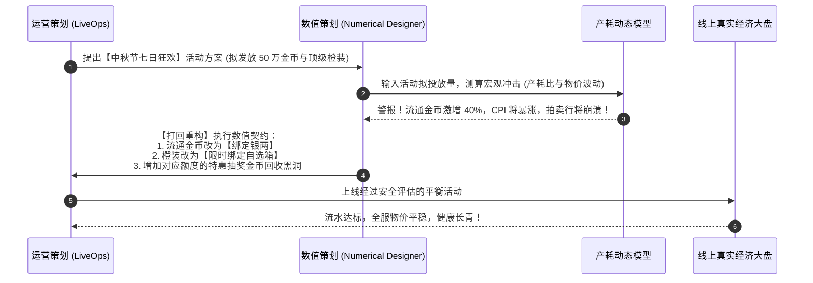
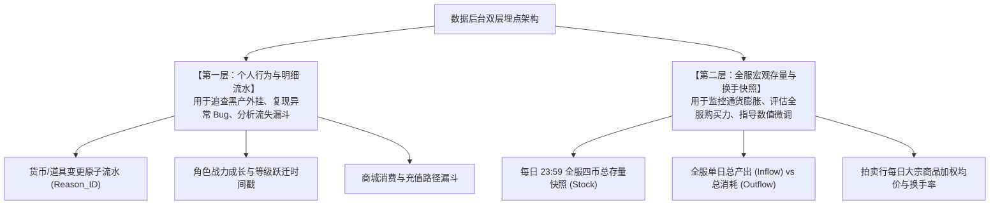

# 运营策划活动设计、后台数据埋点与全服经济健康度指标库

> 对应原书：**第 6 章 运营策划与数据统计**

在现代网络游戏的商业化运作中，研发与运营绝非割裂的两个孤岛。许多游戏的暴毙，并非由于底层玩法糟糕，而是因为**运营策划为了冲刺单月流水 KPI，在短期活动中无节制狂甩高阶材料与非绑定货币，直接击穿了数值策划精心构筑的经济防火墙**。

《平衡掌控者》第 6 章系统阐述了研运一体化的数值契约、商业化活动对经济的冲击评估模型，以及如何通过**工业级的数据后台埋点（Telemetry）**对全服经济健康度进行 24 小时动态体检。

---

## 一、研运一体化：活动设计的数值防冲击契约（6.1 & 6.2 节）



### 1. 常见运营活动的类型解构
- **充值激励型**：首充翻倍、累计充值阶梯返利、开服成长基金（分等级解锁元宝）；
- **消费拉动型**：消耗元宝积分转盘、限时神秘黑市打折特卖；
- **活跃促活型**：七日登录签到、节日副本掉落活动代币兑换专属时装。

### 2. 运营活动三大铁律（防冲击契约）
1. **铁律一：严禁活动直接投放“流通金币”**
   活动产出的货币必须严格限定为**绑定元宝**或**绑定银两**。若直接投放流通金币，工作室会批量建号褥羊毛，洗空拍卖行，彻底摧毁全服物价。
2. **铁律二：产出必须有预算额度对冲（Budget Neutral）**
   当运营决定在活动中免费赠送价值 1000 元宝的材料时，必须在产耗总表中相应削减当周常规副本的对应产出，或者同步推出一个同等容量的消耗活动（如强化半价但消耗巨额金币），确保全服总存量 $\Delta M$ 保持守恒。
3. **铁律三：严禁出售当前版本“毕业级”数值**
   活动最高只能售卖当前主力梯队的进阶材料，**顶级神装必须保留在游戏内核心高难挑战中产出**。一旦在商城明码标价直接卖毕业神装，大R将彻底丧失追求，游戏进入死亡倒计时。

---

## 二、后台数据统计需求与埋点指标库（6.3 节）

要想精准诊断经济问题，必须依赖精细化的底层日志埋点（Data Telemetry）。



### 1. 个人数据流水标准字段规范（6.3.1 节）
每一笔涉及货币或道具的增减，服务器底层日志必须记录以下标准元组：
$$\text{LogRecord} = \langle \text{Timestamp}, \text{RoleID}, \text{AccountID}, \text{ActionType}, \text{ResID}, \text{DeltaAmount}, \text{AfterAmount}, \text{ReasonID}, \text{MapID} \rangle$$

- **`ReasonID`（原因枚举）是数据分析的灵魂**：
  必须穷举全服所有的产耗源头（例如 `1001: 主线任务奖励`, `2005: 装备强化手续费`, `3012: 拍卖行买入扣款`, `4001: 摆摊手续费`）。
  禁止使用模糊的“GM命令”、“系统扣除”等兜底大类，确保能用 SQL 聚合出每一个系统的绝对产耗比重。

### 2. 全服宏观资产每日快照（6.3.2 节）
每日凌晨自动对全服数据进行全局切片聚合：
- **货币存量**：充值元宝全服存量、绑定元宝全服存量、流通金币全服存量、绑定银两全服存量；
- **核心材料存量**：各品阶强化石全服总持有量、各等级宝石全服镶嵌与背包总数；
- **财富集中度**：全服前 $1\%$ 大R持有的金币总量占全服总流通金币的比重。

---

## 三、全服经济健康度核心诊断指标库（6.3.3 节）

数值策划通过监控以下四大核心量化指标，对服务器经济状态进行综合评级：

```mermaid
quadrantChart
    title 全服经济运行体检象限
    x-axis 低产耗比 (通缩萎靡) --> 高产耗比 (通胀泛滥)
    y-axis 低基尼系数 (平均主义) --> 高基尼系数 (两极分化严重)
    quadrant-1 危险通胀：寡头囤积，物价飞涨
    quadrant-2 极度紧缩：平民穷困，大R独大
    quadrant-3 滞胀死水：缺乏流动性，缺乏追求
    quadrant-4 【黄金平衡区】：微通胀，财富良性流动
    "健康服务器基准点": [0.55, 0.45]
    "通胀危机预警点": [0.85, 0.80]
```

### 1. 宏观产耗比（Inflow / Outflow Ratio）
$$\text{IOR}(t) = \frac{\sum \text{Inflow}(t)}{\sum \text{Outflow}(t) + \text{Tax}(t)}$$
- **标准健康区间**：$1.05 \le \text{IOR} \le 1.15$；
- **诊断意义**：衡量全服印钞速度是否失控。大于 1.25 表明水龙头注水过猛；小于 0.95 表明全服流动性枯竭。

### 2. 虚拟 CPI 消费者物价指数
$$\text{CPI}(t) = \sum_{k=1}^n w_k \times \frac{P_k(t)}{P_k(0)} \times 100$$
- 实时追踪宝石、强化石、技能书等大宗硬通货的价格变动趋势，详见 [[10-production-consumption-simulation-model]]。

### 3. 财富分布基尼系数（Gini Coefficient）
用于量化全服玩家之间的贫富差距：
$$G = \frac{\sum_{i=1}^n \sum_{j=1}^n |y_i - y_j|}{2 n \sum_{i=1}^n y_i}$$
（其中 $y_i$ 为玩家 $i$ 的流通金币持有量）。
- **$G < 0.35$**：财富分布过于平均，表明缺少大R，商业化拉收能力偏弱；
- **$0.40 \le G \le 0.55$**：**黄金生态区间**，大R拥有雄厚资金，平民持有足够的周转资金，交易活跃；
- **$G > 0.70$**：极度两极分化！全服 $90\%$ 的流动资金被少数几个投机商人和打金公会垄断，平民失去购买力，市场面临流动性陷阱。

### 4. 货币周转率（Velocity of Circulation）
$$V = \frac{\text{AuctionTotalTurnover}(t)}{\text{TotalCirculatingGoldStock}(t)}$$
- 衡量全服金币的活跃度。若周转率暴跌，说明玩家对市场失去信心，转入恐慌性储蓄。

---

## 四、知识库双链互通与学习路线

- 四阶段循环中生产与消耗的守恒理论 $\rightarrow$ [[03-economic-loop-production-consumption]]
- 多币制如何保障绑定资产不被黑产利用 $\rightarrow$ [[05-currency-systems-and-isolation]]
- 交易系统的税收水泵在数据大盘中的体现 $\rightarrow$ [[06-trading-systems-and-anti-exploit]]
- 结合产耗模型对照实时 Telemetry 读数 $\rightarrow$ [[10-production-consumption-simulation-model]]
- 当数据指标触发警报时如何操作微调阀门 $\rightarrow$ [[11-fine-tuning-economic-valves]]
- 查看《大鲸鱼-深空放置》ISK 流水埋点与星系宏观数据看板落地 $\rightarrow$ [[14-whale-eve-adaptation-guide]]
