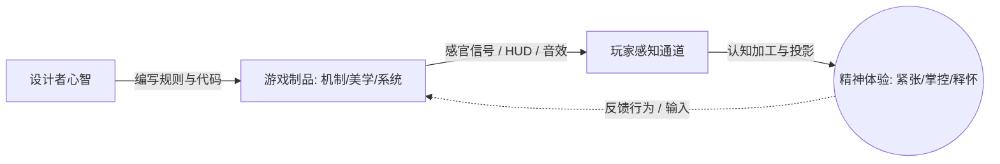
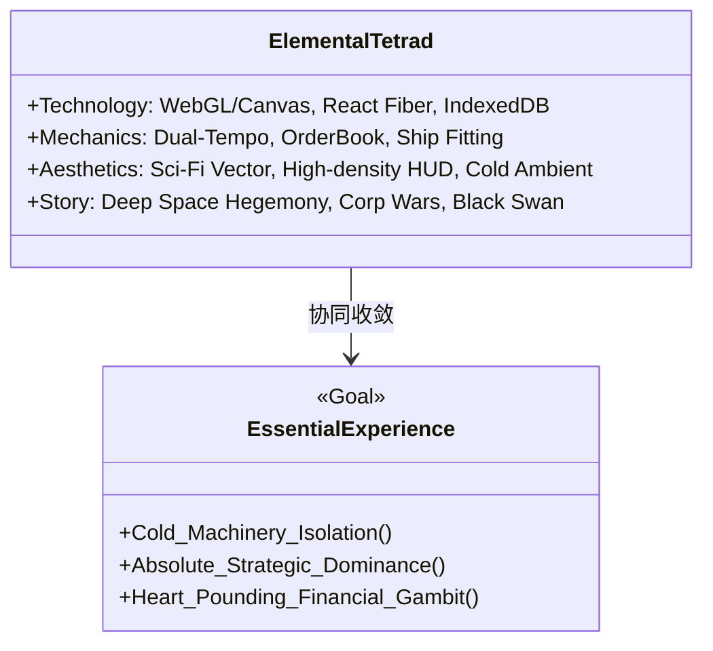
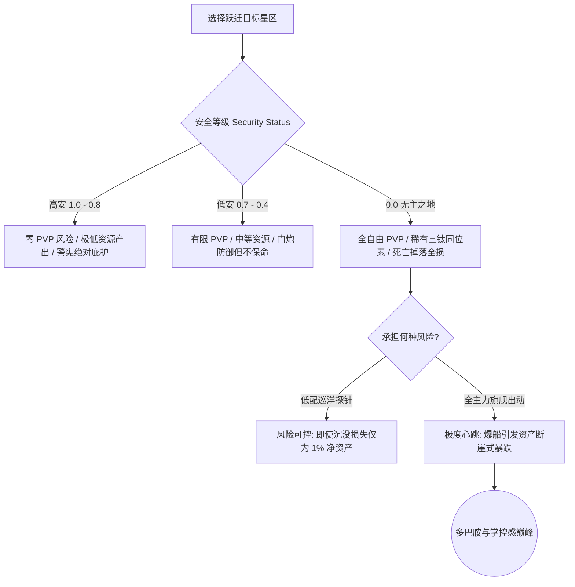

# 《游戏设计艺术》（第3版）深度蒸馏

> **知识定位**：游戏不是体验本身，游戏只是体验的催化剂。优秀的设计师不是在构建枯燥的代码与数值表格，而是在借助机制、技术、美学与故事的共振，在玩家心智中创造独一无二的心流体验。本篇系统解构 Jesse Schell《游戏设计艺术》（*The Art of Game Design: A Book of Lenses*, 3rd Edition），并深度映射至 [[project-overview|大鲸鱼-深空放置]] 的系统设计与工程落地。

---

## 结论先行

1. **游戏四元法（The Elemental Tetrad）的协同共振**：机制（Mechanics）、美学（Aesthetics）、故事（Story）、技术（Technology）是游戏的四大基石。在硬核太空模拟与放置游戏中，技术支撑极致的渲染与数据同步，机制提供深度选择，故事营造冰冷残酷的暗黑宇宙，美学统摄高密度科幻 HUD。四者缺一不可，且必须共同服务于单一的“**本质体验（Essential Experience）**”。
2. **倾听是设计师的核心元能力**：设计师必须同时进行五种倾听：倾听玩家、倾听团队、倾听游戏、倾听世界、倾听内心。绝不能陷入以自我偏好代替客观心流验证的虚妄自负中。
3. **心流通道（Flow Channel）的动态拟合**：心流发生于**高挑战（Challenge）与高技能（Skill）**的精确张力带。放置类游戏容易因“过度等待”跌入无聊区（Boredom），又容易因“突发复杂决策”将玩家抛入焦虑区（Anxiety）。解决之道在于构建**双重时间节拍（Dual-Tempo Engine）**与**分层信息露出版（Progressive Disclosure）**。
4. **透镜（Lenses）是跨越认知盲区的心理工具箱**：Schell 的 100+ 透镜本质上是一套强制设计师切换视角的反思协议。在大鲸鱼项目中，有意义选择透镜、经济平衡透镜、控制感透镜、时间透镜与风险透镜构成了底层核心玩法校验环。

---

## 一、全景认知：游戏设计全景四元法拓扑

```
┌─────────────────────────────────────────────────────────────────────────────┐
│                   Jesse Schell 游戏设计全景四元法 (Elemental Tetrad)         │
├─────────────────────────────────────────────────────────────────────────────┤
│                                  [技术 Technology]                          │
│                             (底层驱动 / 架构基石)                           │
│                                      ▲                                      │
│                                     ╱ ╲                                     │
│                                    ╱   ╲                                    │
│                                   ╱     ╲                                   │
│                                  ╱   ★   ╲                                  │
│                                 ╱ 统一主题 ╲                                 │
│                                ╱  本质体验  ╲                                │
│                               ▼─────────────▼                               │
│           [机制 Mechanics] ◄──────────────────► [美学 Aesthetics]           │
│         (程序规则 / 经济闭环)                     (视听调性 / HUD 感官)     │
│                                ╲             ╱                              │
│                                 ╲           ╱                               │
│                                  ╲         ╱                                │
│                                   ╲       ╱                                 │
│                                    ▼     ▼                                  │
│                                    [故事 Story]                             │
│                               (宇宙编年史 / 涌现叙事)                       │
└─────────────────────────────────────────────────────────────────────────────┘
```

### 1.1 四元法各维度的互锁契约

| 要素 | 核心定义 | 传统误区 | 大鲸鱼项目契约定义 |
| :--- | :--- | :--- | :--- |
| **技术 (Technology)** | 承载媒体与底层代码所能实现的一切物理与数字边界 | 盲目堆砌高新技术或将框架选型脱离核心交互需求 | Vite + React + Canvas/WebGL 极速响应，保证千级天体轨道与高频订单簿无卡顿 |
| **机制 (Mechanics)** | 游戏的规则、空间定义、时间粒度、对象属性、状态机与玩家动作池 | 只有干瘪的数值计算，忽视动作与反馈的交互循环 | 双重时间循环：微观即时操盘/战术防御 vs 宏观挂机采矿/科研制造 |
| **美学 (Aesthetics)** | 塑造玩家感官的一切视听、触觉表现与界面调性 | 将美学等同于外包美术立绘，脱离界面功能性 | 冰冷残酷的暗黑 Sci-Fi 矢量线稿、高信噪比绿黑单色荧光 HUD、无冗余花哨装饰 |
| **故事 (Story)** | 游戏内事件的时空发展序列，包含预设叙事与涌现叙事（Emergence） | 强行灌输大量无法交互的长文本小说，阻断心流 | 环状势力博弈、公司财阀兴衰，以星区冲突、破产公告与黑天鹅新闻进行涌现表达 |

---

## 二、体验创造、五种倾听与心流通道动力学

### 2.1 体验的不可直达性与本质体验

游戏设计师本身无法“直接交付体验”，设计师能构建的只有**游戏制品（Artefact）**。真正的“体验（Experience）”只在玩家的大脑与意识中诞生。



> **本质体验透镜（Lens of Essential Experience）**：
> - 我希望玩家在玩我的游戏时获得怎样的核心情感？
> - 体验的基调是什么？（掌控感？冰冷孤寂感？惊心动魄的孤注一掷？）
> - 机制与美学是否都在全力强化这种体验？有哪些枝节正在削弱它？

### 2.2 深度倾听（Deep Listening）的五大维度

1. **倾听玩家（Listening to the Players）**：观察玩家在做什么，而不是听他们说什么。玩家抱怨“数值太慢”时，本质可能是“缺乏有意义的阶段性目标反馈”。
2. **倾听团队（Listening to the Team）**：让前端交互、数据引擎、数值策划与玩家社群的声音穿透层级壁垒。
3. **倾听游戏（Listening to the Game）**：在游戏的原型（Prototype）跑起来之后，游戏本身会告诉你它想成为什么。不要为了契合最初的策划案而扭曲原型中自然生长出的乐趣。
4. **倾听世界（Listening to the World）**：从真实金融市场的订单簿微秒级高频博弈、天体力学开普勒轨道等现实规律中汲取灵感。
5. **倾听内心（Listening to Yourself）**：保持对设计的本真敏感。如果你自己都无法在这款挂机游戏里沉浸盯盘半小时，就绝不要期望玩家会买单。

### 2.3 心流通道与动态挑战拟合

根据米哈里·契克森米哈赖（Mihaly Csikszentmihalyi）心流理论与 Schell 的工程化转换：

```
挑战度 (Challenge)
     ▲
     │          [焦虑区 Anxiety]
     │          (挫败感 / 决策瘫痪)
     │          /
     │        /    【心流通道 Flow Channel】
     │      /      (高技能与高挑战的动态共振)
     │    /
     │  /
     │/         [无聊区 Boredom]
     │          (机械重复 / 产出固化)
     └──────────────────────────────────────► 玩家技能 (Skill)
```

- **心流中断的危险1（跌入无聊）**：数值膨胀使玩家的矿船采矿无脑挂机，收益虽然在增加，但玩家无需任何决策，丧失了“精神熵减”的快感。
- **心流中断的危险2（撞上焦虑）**：突然遭遇无预警的 0.0 星系海盗截击，缺乏清晰的反制机制，或者面对瞬间暴跌的股票订单簿产生信息过载与决策瘫痪。
- **解法：动态微波浪（Micro-Waves of Tension & Release）**：心流通道不是一条直线，而是一条向上振荡的波浪线。紧绷之后必须有释怀（Release），让玩家在安全母港清点战利品。

---

## 三、Jesse Schell 100+ 设计透镜精选卡片库

以下精选与太空模拟、挂机放置及深度经济体系最为契合的 10 大核心透镜，整理为实战审查卡片：

### 透镜 7：心流透镜 (Lens of Flow)

> [!NOTE] 设计透镜 7：心流透镜
> **核心自检**：
> 1. 我的游戏是否有清晰明确的即时目标？（目标清晰）
> 2. 玩家的动作是否能得到立竿见影的反馈？（反馈即时）
> 3. 游戏是否消除了分散注意力的无用噪音？（专注环境）
> 4. 难度是否随着玩家心智模型的建立而平滑递增？（技能与挑战拟合）
> 5. 是否为不同水平的玩家提供了自主调节节奏的旋钮？

### 透镜 21：功能可供性透镜 (Lens of Affordance)

> [!NOTE] 设计透镜 21：功能可供性透镜
> **核心自检**：
> 1. 玩家第一眼看到一个 UI 元素或操作按钮时，它在视觉上暗示了何种操作？
> 2. 红色闪烁是否天然意味着“紧急警报/致命威胁”？
> 3. 数字绿涨红跌（或国际通用红涨绿跌）是否符合目标受众的本能映射？
> 4. 是否存在“长得像可点击的按钮，实际却只是静态标签”的混淆元素？

### 透镜 34：有意义的选择透镜 (Lens of Meaningful Choices)

> [!NOTE] 设计透镜 34：有意义的选择透镜
> **核心自检**：
> 1. 玩家做出的选择是否真正影响了游戏走向，还是纯粹的形式主义（虚假分支）？
> 2. 是否存在无可争议的“绝对最优解（Dominant Strategy）”？如果所有玩家都选同一艘巡洋舰配装，其他选择便形同虚设。
> 3. 玩家在做出选择前，是否具备足够的信息做出合理解构？
> 4. 做出选择后，玩家能否直观感知到其带来的长远代价与收益（Trade-offs）？

### 透镜 39：经济平衡透镜 (Lens of Economy)

> [!NOTE] 设计透镜 39：经济平衡透镜
> **核心自检**：
> 1. 游戏内货币与资源的水龙头（Faucet）产出速率是否被精准监控？
> 2. 排水池（Sink）是否有足够的刚性吸引力让玩家自愿消耗资产？
> 3. 资源是否可以通过多种不同途径获取与转换，从而形成弹性市场？
> 4. 是否存在滚雪球（Positive Feedback Loop）导致的极速恶性通胀？

### 透镜 42：优雅透镜 (Lens of Elegance)

> [!NOTE] 设计透镜 42：优雅透镜
> **核心自检**：
> 1. 经典定义：一个优雅的游戏规则极度简洁，却能产生丰富多样的自发涌现行为（Emergence）。
> 2. 我是否在用增加新系统、新菜单、新按钮的方式来修补旧系统的问题？
> 3. 能否通过强化已有对象之间的相互作用，替代引入冗余的外部规则？
> 4. 能否删除游戏 20% 的细枝末节，而让整体玩法体验更加纯粹？

### 透镜 47：控制感透镜 (Lens of Control)

> [!NOTE] 设计透镜 47：控制感透镜
> **核心自检**：
> 1. 玩家输入与系统响应之间是否存在让玩家困惑的延迟或歧义？
> 2. 当复杂自动化运作时（如后台自动寻路采矿），玩家是否感觉掌控了全局，还是感觉沦为了旁观者？
> 3. 控制界面是否能让玩家将游戏世界完全映射为自己神经系统的延伸？

### 透镜 49：时间透镜 (Lens of Time)

> [!NOTE] 设计透镜 49：时间透镜
> **核心自检**：
> 1. 玩家在此游戏中的主观时间流速与客观时间流速有何差异？
> 2. 什么时候应该让时间变慢（如高危战斗战术决策），什么时候应该允许时间压缩/快速推进？
> 3. 放置离开的时间（离线收益）是否让玩家对重返游戏充满期待？

### 透镜 51：风险透镜 (Lens of Risk)

> [!NOTE] 设计透镜 51：风险透镜
> **核心自检**：
> 1. 风险与收益的预期数学期望（EV）是否对等？
> 2. 玩家是主动承担风险（如单舰跃迁入低安高风险海盗区），还是被动遭受不可抗力？
> 3. 规避风险的手段是否充足？高风险带来的心跳加速是否提供了极高的情绪价值？

### 透镜 64：兴趣曲线透镜 (Lens of the Interest Curve)

> [!NOTE] 设计透镜 64：兴趣曲线透镜
> **核心自检**：
> 1. 玩家进入游戏的前 30 秒、前 5 分钟、前 1 小时的注意力峰值如何分布？
> 2. 是否有一记强有力的“钩子（Hook）”迅速抓住玩家？
> 3. 兴趣曲线是单调上升还是具有韵律的峰谷波浪？高潮过后是否有舒适的调整期？

### 透镜 71：间接控制透镜 (Lens of Indirect Control)

> [!NOTE] 设计透镜 71：间接控制透镜
> **核心自检**：
> 1. 如何在不剥夺玩家自主权的前提下，引导玩家前往设计师希望他去探索的星区？
> 2. 通过界面的视觉重心、背景环境音的异动、雷达信号的隐蔽频段，是否能达成隐式引导？
> 3. 玩家是否以为“这是我自己聪明才智发现的秘密”，而实际上是精密的间接诱导？

---

## 四、大鲸鱼项目落地映射实战架构

将 Jesse Schell 的四元法与透镜体系深度落地到《大鲸鱼-深空放置》的核心玩法与工程实现中。

### 4.1 四元法在大鲸鱼中的系统级解构



1. **美学落地：冰冷残酷的暗黑科幻冷色调 HUD**
   - 绝不采用高饱和度卡通风格或廉价光效。统一使用 `#050811`（深空虚空黑）、`#00f0ff`（高对比电子蓝/护盾色）、`#ffaa00`（装甲结构警示橙）与 `#ff0055`（结构爆裂与致命敌意红）。
   - 界面字体采用精密等宽终端字体与几何无衬线字体，强化“坐在泰坦级星舰舰桥指挥舱”的绝对冷峻仪式感。
2. **机制落地：双重时间节拍（Dual-Tempo Loop）**
   - **离线/宏观慢时钟（Macro Idle Rhythm）**：行星工业产线、重型穿梭机采矿集群、深空空间站研发。时间粒度为“小时/天”。为玩家提供坚不可摧的安全感与沉淀资产。
   - **在线/微观快时钟（Micro Active Rhythm）**：高频股票订单簿多空挂单、跃迁拦截泡逃脱、过载装甲维修器、深空异常截击。时间粒度为“秒/毫秒”。满足玩家追求即时刺激与精准操作的渴望。
3. **技术落地：无阻塞数据流与分层渲染画布**
   - 采用 React 作为状态驱动框架，对静态高频 HUD 指标使用直接 DOM 补丁或 Canvas 2D 进行局部重绘，保证 60 FPS 顺滑帧率。
   - 离线时间补偿算法：采用严谨的离线积分方程与上限截断，避免利用系统修改时钟进行的本地刷币作弊。
4. **故事落地：去叙事化与环境叙事（Environmental Storytelling）**
   - 不设置烦冗的冗长 NPC 对话。故事在星区治安度降至 0.0、股票公告栏中的企业恶意收购、海盗军团的覆灭战报中自然涌现。

### 4.2 核心透镜在大鲸鱼具体模块中的工程化检验

#### (1) 控制感透镜 (Lens of Control) ➔ 高密度 HUD 信息分层通道

太空类放置游戏最忌讳“信息堆积成灾导致认知过载”，也忌讳“信息过分隐藏导致操作盲目”。

```
┌─────────────────────────────────────────────────────────────────────────────┐
│                       大鲸鱼舰桥控制台通道映射拓扑                           │
├─────────────────────────────────────────────────────────────────────────────┤
│  [第一通道：高敏生命体征] (眼动聚焦 0.1s 内感知)                           │
│  - 环形三层状态环：外环护盾 (Shield) / 中环装甲 (Armor) / 内环结构 (Hull)  │
│  - 电容电量 (Capacitor)：电容绝对百分比与回复速率动态指示器                 │
├─────────────────────────────────────────────────────────────────────────────┤
│  [第二通道：战术态势感知] (视线周边感知 / 动态报警)                         │
│  - 360° 战术罗盘 (Tactical Compass)：锁定目标方位、角速度、拦截泡扩散边界  │
│  - 警报闪烁：反跃迁扰频器锁定 (Scrambled)、目标标记 (Target Painted)       │
├─────────────────────────────────────────────────────────────────────────────┤
│  [第三通道：宏观经济与生产状态] (边缘稳态监控)                             │
│  - 净资产净值实时曲线 (NAV Realtime Curve)                                  │
│  - 离线矿仓饱和度进度条 (Cargo Hold Fill Level)                             │
└─────────────────────────────────────────────────────────────────────────────┘
```

#### (2) 有意义的选择透镜 (Lens of Meaningful Choices) ➔ 舰船槽位配置（Ship Fitting）

- 槽位设计遵循严格的**边际机会成本（Opportunity Cost）**法则：
  - **高槽（High Slots）**：重型激光炮 vs 隐形跃迁装置 vs 采矿激光器。选择输出就必须放弃隐匿与资源采集。
  - **中槽（Medium Slots）**：加力燃烧推进器 vs 电容注电模块 vs 目标索敌计算机。选择机动力就牺牲持续防御续航。
  - **低槽（Low Slots）**：能源诊断系统 vs 损伤控制元件 vs 惯性稳定器。
  - **功率栅格（Powergrid, PG）与 CPU 算力**作为两大绝对刚性物理预算，彻底斩断无脑全能神装的可能，迫使玩家在极端针对性场景中做出痛苦但有深度的权衡。

#### (3) 风险透镜 (Lens of Risk) ➔ 星区安全等级与全损机制



- **全损心理对冲（Soft-Loss Buffer）**：在 0.0 星区被击毁虽然舰船与舰载装备全损，但舰长的**神经克隆插槽（Clones）**与**作战数据记忆芯片**可以通过救生舱紧急跳跃得以保全，带回关键科研熟练度，使高风险的“死亡”成为下一次复仇的成长垫脚石，完美契合心流通道中的抗挫折设计。

---

## 五、延伸阅读与知识网络关联

- [[balance-master-game-economy|《平衡掌控者：游戏数值经济设计》全书精要]]：从货币闭环与防波堤视角深化经济平衡透镜
- [[game-design-236-techniques|《游戏设计的236个技巧》实战微操手感剖析]]：将控制感与功能可供性落地到打击停顿、抖屏与指示器
- [[game-design-creativity-and-rhythm|《大师谈游戏设计：创意与节奏》]]：情绪张弛波浪与放置挂机时间节拍的深入解构
- [[project-overview|大鲸鱼-深空放置 项目愿景与架构基线]]：项目核心目标与工业级代码规范
