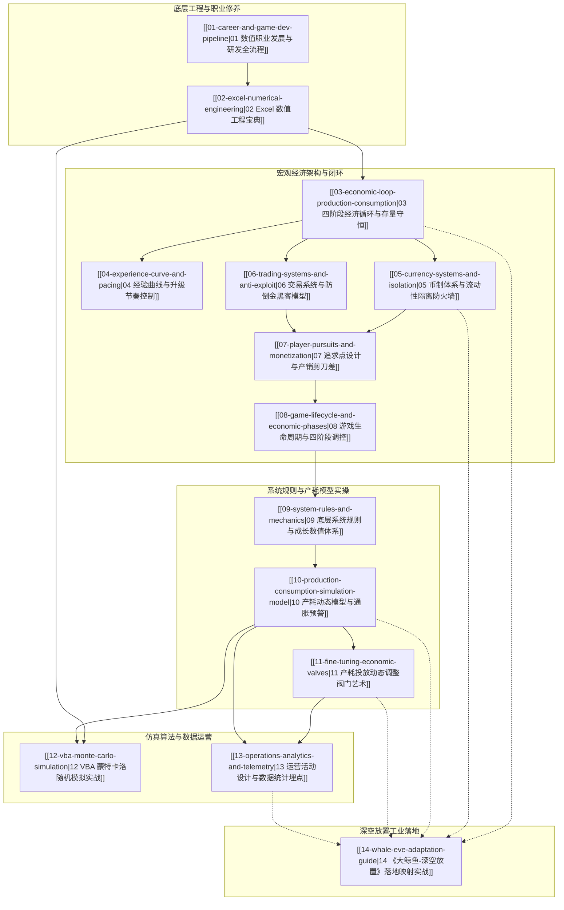

# 《平衡掌控者：游戏数值经济设计》全书知识库导读

> **“只要能控制一个国家的货币发行，我不在乎谁制定了法律。”** —— 梅耶·阿姆谢尔·罗斯柴尔德
> **“只要能控制游戏中的经济系统，我不在乎谁做游戏设计。”** —— 《平衡掌控者》核心哲学

本知识库是对行业权威专著《平衡掌控者：游戏数值经济设计》（似水无痕 著）的**无遗漏全量深度萃取与工程化重构**。全书打破了传统数值策划“重战斗平衡、轻宏观经济”的狭隘视角，以宏观经济学、货币银行学与系统工程学为理论武器，系统化解构了大型多人在线网络游戏（MMORPG）中财富的**生产、积累、交易与消耗**全生命周期法则。

---

## 一、知识库全景知识图谱 (Knowledge Graph)

---

## 二、全书知识库模块导航与核心摘要

| 序号 | 知识库文档 | 原书章节映射 | 核心知识点与工程抓手 |
| :--- | :--- | :--- | :--- |
| **01** | [[01-career-and-game-dev-pipeline]] | 第 1 章、第 7 章 | 数值策划能力四维模型（机缘/求知欲/自省/数理）、三大职业成长阶段、研发协同契约标准、校招与社招笔试面试深度真题拆解 |
| **02** | [[02-excel-numerical-engineering]] | 第 2 章 | 职业级 Excel 规范：逆向查询（INDEX+MATCH / VLOOKUP+IF{1,0}）、万能一对多动态数组、R1C1 引用、EVALUATE 宏表求值、分级累进求和矩阵公式 |
| **03** | [[03-economic-loop-production-consumption]] | 第 3.1 节 | 生产-积累-交易-消耗四阶段流转法则、全服存量资产平衡守恒方程 $\Delta M = P - C$、系统回收泵压机制、通胀临界控制 |
| **04** | [[04-experience-curve-and-pacing]] | 第 3.2 节 | 升级经验值数学模型（多项式/指数/分段拟合）、标准升级耗时 TTL 预算分配、多源经验产出树、等级差收益衰减与防刷断层 |
| **05** | [[05-currency-systems-and-isolation]] | 第 3.3 节 | 三币制与四币制（充值元宝/绑定元宝/流通金币/银两）的物理隔离与不可逆单向流转、流动性阻断、官方寄售行汇率平抑壁垒 |
| **06** | [[06-trading-systems-and-anti-exploit]] | 第 3.4 节 | 摆摊（离散长尾）、拍卖行（中心化换手）、面对面点对点交易三大机制；挂单费与交易税率杠杆；工作室倒金特征识别与拦截模型 |
| **07** | [[07-player-pursuits-and-monetization]] | 第 3.5 节 | 等级追求与属性追求双核驱动、战力边际效应递减阶梯、大R/中R/免费玩家分层生态模型、产销剪刀差拉力构建 |
| **08** | [[08-game-lifecycle-and-economic-phases]] | 第 3.6 节 | 宏观生命周期四阶段：体验期（宽裕沉浸）、新手期（紧平衡破冰）、成长期（爆发多线）、稳定期（通胀高压与长尾沉淀）调控法则 |
| **09** | [[09-system-rules-and-mechanics]] | 第 4.1-4.2 节 | 底层 MMORPG 规则库：人物一级/二级属性换算、装备强化/洗炼/继承规则、宠物资质与技能洗炼、宝石几何级合成、副本掉落伪随机与保底 |
| **10** | [[10-production-consumption-simulation-model]] | 第 4.3 节 | 产耗模型工程化落地：系统全量产耗总表架构、单玩家及全服时间轴（Day 1 - Day 180）资产存量推演曲线、CPI 虚拟物价指数与通胀预警体系 |
| **11** | [[11-fine-tuning-economic-valves]] | 第 4.4 节 | 产耗投放动态微调艺术：经验加成系数、金币掉落与税率阀门、装备耐久与重铸材料、宝石活动兑换比率微调，防震荡平抑机制 |
| **12** | [[12-vba-monte-carlo-simulation]] | 第 5 章 | VBA 数值仿真工程：强化洗点概率分布蒙特卡洛验证；全服 1000 玩家、365 天宏观经济行为全真模拟器完整架构与代码解析 |
| **13** | [[13-operations-analytics-and-telemetry]] | 第 6 章 | 研运一体活动设计（打折促销/返利对经济存量的冲击评估）；个人行为漏斗与全服宏观存量埋点指标库；产耗比与基尼系数健康度诊断 |
| **14** | [[14-whale-eve-adaptation-guide]] | 工业实战篇 | 《平衡掌控者》思想在《大鲸鱼-深空放置》落地映射：ISK 信用点四阶段闭环、矿石工业生产与战损回收黑洞、星系证券交易所（IPO/印花税/防倒金）设计方案 |

---

## 三、核心设计法则与推导公式速查表

### 1. 虚拟经济存量守恒方程 (Conservation of Inflow & Outflow)
$$\Delta M = \sum_{i=1}^{n} P_i(t) - \sum_{j=1}^{m} C_j(t) - T_{\text{tax}}(t)$$
- 当 $\Delta M > 0$ 且持续扩大时，全服进入通货膨胀通道，单位货币购买力下降；
- 当 $\Delta M < 0$ 时，全服流动性枯竭，平民生活困难，交易市场陷入滞胀；
- 详细推导见 [[03-economic-loop-production-consumption]] 与 [[10-production-consumption-simulation-model]]。

### 2. 产销剪刀差方程 (The Scissors Gap Formula)
$$\text{Gap}(L) = C_{\text{upgrade}}(L) - P_{\text{daily\_inflow}}(L)$$
随着角色等级或战力阶层 $L$ 的提高，$C_{\text{upgrade}}(L)$ 呈超线性或指数级增长（$O(L^k)$ 或 $O(a^L)$），而免费日常产出 $P_{\text{daily\_inflow}}(L)$ 趋向线性对数饱和，促使差距 $\text{Gap}(L)$ 急剧放大，形成强烈的社会化交易与付费诉求。详见 [[07-player-pursuits-and-monetization]]。

### 3. 三币制不可逆单向流转法则 (Currency Irreversibility Rule)
$$\text{充值元宝} \xrightarrow{\text{商城/寄售}} \text{流通金币} \xrightarrow{\text{强化/手续费}} \text{系统黑洞 (销毁)}$$
$$\text{充值元宝} \xrightarrow{\text{活动/补偿}} \text{绑定元宝} \xrightarrow{\text{绑元商城}} \text{系统黑洞 (销毁)}$$
严格阻断流通金币逆向兑换充值元宝、阻断绑定资产流入公共流通池。详见 [[05-currency-systems-and-isolation]]。

---

## 四、如何使用本知识库

1. **新人入门与系统搭建**：
   - 先读 [[01-career-and-game-dev-pipeline]] 理解数值策划的工作职责与边界；
   - 研读 [[02-excel-numerical-engineering]] 掌握数值工程化必备的查询与累进公式；
   - 遵循 [[03-economic-loop-production-consumption]] 至 [[08-game-lifecycle-and-economic-phases]] 建立完整的经济循环架构思维。
2. **已有项目调优与防崩盘**：
   - 遇到通货膨胀或物价飞涨：查阅 [[05-currency-systems-and-isolation]] 的隔离防线与 [[11-fine-tuning-economic-valves]] 的阀门微调方案；
   - 遇到黑产倒金与工作室刷币：查阅 [[06-trading-systems-and-anti-exploit]]；
   - 搭建数据监控平台：直接套用 [[13-operations-analytics-and-telemetry]] 的全服数据埋点矩阵。
3. **复杂算法仿真与实战检验**：
   - 洗点与全服经济行为模拟：研读 [[12-vba-monte-carlo-simulation]]，直接运行 VBA 蒙特卡洛推演代码；
   - 《大鲸鱼-深空放置》项目落地：直奔 [[14-whale-eve-adaptation-guide]]，查看 ISK 闭环与星际股市系统的落地设计方案。
