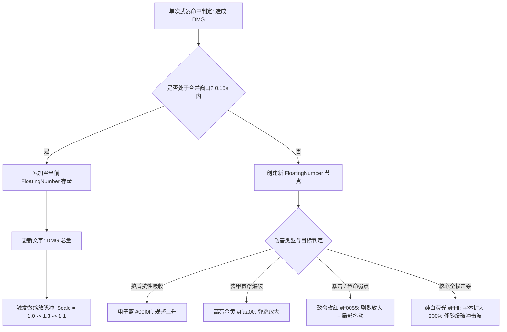

# 《游戏设计的236个技巧》深度蒸馏

> **知识定位**：操作感（Game Feel）与打击感绝非玄学，而是由严格的毫秒级帧数控制、物理动画插值、心理预期管理与视听多通道刺激构成的精确工程。大野功二在《游戏设计的236个技巧》（236 Game Design Techniques）中系统拆解了自任天堂（马里奥/塞尔达）、卡普空（生化危机）、索尼圣莫尼卡（战神）到白金工作室（猎天使魔女）等顶尖大作的实战技巧。本篇将其精萃蒸馏，并系统性赋能于 [[project-overview|大鲸鱼-深空放置]] 的战术推演、舰船交火与高密度终端交互。

---

## 结论先行

1. **打击感的本质是“破坏的阻力与能量传递”**：没有阻力就没有打击感。纯粹的数值跳动无法激发肉体共鸣；必须依靠**命中停顿（Hitstop / 冻结帧 3~8 帧）**、**受力主体微回缩与受体剧烈顿挫**、**非线性阻尼震屏（Trauma Shake）**三位一体，让玩家感知到武器切入护盾与装甲的物理实体感。
2. **输入缓冲（Input Buffer）是消除“操作便秘感”的生命线**：绝不能要求玩家在上一动作完全结束的 1 毫秒内按下下一指令。设置 6~12 帧（100~200ms）的指令预输入宽容队列，是区分粗糙半成品与工业级丝滑手感的分水岭。
3. **空间引导不是指路箭头，而是环境暗示（Subconscious Leading）**：一流的关卡设计师从不用突兀的 UI 罗盘生硬牵引玩家。通过**明暗照度对比（明处即安全/目标）**、**高低差视平线牵引**与**诱饵面包屑（Breadcrumb Trail）**，在潜意识层面诱导玩家视线流动。
4. **数字心理学重塑战斗心流**：高频小数字会制造视觉视觉垃圾（Cognitive Clutter），引发感知钝化。必须引入**伤害数字合并窗口（Damage Batching Window）**、**暴击字体弹簧缩放**与**四级色彩认知编码（护盾蓝/装甲黄/结构红/核心白）**。
5. **在放置/挂机类游戏中同样需要极致手感**：即使战斗由 AI 自动巡航解算，操作终端的“按键按下-触觉回弹-指令发射-高亮确认”依然遵循 236 技巧中的微操作感闭环，赋予舰长不可动摇的操控威严。

---

## 一、全书总览与微操手感拓扑架构

```
┌─────────────────────────────────────────────────────────────────────────────┐
│                 《游戏设计的236个技巧》微操手感与空间架构拓扑                 │
├─────────────────────────────────────────────────────────────────────────────┤
│ 1. 动作反馈与打击感物理学 (Game Feel & Impact Physics)                      │
│    - 动作三阶段：前摇预备 (Anticipation) ➔ 判定激活 (Active) ➔ 后摇硬直 (Recovery)  │
│    - 命中停顿 (Hitstop)：攻防双向帧冻结、局部时间膨胀 (Micro Slomo)        │
│    - 震动动力学：Trauma 创伤衰减模型、角位移衰减 vs 轴向抖动                │
│    - 输入宽容度：输入缓冲队列 (Input Buffering)、土狼时间 (Coyote Time)     │
├─────────────────────────────────────────────────────────────────────────────┤
│ 2. 空间引导与视觉认知心理学 (Spatial Navigation & Guidance)                 │
│    - 光影诱导：明暗对比法 (Chiaroscuro)、光源焦点吸引效应                   │
│    - 空间层级：高地制空优势、垂直落差心理学、纵深视平线暗示               │
│    - 诱饵链条：面包屑法 (Leading Items)、探索可见不可达诱饵                │
│    - 防遮挡机制：X-Ray 轮廓透视 (Silhouette)、镜头几何穿透剔除             │
├─────────────────────────────────────────────────────────────────────────────┤
│ 3. 运镜艺术与动态视角系统 (Dynamic Camera Architecture)                     │
│    - 运镜阻尼：弹簧-阻尼-质量模型 (Spring-Damper Model)、平滑追踪死区       │
│    - 视线留白：前置位移 (Lead Room)、朝向动态超前补偿                      │
│    - 动态广角：速度与焦距联动 (FOV Warping)、跃迁失真视差                  │
├─────────────────────────────────────────────────────────────────────────────┤
│ 4. 界面可读性与数字心理学 (UI Readability & Number Psychology)              │
│    - 认知负荷控制：视网膜焦点 2° 锥形区与周边视觉预警                        │
│    - 伤害数字流：高频飘字合流 (Damage Batching)、阶梯膨胀与衰减曲线         │
│    - 边缘警报：弧形边缘威胁雷达、直觉式血槽形变                             │
└─────────────────────────────────────────────────────────────────────────────┘
```

---

## 二、打击感核心机制的工程化解构

### 2.1 命中停顿（Hitstop / Hit Freeze）动力学

大野功二指出：打击感最致命的错误是“武器像划过空气一样穿过敌人物体”。当锋刃或激光命中高密度实体时，反作用力必然导致短暂的物理迟滞。

```mermaid
sequenceDiagram
    participant P as 攻击方 (舰船主炮/玩家)
    participant E as 空间物理引擎
    participant T as 被击目标 (敌舰/护盾)
    participant C as 渲染管线与摄像机

    Note over P,T: 阶段1: 前摇 (能量蓄力、导轨充能 300ms)
    P->>T: 阶段2: 弹道/激光击中判定 (Active Frame)
    rect rgb(30, 45, 60)
    Note over P,T: 阶段3: 命中停顿 (Hitstop: 冻结 4~8 帧 / 60~120ms)
    E-->>P: 攻击者局部动画速度降至 0.05
    E-->>T: 受击者完全静止并施加高光白闪 (Hit Flash)
    E-->>C: 触发微小视野抖动 (Micro Shake)
    end
    Note over P,T: 阶段4: 后摇与击退恢复 (Recovery: 抛洒残骸、护盾波动、冲量传递)
    P->>P: 散热喷气、后坐力复位
    T->>T: 舰体受冲击旋转、结构形变
```



#### 命中停顿的标准算法模型

$$T_{\text{hitstop}} = \text{BaseFrames} + \alpha \cdot \frac{\text{Damage}}{\text{TargetMaxHP}} + \beta_{\text{Crit}}$$

- **BaseFrames**：基础停顿帧数（轻型副炮为 2 帧，重型巡洋舰主炮为 6 帧，泰坦末日武器为 14 帧）。
- **攻防双向非对称冻结**：攻击方停顿 $T_{\text{attacker}} = 0.5 \cdot T_{\text{hitstop}}$，受击方停顿 $T_{\text{target}} = T_{\text{hitstop}}$。攻击方更早恢复行动，产生强烈的“挥洒自如与压制感”。
- **白闪高亮（Hit Flash）**：在停顿前 2 帧，受击部位网格着色器瞬间叠加纯白（RGB 1, 1, 1），将大脑视觉暂留激发至峰值。

### 2.2 屏幕震动的 Trauma 创伤衰减模型

简单粗暴地在 X/Y 轴施加随机数抖动只会导致玩家生理眩晕与低级塑料感。工业级规范采用基于 **Trauma（创伤值）** 的平方衰减非线性模型：

```
Trauma 累加:   Trauma = clamp(Trauma + impact_trauma, 0, 1.0)
震颤强度:       Shake = Trauma²   (或 Trauma³)
每帧衰减:       Trauma = max(0, Trauma - DecayRate · Δt)

位移计算:
OffsetX = MaxOffset · Shake · PerlinNoise(seed_x, t · Frequency)
OffsetY = MaxOffset · Shake · PerlinNoise(seed_y, t · Frequency)
RotationAngle = MaxAngle · Shake · PerlinNoise(seed_rot, t · Frequency)
```

- **为什么使用平方或立方？**：人类对震动感知是非线性的。微小伤害时 $0.2^2 = 0.04$ 产生几不可察的细腻微颤；而在战舰护盾爆裂的致命打击下 $0.9^2 = 0.81$，释放惊天动地的猛烈震荡，带来巨大的情绪冲击。
- **使用柏林噪声（Perlin Noise）替代单纯 Random**：保证抖动连续而有机，避免高频剧烈撕裂眼球。

### 2.3 动作前后摇与输入缓冲（Input Buffering）

```
[玩家按键输入] ──┐
                 ▼
[时间轴] ────|────[前摇 Anticipation]────|────[有效帧 Active]────|────[后摇 Recovery]────|────[空闲 Idle]
                                                                     ▲
                                                       [预输入缓冲窗口开启: 150ms]
                                                       (若在此窗口按下新指令，记录进队列)
                                                                     ▼
                                                       [动作结束瞬间无缝自动触发]
```

- **吞键灾难**：如果玩家在后摇期间（Recovery）按下“紧急过载维修”，系统若未开启预输入缓冲，由于当前状态机处于 `BUSY`，按键直接被丢弃。玩家会产生“按键坏了/游戏卡死了”的极大挫败感。
- **输入缓冲队列（Input Queue）**：保存最近 150ms 内的最新合法指令，在当前动画进入 Cancel Frame（取消窗口）或结束的瞬间立即消费执行。

---

## 三、空间引导、运镜与 UI 易读性心理学

### 3.1 空间关卡诱导三法则

1. **明暗法（Chiaroscuro Leading）**：
   - 黑暗深空中，玩家的视线本能被高对比度光源捕获。未开采的高丰度矿石小行星必须自带淡淡的脉冲冷光；被海盗设伏的废弃空间站则沉浸在暗影中，唯有一座应急停机坪闪烁红色航标灯，诱引玩家踏入猎杀陷阱。
2. **高低差暗示（Verticality & Horizon）**：
   - 高处代表“全知视野”与“战术制高点”；深谷与下陷代表“未知”、“幽闭”与“财富深渊”。在星图设计中，主星系核心位于上方中央亮区，海盗 0.0 黑域位于下方幽深旋臂。
3. **面包屑诱饵（Breadcrumb Trail）**：
   - 当指引玩家穿越超大空间尺度（如 100 AU 的深空暗区）时，不要使用一条呆板的直线导航线，而是在航道沿线布置一系列“空间残骸箱（Debris）”、“漂浮导航浮标（Beacon）”和“微型气体云”，让玩家在不断拾取/触发阶段性微小正反馈中不知不觉抵达终点。

### 3.2 镜头运镜阻尼与视线留白

- **弹簧阻尼追踪（Spring-Damper Camera Tracking）**：
  - 严禁镜头刚性绑定（Hard Attach）在战舰质心。必须使用二阶阻尼弹簧方程：
    $$\vec{F}_{\text{spring}} = -k \cdot (\vec{P}_{\text{cam}} - \vec{P}_{\text{target}}) - c \cdot \vec{V}_{\text{cam}}$$
  - 当战舰急转弯或启动加力燃烧时，舰体会先突破画面中心，镜头再柔和加速跟进，产生厚重的万吨星舰惯性质感。
- **视线留白（Lead Room / Look Ahead）**：
  - 战舰朝向右方高速巡航时，镜头必须自动向右前方向前置偏移 20%~30% 屏幕宽度，将未知星空展现在前进路径上，消除“撞向屏幕盲区”的局促不安感。

### 3.3 界面与伤害数字心理学

在高密度战场中，同屏可能有数十门火炮同时开火。如果每个 tick 都弹出一个 `+128`，屏幕将沦为数字雪崩，导致认知瘫痪。



- **伤害合并（Damage Number Batching）**：对于激光切割器或多联装近防炮等极高射速武器，开启 150ms 聚合窗口，将多次细碎伤害合并为一个不断跃动的总数字。
- **眼动疲劳防护（Color Noise Suppression）**：常规白字在命中后向上飘动 40px 后以 Alpha 线性衰减在 0.4s 内迅速消隐；唯有致命击杀与重度暴击才允许停留 1.0s 并伴随轻微缩放。

---

## 四、大鲸鱼项目落地映射实战架构

将《游戏设计的236个技巧》转化为《大鲸鱼-深空放置》的前端交互、战斗系统与星图模块的具体代码实现与设计规范。

### 4.1 战舰交火打击感三要素落地

在 `packages/renderer/combat/` 模块中实现标准打击感管线：

```typescript
// 舰船打击感调度器 (CombatFeelDispatcher.ts 架构示意)
export interface HitFeedbackConfig {
  damage: number;
  isCrit: boolean;
  targetLayer: 'shield' | 'armor' | 'hull';
  hitPosition: { x: number; y: number };
}

export class CombatFeelDispatcher {
  // 1. 命中停顿与全局微时间缩放
  public static triggerHitstop(config: HitFeedbackConfig): void {
    let freezeMs = 40; // 基础 40ms (~2.5 帧)
    if (config.targetLayer === 'armor') freezeMs = 80;
    if (config.targetLayer === 'hull') freezeMs = 120;
    if (config.isCrit) freezeMs += 60;

    // 局部冻结物理状态机更新
    GlobalPhysicsEngine.pauseTemporarily(freezeMs);
    
    // 受击者 Shader 白闪
    EffectPipeline.flashMeshWhite(config.targetLayer, freezeMs * 0.5);
  }

  // 2. 屏幕震动调度 (Trauma 模型)
  public static triggerScreenShake(config: HitFeedbackConfig): void {
    let traumaAdd = 0.15;
    if (config.targetLayer === 'hull') traumaAdd = 0.4;
    if (config.isCrit) traumaAdd += 0.3;

    CameraRig.addTrauma(traumaAdd);
  }

  // 3. 聚合伤害飘字
  public static emitDamageText(config: HitFeedbackConfig): void {
    DamageNumberBatcher.push({
      amount: config.damage,
      isCrit: config.isCrit,
      layer: config.targetLayer,
      pos: config.hitPosition,
    });
  }
}
```

### 4.2 0.0 无主之地星图探索：视线诱导与暗礁诱饵

在星图探索（Star Map Exploration）中，彻底淘汰传统游戏的大箭头导航，完全采用大野功二的关卡诱导机制：

```
┌─────────────────────────────────────────────────────────────────────────────┐
│                        0.0 星区暗礁诱导布局示意图                           │
├─────────────────────────────────────────────────────────────────────────────┤
│                                                                             │
│   [高安全度入口星门] (冷色柔光 3000K, 安定感)                               │
│           │                                                                 │
│           ▼ (虚线巡航航道)                                                  │
│      [明亮科研浮标] ──► [废弃小行星采矿哨站] (面包屑 1: 发现 500 钛矿)       │
│                                │                                            │
│                                ▼ (高对比度暗区)                             │
│                    [高辐射幽灵信号源] (微弱红光脉冲)                        │
│                                │ (诱饵：未鉴定的高级蓝图数据罐)             │
│                                ▼                                            │
│               【伏击暗礁：海盗巡洋伏击圈】 (视线死角盲区)                   │
│                                                                             │
└─────────────────────────────────────────────────────────────────────────────┘
```

- **诱饵与心理博弈**：漂浮在引力死角的数据罐释放微弱的雷达信号诱饵，诱导玩家主动跃迁至小行星背面；而小行星背面属于恒星阴影区，雷达散射截面极大，海盗截击舰便在此设伏，完全以环境几何实现战术诱导。

### 4.3 高密度 Sci-Fi HUD 防疲劳设计规范

为了在容纳 50+ 维度的战术仪表盘的同时避免视觉疲劳，严格落地 236 技巧中的界面心理学准则：

| 技巧要点 | HUD 设计方案 | 达成心理效果 |
| :--- | :--- | :--- |
| **色彩饱和度分级** | 80% 界面采用低纯度冷色系（暗蓝灰色、半透明灰），仅 20% 战术告警使用高饱和霓虹荧光（青、橙、品红） | 压制背景底噪，让玩家眼球自动巡航在关键异常状态 |
| **弧形三层核心仪表** | 战舰中控仪表摒弃生硬的长条形，改用环绕十字准心的半圆弧形光带（外环盾/中环甲/内环结构） | 人类周边视觉（Peripheral Vision）对弧线变化极其敏感，无需转移视线注视点即可感知血量暴跌 |
| **快捷指令输入缓冲** | 战术技能栏（超载推进/释放诱饵/电容过载）全部内置 200ms 输入缓冲与按键下压高亮态 | 杜绝玩家在危急跃迁时刻因微小手速偏差造成的“吞按键”，提供坚实的操作反馈信赖感 |
| **操作热区与边缘留白** | 移动端/高分屏视窗四周保留 48px 绝对无触控盲区，主要战术下发按钮集中在右下 90° 扇形 thumb-zone（大拇指舒适区） | 杜绝由于长时间悬空点击引起的肌肉疲劳，支撑连续挂机与微操 |

---

## 五、延伸阅读与知识网络关联

- [[art-of-game-design-schell|《游戏设计艺术》（第3版）核心精要]]：理解游戏四元法中技术与美学、机制的深层协同
- [[game-design-creativity-and-rhythm|《大师谈游戏设计：创意与节奏》]]：微操节奏如何编织成宏观心流波浪
- [[balance-master-game-economy|《平衡掌控者：游戏数值经济设计》全书精要]]：微观打击与战损如何转化为宏观物资损耗闭环
- [[project-overview|大鲸鱼-深空放置 战斗引擎与渲染基线]]：战斗管线与高密度 HUD 实现规范
