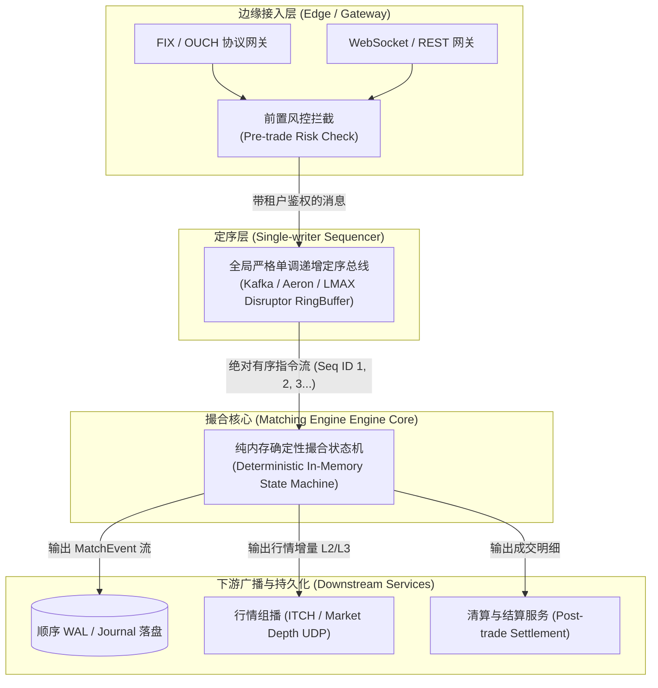
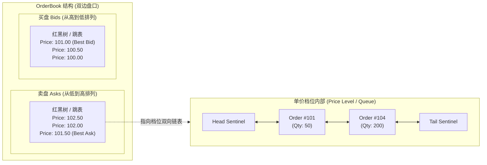
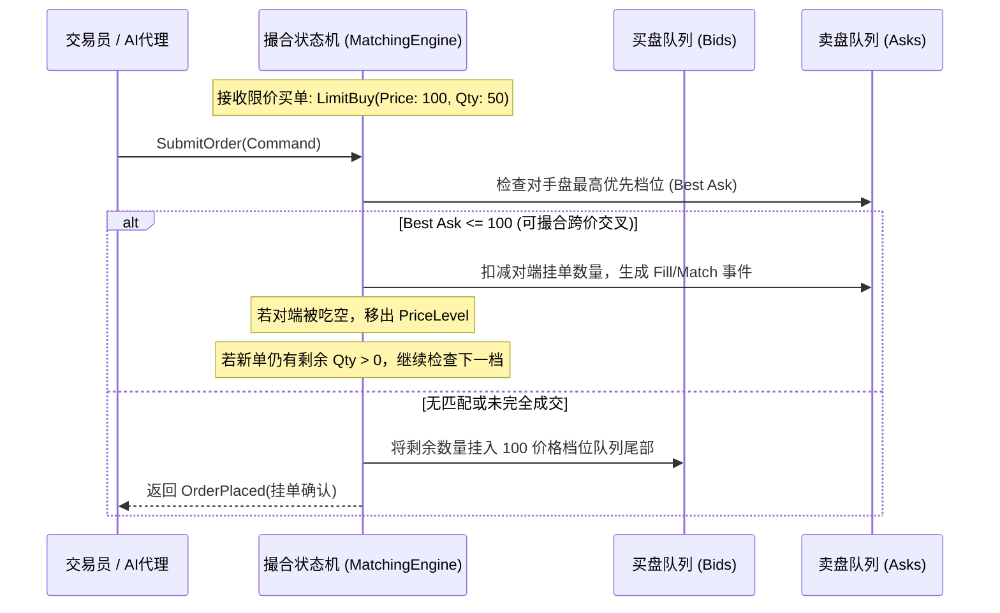
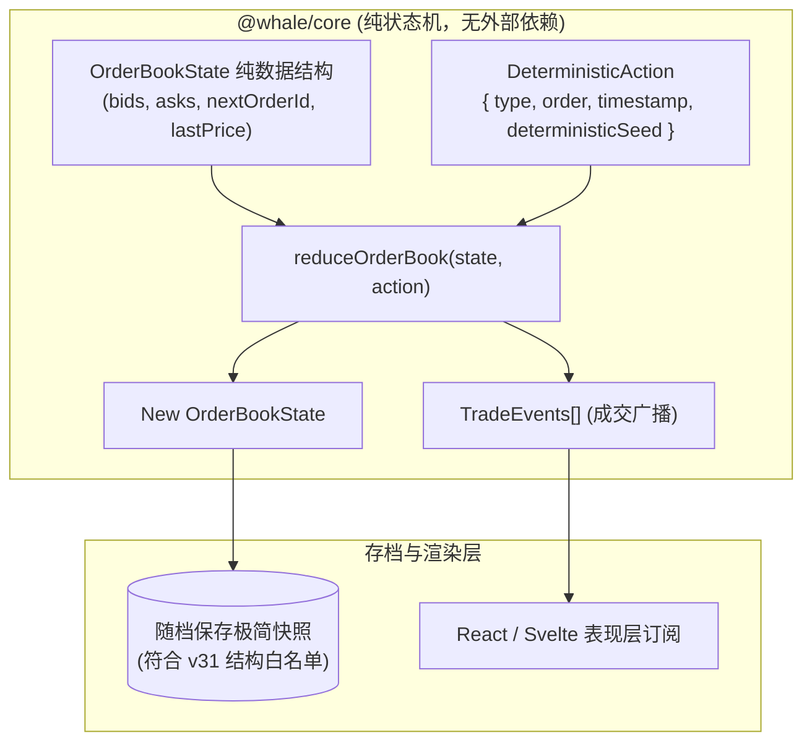

# 开源项目解构：intrepidkarthi/orderbook 高性能确定性撮合引擎

> 关联体系：[[whale-stock-market-architecture|证券交易所设计方案]] | [[save-architecture]] | [[verification-and-commit]]  
> 源码基线：`intrepidkarthi/orderbook` (Go 高性能、低延迟、确定性纯内存撮合系统)

---

## 一、真实世界交易所架构演进与重大事故复盘

金融交易系统的底层撮合引擎是人类计算机工程中对**吞吐量、纳秒级延迟与绝对确定性**要求最为严苛的软件系统之一。`intrepidkarthi/orderbook` 的技术文档深刻剖析了现代主流交易所的架构流派与历史血泪教训。

### 1.1 全球顶级交易所的系统拓扑流派



主流交易所的设计选型各有侧重：

1. **Nasdaq (纳斯达克)**：
   - 核心协议：**ITCH**（行情下行广播）与 **OUCH**（极简轻量下单协议）。
   - 架构理念：剥离一切复杂业务逻辑，撮合核采用单线程单核绑定（CPU Pinning）与旁路缓存优化，实现纳秒级执行。
2. **LMAX Exchange**：
   - 架构开创者：**LMAX Disruptor**。
   - 核心理念：摒弃线程池并发锁（Lock-free RingBuffer），采用**单写者模型（Single-Writer Principle）**。通过极度高效的 CPU 缓存行对齐（False Sharing Elimination），在普通 Java 堆内存上跑出了每秒 600 万笔订单的逆天吞吐。
3. **Binance (币安) & Coinbase**：
   - Coinbase 早期将订单直接写入 PostgreSQL 数据库，通过 `SELECT FOR UPDATE` 锁行撮合，在 2017 年牛市中引发灾难性雪崩，随后彻底重构为内存定序引擎。
   - 币安撮合引擎基于内存多副本集群，采用 Raft/PaxOS 共识前置定序，撮合结果单调输出，支撑数万亿美元加密货币流动性。
4. **IEX (投资者交易所)**：
   - 著名的“38 微秒物理减速带（Speed Bump）”：铺设 60 公里环形光纤延迟线，任何高频交易机构的订单必须经过物理延迟，消除了微波通信与机房托管带来的掠夺性跨市场套利（Front-running）。
5. **CME (芝加哥商品交易所) Globex**：
   - 衍生品领域霸主，撮合引擎具备极其严密的 FIFO 与 Pro-Rata（按持仓比例撮合）算法，并深度集成隐含订单（Implied Orders）跨合约自动衍生撮合。

---

### 1.2 历史重大事故复盘：血与泪重塑的拓扑原则

金融系统历史上因架构设计失误引发的灾难，为现代软件设计提供了极具价值的避坑准则：

#### 事故 1：Knight Capital 45 分钟亏损 4.4 亿美元（2012 年）
- **根因**：在新上线的自动化做市软件中，复用了已废弃 8 年的旧代码标志位（Power Peg）。8 台生产服务器中有一台未成功部署新代码。开盘后该节点旧代码被意外激活，进入失控死循环，在 45 分钟内执行了数百万笔无保护的逆势市价单，吃光市场流动性，公司直接宣告破产。
- **教训**：**死代码彻底物理清除**，禁止通过配置开关保留具备副作用的历史逻辑；严格的全集群原子化金丝雀部署；核心引擎必须具备硬性熔断阈值。

#### 事故 2：撮合队列队头阻塞（Head-of-Line Blocking）
- **现象**：当某一个大客户发送超大批量订单或无效格式包时，网关阻塞了单核撮合通道，导致正常玩家的取消订单无法及时送达，引发巨额滑点。
- **重塑设计**：**网关前置非阻塞排队 + 独立取消订单优先级通道**。撤单指令（Cancel Order）在定序总线上享有免除复杂风控检查的超车通道。

#### 事故 3：定序漂移（Sequencer Drift）与时间戳竞争
- **现象**：多线程或分布式节点依赖本地墙上时钟（Wall Clock），因 NTP 时钟回拨或时钟漂移，导致定序混乱，产生“回到过去成交”的时空悖论。
- **重塑设计**：**逻辑时钟取代物理时钟**。全局单调递增的 `SequenceNumber`（1, 2, 3...）成为唯一的因果律标准，物理时间戳仅作为元数据附带，绝不参与撮合优先级仲裁。

#### 事故 4：撮合引擎与账本状态脱节（Dual State Desynchronization）
- **现象**：撮合核心认为已成交，但落盘持久化失败；或者数据库事务回滚，内存状态未同步回滚，导致账户资金出现超额“空气币”。
- **重塑设计**：**以内存定序状态机为唯一事实来源（Single Source of Truth）**。持久化降级为日志复制（WAL），一切下游账本均由撮合引擎发出的单向不可变事件流（Event Sourcing）异步投递驱动。

---

## 二、从第一性原理讲订单簿：数据结构与撮合微观结构

`intrepidkarthi/orderbook` 的 `docs/LEARN.md` 详尽阐释了微观市场结构的基石。

### 2.1 订单簿底层数据结构：红黑树 + 双向循环链表

订单簿（OrderBook）必须支持两种维度的操作：
1. **寻找最优价格档位（Best Bid / Best Ask）**：需要极快的有序查找。
2. **在同一价格档位内排队**：严格遵守 **价格优先、时间优先（Price-Time Priority, FIFO）** 原则。
3. **取消订单（Cancel）**：根据 `OrderId` 实现 $O(1)$ 快速索引与剔除。



- **价格层（Price Level Map）**：使用有序映射（Go 中通常为 Red-Black Tree 或 B-Tree）维护所有报价档位，买盘按价格降序、卖盘按价格升序。最优盘口获取复杂度为 $O(1)$ 或 $O(\log N)$。
- **档位队列（Order Queue）**：每个价格节点内部持有一个双向链表。新订单追加到队尾（Tail）；撮合吃单从队首（Head）弹出。
- **全局订单哈希索引（Order Index Map）**：`map[string]*OrderNode`。使撤单操作可以在 $O(1)$ 时间内精准定位节点并切断双向指针完成剔除，避免遍历队列。

---

### 2.2 四大核心指令处理管线



1. **限价单（Limit Order）**：
   - 指定具体价格与数量。
   - 先探测对手盘最优档位（买单查 Asks，卖单查 Bids）。如果价格重叠，立即循环撮合成交并生成 `Trade` 事件；未成交部分以 FIFO 原则挂入本侧盘口。
2. **市价单（Market Order）**：
   - 不指定价格，要求按当前市场最优惠价格立刻成交全部数量。
   - 连续横扫对手盘档位（Sweep the Book），直至填满数量或流动性枯竭。未成交部分通常自动取消（IOC, Immediate-Or-Cancel）。
3. **取消单（Cancel Order）**：
   - 传入 `OrderId`。哈希表定位节点后，从双向链表中移除。若所在价格档位的队列为空，则从红黑树中剔除该价格节点。
4. **成交确认（Fill / Execution）**：
   - 计算成交价（以挂单方即 Maker 的价格为准），输出成交撮合对：`{ MakerOrderId, TakerOrderId, Price, Qty }`。

---

### 2.3 做市商微观结构模型：Avellaneda-Stoikov 数学原理

在真实交易所中，没有做市商（Market Maker, MM），订单簿就会是一滩死水（流动性枯竭）。
经典 **Avellaneda-Stoikov (2008)** 模型揭示了做市商如何在承担库存风险的同时提供买卖双边流动性：

#### 1. 预订价值（Reservation Price）计算：
做市商根据当前持有的资产库存量 $q$ 动态微调自身的心理锚定价格 $R$：

$$R(s, q, t) = s - q \cdot \gamma \cdot \sigma^2 \cdot (T - t)$$

- $s$：当前市场中间参考价（Mid-price）
- $q$：做市商当前库存数量（持有多头时 $q > 0$，持有空头时 $q < 0$）
- $\gamma$：做市商风险厌恶系数（Risk Aversion）
- $\sigma$：资产波动率
- $(T - t)$：交易时段剩余时间

> [!NOTE]
> **直观理解**：当做市商手里持有的多头库存过重（$q$ 很大）时，为了规避暴跌风险，做市商的预订价 $R$ 会主动下移，促使其**挂更低的卖价吸引买家帮其卸货，同时挂更低的买价减少进货**。

#### 2. 最优买卖差价（Optimal Bid-Ask Spread）：

$$\delta^a + \delta^b = \gamma \cdot \sigma^2 \cdot (T - t) + \frac{2}{\gamma} \ln\left(1 + \frac{\gamma}{\kappa}\right)$$

其中 $\kappa$ 为市场订单流到达强度参数。做市商据此在预订价上下分别悬挂买一（Bid）和卖一（Ask），赚取买卖点差（Spread）。

---

## 三、架构独立性：纯确定性状态机契约

`intrepidkarthi/orderbook` 架构最震撼的亮点在于**纯粹性（Purity）与确定性（Determinism）**。

### 3.1 消除一切非确定性副作用

现代高性能撮合引擎的核心被抽象为一个严格的纯数学状态机：

$$\text{State}_{n+1} = \mathcal{F}(\text{State}_n, \text{Command}_n) \longrightarrow \{\text{State}_{n+1}, [\text{Events}]\}$$

为了保证此方程在任何机器、任何时间运行均得到 100% 逐位相同的字节级结果，必须剔除所有外部隐式依赖：

| 非确定性诱因 | 传统编程陷阱 | 确定性状态机解决方案 |
|---|---|---|
| **物理时间** | 在撮合逻辑内调用 `time.Now()` / `Date.now()` | 严格禁止在内部取时钟！时间戳由定序网关在打包 Command 时显式传入。 |
| **随机数生成** | 随机生成撮合订单编号 | 使用确定性自增 ID 生成器（`SequenceID++`）。 |
| **异步并发竞争** | 在核心引擎内使用多线程读写状态 | 核心采用严格单写者（Single Writer），按定序流水线单线程串行处理。 |
| **网络与磁盘 I/O** | 撮合过程中触发数据库写、RPC 调用 | 撮合核心只在纯内存运行，执行完毕只输出不可变事件流，由下游异步处理 I/O。 |

这种绝对的确定性赋予系统无与伦比的能力：
1. **确定性审计回放（Deterministic Replay）**：任何故障发生时，只要导入初始快照和后续的 Command 日志流，就能在调试器中逐指令 100% 复现案发现场的每一个内存状态。
2. **零拷贝多副本灾备**：辅节点只需订阅主节点的指令流自行演进，主备状态永远毫厘不差，无需昂贵的分布式分布式锁。

---

## 四、可借鉴点与大鲸鱼落地实战

大鲸鱼（Deepseek-EVE）作为一款极其看重**离线计算一致性、读档白名单与纯本地确定性演化**的放置游戏（参见 `[[save-architecture]]` 和 `[[verification-and-commit]]`），该项目的架构模式堪称教科书级的参考蓝本。

### 4.1 packages/core 撮合引擎纯函数化设计

在大鲸鱼的单机架构下，我们完全不需要搞多节点网络定序，但必须坚持**核心演进与持久化彻底解耦**的架构契约：



### 4.2 离线计算与读档一致性保障

在 `[[save-architecture]]` 中，存档只保留最小化的运行时快照：
- **存盘内容**：仅需保存当前盘口的未成交订单（Bids / Asks 数组）与当前 `lastPrice`，不随档保存历史全量成交单。
- **离线回放**：当玩家离线一段时间重连时，如果需要模拟离线期间的市场撮合，核心必须使用**挂在 GameState 上的可序列化种子伪随机数发生器（PRNG）**，严禁使用 `Math.random()` 或物理 `Date.now()`！
- **杜绝走势分叉**：确保玩家在同一存档点读档 100 次，离线相同时间后看到的股票价格、盘口深度与成交结果永远严格一致。

### 4.3 适合放置类单机的轻量级 TS 订单簿实现

大鲸鱼不需要承载百万级的外部挂单，每只股票仅需维护 **5~10 档深度（买一~买五，卖一~卖五）**。我们可以用极其轻巧平整的 TypeScript 数组实现一个极简的高性能确定性撮合器：

```typescript
export interface Order {
  id: number;
  traderId: string; // "player" | "mm_bot" | "retail_ai"
  price: number;
  qty: number;
  side: 'buy' | 'sell';
}

export interface CompactOrderBook {
  symbol: string;
  lastPrice: number;
  bids: Order[]; // 按 price 降序排列 (买方)
  asks: Order[]; // 按 price 升序排列 (卖方)
}

export function executeLimitOrder(
  book: CompactOrderBook,
  newOrder: Order
): { filledQty: number; trades: Array<{ price: number; qty: number }> } {
  const trades: Array<{ price: number; qty: number }> = [];
  let remainingQty = newOrder.qty;

  const opponentQueue = newOrder.side === 'buy' ? book.asks : book.bids;
  const isMatchable = (oppPrice: number) =>
    newOrder.side === 'buy' ? newOrder.price >= oppPrice : newOrder.price <= oppPrice;

  // 1. 扫描对手盘吃单
  while (opponentQueue.length > 0 && remainingQty > 0 && isMatchable(opponentQueue[0].price)) {
    const oppOrder = opponentQueue[0];
    const tradeQty = Math.min(remainingQty, oppOrder.qty);
    const tradePrice = oppOrder.price; // Maker 价格优先

    remainingQty -= tradeQty;
    oppOrder.qty -= tradeQty;
    book.lastPrice = tradePrice;
    trades.push({ price: tradePrice, qty: tradeQty });

    if (oppOrder.qty <= 0) {
      opponentQueue.shift(); // 吃空该档出列
    }
  }

  // 2. 剩余数量若为限价挂单，插入对应队列保持有序
  if (remainingQty > 0) {
    const insertQueue = newOrder.side === 'buy' ? book.bids : book.asks;
    newOrder.qty = remainingQty;
    insertQueue.push(newOrder);
    // 按价格优先、插入顺序自然保持时间优先
    if (newOrder.side === 'buy') {
      insertQueue.sort((a, b) => b.price - a.price);
    } else {
      insertQueue.sort((a, b) => a.price - b.price);
    }
  }

  return { filledQty: newOrder.qty - remainingQty, trades };
}
```

- 该实现每毫秒可轻松执行上万次撮合，计算开销仅占几微秒，彻底免除了复杂链表指针开销，完美契合大鲸鱼对**高可靠、易调试、纯函数、零副作用**的工程审美。

---

## 五、架构借鉴总结

| 维度 | intrepidkarthi/orderbook 设计 | 大鲸鱼 (Deepseek-EVE) 落地契约 |
|---|---|---|
| **架构哲学** | 纯确定性内存状态机，外部事件溯源（Event Sourcing） | `packages/core` 纯逻辑化，输入确定则状态演化绝对确定 |
| **定序机制** | 单写者无锁定序总线（Single-Writer Disruptor） | 游戏主循环按帧串行步进，彻底避免时钟竞争 |
| **撮合模型** | 价格优先、时间优先（Price-Time Priority, FIFO） | 5 档精简限价/市价吃单撮合，提供真实买卖滑点 |
| **做市机制** | Avellaneda-Stoikov 库存风险最优价差定价 | 做市商 AI 机器人根据持仓库存与锚定值双边挂单 |
| **时间与随机** | 外部时间戳注入，拒绝系统随机数 | 状态机注入种子 PRNG，保证读档与离线演进 100% 可复现 |
