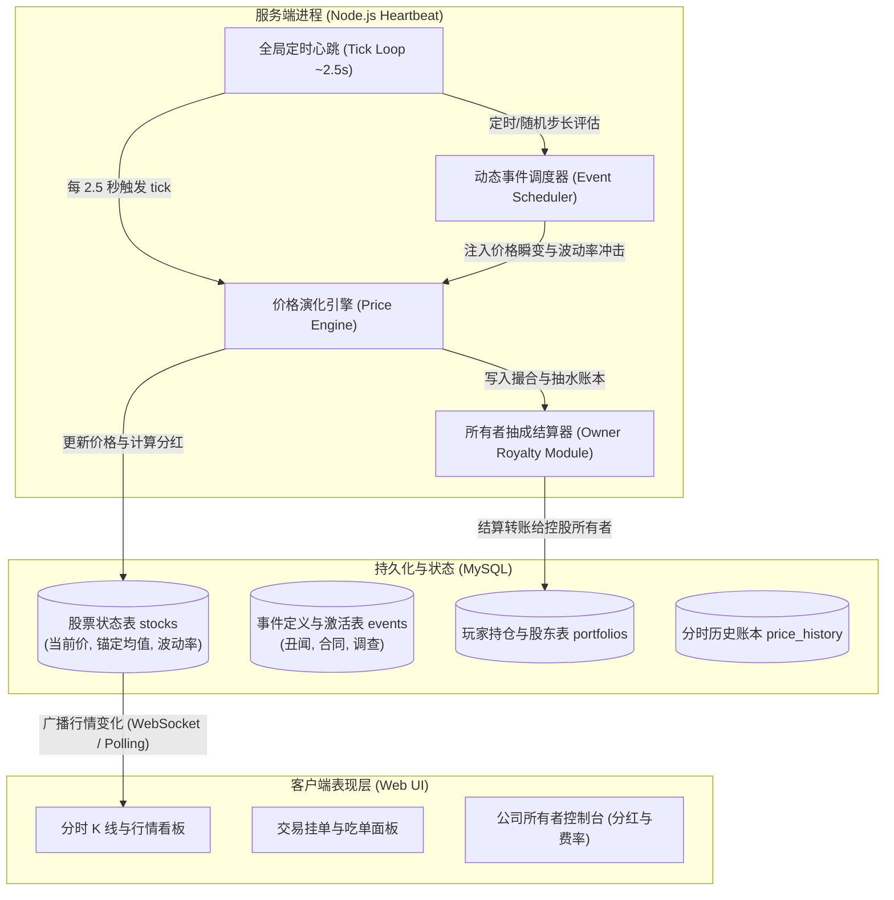
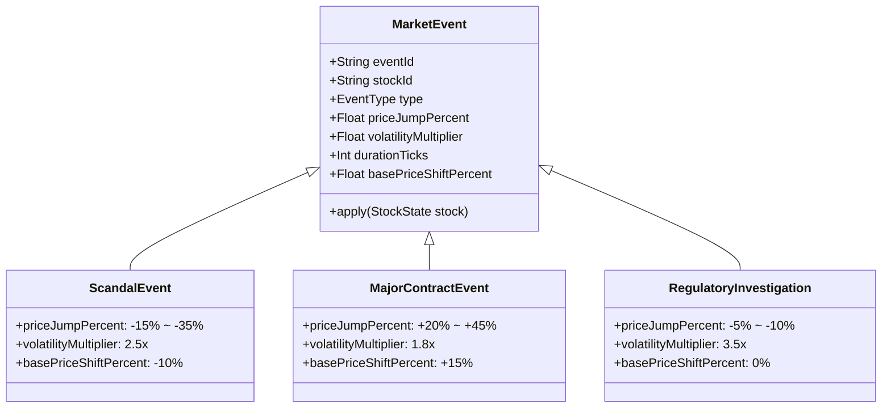
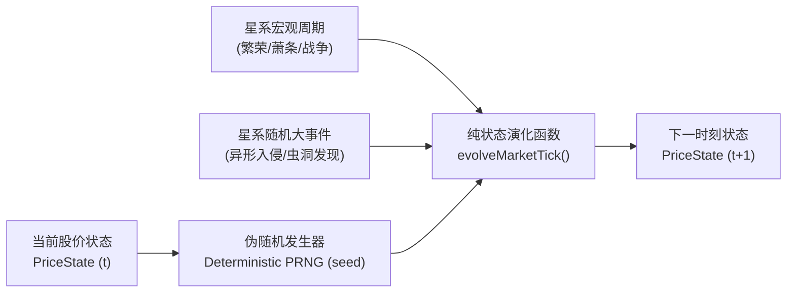

# 开源项目解构：LagBack/corleonemarket 实时模拟股市

> 关联体系：[[whale-stock-market-architecture|证券交易所设计方案]] | [[save-architecture]] | [[project-overview]]<br>
> 源码基线：`LagBack/corleonemarket` (Node.js + Express + MySQL / Real-time Virtual Stock Exchange)

---

## 一、项目技术栈与系统拓扑

`corleonemarket` 是一个经典的 Web 实时虚拟金融交易所系统，专为模拟一个具备自主演化能力的资本市场而设计。



### 1.1 系统核心边界与时钟粒度
- **心跳粒度**：服务端通过 `setInterval` 设定 ~2.5 秒（可配置 1s~5s）作为全局 **Tick Heartbeat**。每一个心跳代表一次离散时间步推进 $\Delta t$。
- **状态同步边界**：服务端将价格状态演进与用户下单解耦。价格在后台无休止自转，玩家提交的交易请求（买入/卖出）在当前 Tick 的瞬时价格快照下完成结算。
- **架构轻量性**：相较于高频撮合的微秒级引擎，该系统采用**基于宏观公式与事件调制的自律演化模型**，无需承担复杂的多方订单簿交叉计算开销，非常适合以拟真、轻快为核心诉求的模拟经营系统。

---

## 二、价格引擎机制：带均值回归的随机游走模型

纯粹的随机游走（Random Walk，如标准布朗运动）在游戏中存在致命缺陷：**无界发散或归零塌陷**。若没有向心约束，部分股票在经过几十万步演进后可能涨至天文数字，或者跌至无限接近于 0，破坏游戏经济平衡。

`corleonemarket` 采用了**离散化的 Ornstein-Uhlenbeck (O-U) 均值回归过程变体**：

### 2.1 数学动力学方程

$$P_{t+1} = P_t + \theta \cdot (\mu - P_t) \cdot \Delta t + \sigma \cdot \sqrt{\Delta t} \cdot \epsilon_t + J_t$$

各参数的金融物理意义如下：

| 参数 | 定义 | 物理意义与系统角色 |
|---|---|---|
| $P_t$ | 当前时刻股价（Current Price） | 当前市场交易价格 |
| $\mu$ | 内在锚定基准价（Intrinsic Base Price） | 企业的“重力中心”，代表公司基本面实际价值 |
| $\theta$ | 均值回归速率（Mean Reversion Speed） | 拉力系数（$\theta > 0$）。离 $\mu$ 越远，向心拉力越大 |
| $\sigma$ | 波动率（Volatility） | 市场随机噪声的扩散幅度 |
| $\epsilon_t$ | 标准正态分布随机数 $\sim \mathcal{N}(0, 1)$ | 模拟买卖微观噪声与情绪扰动 |
| $J_t$ | 突发事件跳跃项（Jump Component） | 由突发事件（丑闻、合同等）导致的非连续跳变 |

### 2.2 离散化演进伪代码

```typescript
interface StockState {
  id: string;
  price: number;        // 当前市价 P_t
  basePrice: number;    // 锚定均值 mu
  reversionRate: number;// 均值回归强度 theta (如 0.05)
  volatility: number;   // 波动率 sigma (如 0.02)
  minPrice: number;     // 兜底硬底线 (防止穿仓归零)
  maxPrice: number;     // 熔断硬顶线
}

function tickPrice(stock: StockState, eventImpact: number = 0): number {
  // 1. 计算均值回归向心漂移量
  const deltaDistance = stock.basePrice - stock.price;
  const drift = stock.reversionRate * deltaDistance;

  // 2. 生成正态分布白噪声 (Box-Muller 变换)
  const u1 = Math.random();
  const u2 = Math.random();
  const z0 = Math.sqrt(-2.0 * Math.log(u1)) * Math.cos(2.0 * Math.PI * u2);

  // 3. 随机扩散项
  const diffusion = stock.price * stock.volatility * z0;

  // 4. 合成新价格 (加入事件瞬态跳跃)
  let nextPrice = stock.price + drift + diffusion + eventImpact;

  // 5. 边界保护约束
  nextPrice = Math.max(stock.minPrice, Math.min(stock.maxPrice, nextPrice));
<br>
  return Number(nextPrice.toFixed(2));
}
```

> [!TIP]
> **均值回归的动态平衡之美**：<br>
> 当 $P_t > \mu$ 时，$(\mu - P_t) < 0$，漂移项为负，产生做空回踩拉力；<br>
> 当 $P_t < \mu$ 时，$(\mu - P_t) > 0$，漂移项为正，产生超跌反弹推力。<br>
> 这使得股票走势在宏观上始终围绕企业内在价值波动，具有极高的人类心理拟真感。

---

## 三、事件驱动体系：事件表与波动率冲击

在 `corleonemarket` 中，平稳的均值回归只是底色，**真正驱动玩家投机暴富与割肉踩踏的是离散事件系统**。

### 3.1 事件类型与影响模型



1. **企业丑闻（Scandal）**：
   - **机制**：触发时立即产生向下剧烈跳变（`priceJump = -25%`），同时临时下调锚定基准值 $\mu$，并将波动率 $\sigma$ 放大 2.5 倍，持续维持数十个 Tick。
   - **盘面表现**：断崖式跳空低开，随后伴随剧烈的高频上下震荡，散户恐慌抛售。
2. **重磅合同/利好商业突破（Major Contract / Acquisition）**：
   - **机制**：产生向上跳变（`priceJump = +30%`），同时永久或中长期提升企业内在基准价 $\mu$。
   - **盘面表现**：火箭式发射拉升，随后在新的高位形成平台整理。
3. **监管调查（Investigation / Audit）**：
   - **机制**：不显著改变基准价 $\mu$，但将波动率 $\sigma$ 提高 3~4 倍。
   - **盘面表现**：方向不明的巨幅洗盘，多空双杀，考验玩家的持股定力。

---

## 四、经济抽成与利益模型：公司所有者与分红

`corleonemarket` 极具特色的设计之一是**虚拟企业的产权归属与税收流转**：

### 4.1 交易流水分润（Transaction Fee Royalty）
- 每家上市企业均记录一个 `owner_user_id`（通常由拥有最多股份的玩家或设立公司的创始人担任）。
- 玩家向该股票发起买入或卖出时，系统扣除固定比例（例如 1.5%）的交易手续费。
- **抽水流向切分**：
  - 50% 作为系统货币回收（Sink，抑制通胀）；
  - 50% 自动打入该公司的「所有者专属资金池」或直接转入 `owner` 的账户。

### 4.2 股息分红（Dividend Distribution）
- 公司账户可设定「留存公积金」与「分红池」。
- 当公司盈利（或累计抽水）达到门槛时，控制人或系统定时触发**全员分红**：
  $$\text{Payout}_i = \text{DividendPool} \times \frac{\text{Shares}_i}{\text{TotalShares}}$$
- 这一机制激励了玩家去争夺控股权，将单纯的二级市场炒作升华为**对优质资产现金流控制权的股权争夺战**。

---

## 五、可借鉴点与大鲸鱼落地实战

大鲸鱼宇宙拥有深厚的星际探索与重工业背景，`corleonemarket` 的机制对于大鲸鱼具有极佳的落地契合点。

### 5.1 打造“会自己呼吸的确定性价格引擎”

在大鲸鱼的单机离线架构契约（参见 `[[save-architecture]]`）中，我们不能运行沉重的真实高并发数据库。我们可以借鉴 `corleonemarket` 的动力学方程，将其封装为一个**纯函数式的确定性演进时钟**：



- **离线快进演化**：当玩家离线 8 小时重连时，核心引擎只需利用确定性伪随机数发生器（PRNG），根据离线经过的 Tick 步数，快速矩阵运算迭代计算出最新的股价和 K 线折线点，性能损耗几乎为零！
- **向心拉力防止经济崩盘**：游戏中的矿产公司、造船厂股票通过设定合理的基准均值 $\mu$，无论玩家如何炒作，都会在大周期上回归工业基本面，彻底避免由于数值失控导致玩家几百亿资产凭空蒸发或通胀爆炸。

### 5.2 星系大事件与企业事件表的双向打通

将大鲸鱼星系的动态玩法直接挂钩到股票事件系统：

| 大鲸鱼星系事件 | 关联股票标的 | 价格与基准价冲击 | 机制反馈 |
|---|---|---|---|
| **边境星门遭受海盗封锁** | `猎户座跃迁物流 (OJLS)` | 价格瞬跌 -20%，基准 $\mu$ 下调 10%，持续 300 步 | 物流成本增加，玩家可做空或在底部抄底 |
| **爆发星系级异形战争** | `西斯玛特重工 (SMHI)`<br>`铁穹军械联合体 (ICAC)` | 价格跳涨 +35%，波动率 $\sigma \times 2.0$ | 军火订单爆满，重工企业分红翻倍 |
| **探明高富矿虫洞空间** | `泛星系联合矿业 (UGMC)` | 基础均值 $\mu$ 永久性提升 +15% | 稀缺原材料供给增加，压低精炼成本 |
| **玩家批量向空间站倾销矿石** | `泛星系联合矿业 (UGMC)` | 价格瞬间砸盘 -8%（玩家行为冲击） | 真实展现玩家资本体量对盘面的影响力 |

### 5.3 势力交易税与股东分红的大鲸鱼落地

大鲸鱼可在 `packages/core` 中引入**控股特权与分红账本**：
1. **势力印花税分成**：当玩家在二级市场吸筹，持有某上市公司（如 `西斯玛特重工`）超过 10% 股份时，玩家自动获得该企业对应势力空间站船坞制造手续费的 5% 作为分红。
2. **董事会战略席位**：
   - 持股达到 20% 时，该企业的专属装备蓝图制造耗时缩短 10%；
   - 定期直接通过游戏内邮件向玩家发放信用点现金股息，让玩家体验成为“星际企业巨头”的被动收入快感。

---

## 六、架构借鉴总结

| 架构维度 | LagBack/corleonemarket 实现 | 大鲸鱼 (Deepseek-EVE) 适配选型 |
|---|---|---|
| **时钟机制** | 服务端 2.5s 定时器心跳 | 核心引擎 `tick()` 循环统一驱动（支持离线确定性步进） |
| **定价模型** | 离散 O-U 均值回归随机游走 | 带工业基本面锚定与玩家资金冲击因子的 O-U 模型 |
| **事件触发** | 随机数定时抽样事件表 | 与星系星图大事件、虫洞刷新及玩家批量工业行为联动 |
| **商业抽水** | 公司所有者固定手续费抽成 | 势力交易税减免、董事会分红池与特权装备制造解锁 |
| **数据持久化** | MySQL 关系型数据库 | 随档保存极简状态快照（符合 `[[save-architecture]]`） |
