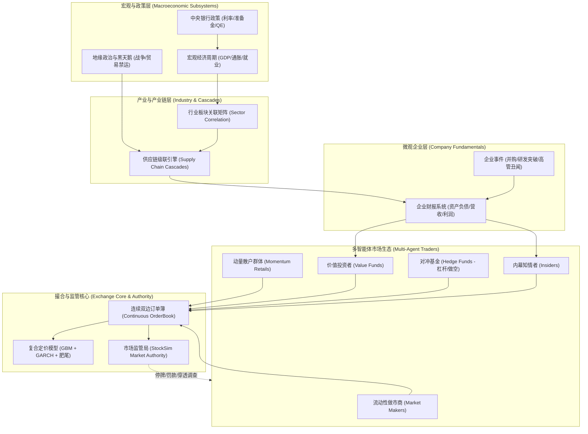
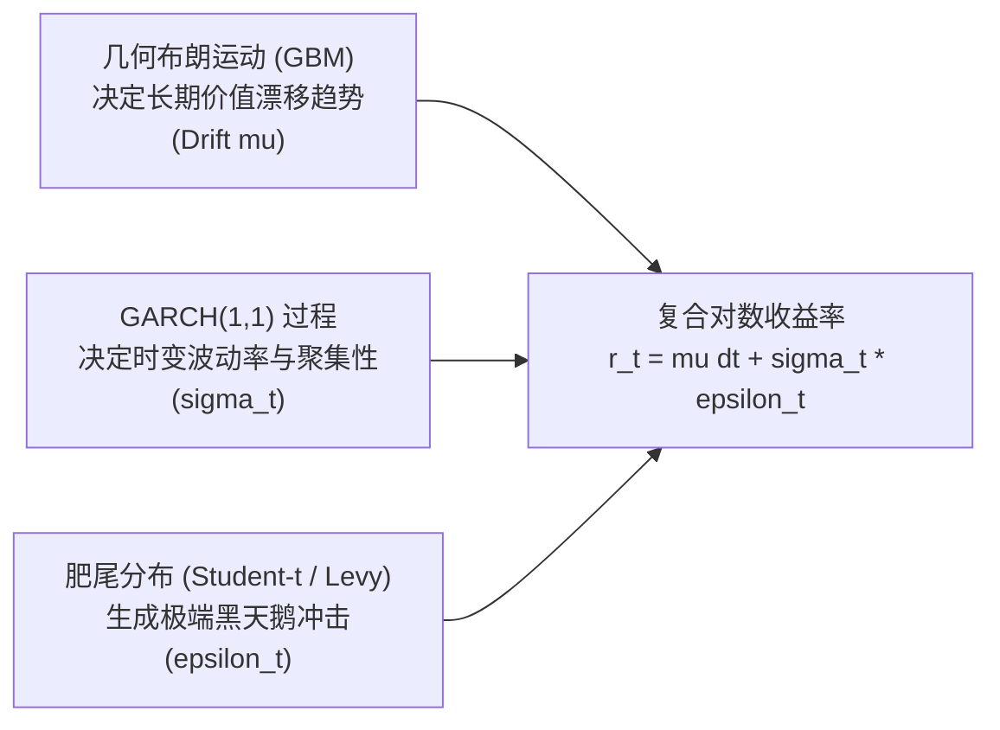
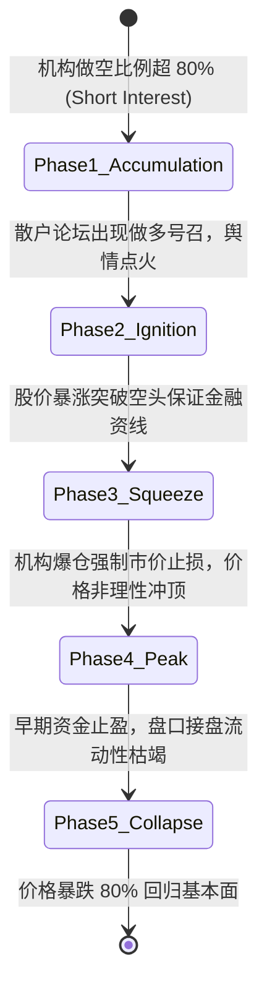
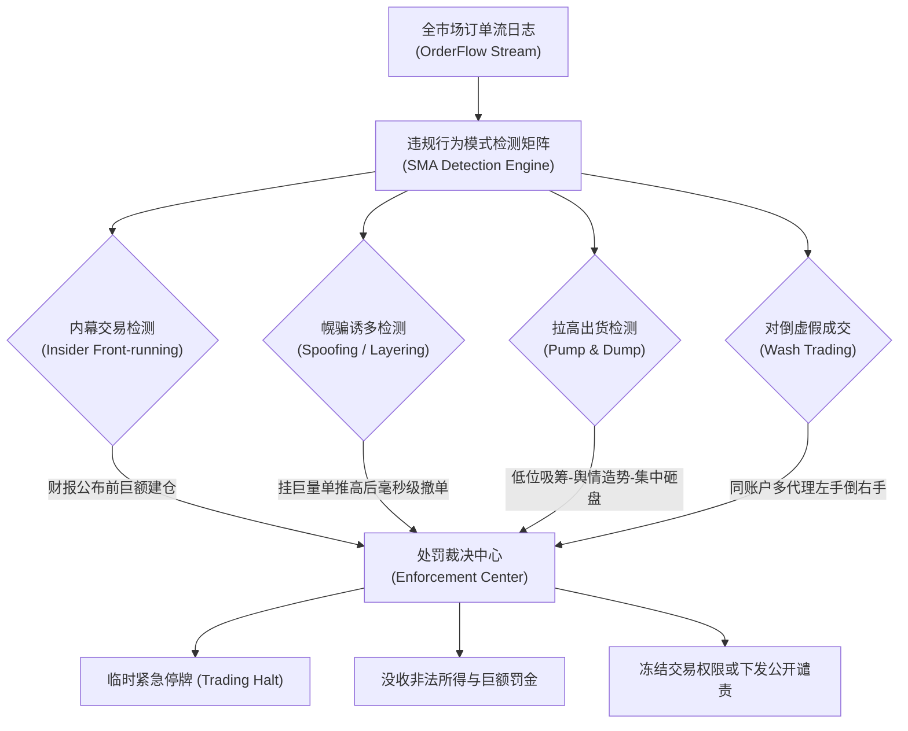
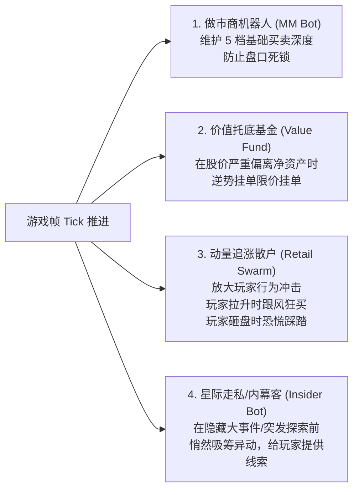

# 开源项目解构：Tschonsen/StockSim 宏大拟真股市模拟器

> 关联体系：[[whale-stock-market-architecture|证券交易所设计方案]] | [[lagback-corleonemarket]] | [[intrepidkarthi-orderbook]]<br>
> 源码基线：`Tschonsen/StockSim` (C# .NET Core + Electron / React 宏观多智能体金融模拟器)

---

## 一、18 大子系统交互架构

`StockSim` 是目前开源界在微观市场结构与宏观经济建模结合上最为宏大的金融模拟项目之一。它并非简单的折线图随机数生成器，而是构建了一个具备**宏观政策传导、产业上下游协同、多智能体盘口博弈与监管审查**的完整有机生命体。



### 1.1 系统职能划分概览（18 大子系统精要）
1. **宏观经济周期引擎**：控制繁荣、衰退、萧条、复苏四阶段轮动。
2. **央行货币政策模拟器**：根据泰勒规则（Taylor Rule）升降息，直接影响全市场无风险贴现率。
3. **通胀与劳工指数**：影响大宗商品定价与企业生产成本。
4. **行业板块关联矩阵**：定义 12+ 行业间的输入输出敏感度。
5. **供应链级联传播网**：上游供应断裂沿产业树逐级向中下游传导。
6. **企业财务报表生成器**：定时生成资产负债表、现金流量表与利润表。
7. **研发与专利转化系统**：研发投入沉淀为无形资产，概率性爆发技术突破。
8. **高管与治理画像**：CEO 风险偏好指数影响公司杠杆与扩张决策。
9. **新闻情绪舆情引擎**：NLP 情感打分（-1.0 ~ +1.0），直接驱动散户 FOMO 情绪。
10. **多智能体决策网络**：驱动 14 类交易者自主感知与下单。
11. **连续双边撮合订单簿**：处理市价、限价、止损单与挂单排队。
12. **复合随机定价引擎**：在订单簿稀疏时提供数学自洽的价格边界约束。
13. **信用与杠杆配资系统**：管理保证金、维持担保比例与强制平仓（Margin Call）。
14. **融券与做空池**：提供可借券库存与借券利息计算。
15. **迷因股网络病毒传播器**：模拟散户论坛上的集中抱团与多头号召。
16. **市场监管局（SMA）**：实时监测异常交易量、操纵盘口行为并执行制裁。
17. **股息分红与再投资系统**：派发股利并自动驱动长线基金再投资。
18. **清算交割总账本**：T+0 / T+2 资产交割与穿仓风险兜底。

---

## 二、复合定价引擎（Hybrid Pricing Engine）：GBM + GARCH + 肥尾分布

纯随机定价（标准几何布朗运动 GBM）假设资产对数收益率服从正态分布，无法解释真实金融市场中的两大核心异象：**波动率聚集（Volatility Clustering）** 与 **极端行情的肥尾效应（Fat-Tailed Black Swans）**。

`StockSim` 设计了三位一体的复合定价模型：



### 2.1 数学公式体系

#### 1. 资产价格几何演变
$$S_t = S_{t-1} \cdot \exp\left( \left(\mu - \frac{1}{2}\sigma_t^2\right)\Delta t + \sigma_t \sqrt{\Delta t} \cdot Z_t \right)$$

- $\mu$：企业内在增长漂移率（受财报与宏观周期驱动）。
- $\sigma_t$：$t$ 时刻的**条件时变波动率**。
- $Z_t$：从**自由度 $\nu$ 的学生 $t$-分布（Student's $t$-distribution）** 中采样的随机扰动（具有重尾特征，$\nu \approx 4\sim 6$）。

#### 2. 时变条件方差 GARCH(1,1) 方程
$$\sigma_t^2 = \omega + \alpha \cdot \epsilon_{t-1}^2 + \beta \cdot \sigma_{t-1}^2$$

- $\omega > 0$：长期方差基准常数。
- $\alpha$：ARCH 项系数（衡量新信息、突发事件对波动的冲击程度）。
- $\beta$：GARCH 项系数（衡量波动的持续性/记忆深度）。约束条件：$\alpha + \beta < 1$ 保证过程协方差平稳。

> [!NOTE]
> **波动率聚集效应**：<br>
> 一旦市场发生剧烈震荡（$\epsilon_{t-1}^2$ 极大），$\sigma_t^2$ 将在未来多期内维持高位，形成“大波动跟随大波动、平静期跟随平静期”的真实股市心理体验。

---

## 三、14 类 AI 交易者画像：生机勃勃的微观市场生态

在 `StockSim` 中，盘口深度并不是静态写死的，而是由不同投资哲学的 AI 智能体根据自身效用函数实时博弈形成的：

```mermaid
graph TD
    Market["交易所订单簿"]
<br>
    subgraph LiquidityProviders["流动性提供者 (Maker)"]
        MM["做市商 (Market Maker)\n双边挂单，吃买卖价差"]
        Scalper["高频黄牛 (HFT Scalper)\n极短周期剥头皮，毫秒撤单"]
    end

    subgraph Institutional["机构资金 (Institutional)"]
        ValueFund["价值基金 (Value Investor)\n锚定基本面，低估买/高估卖"]
        HedgeFund["对冲基金 (Hedge Fund)\n多空对冲，严格执行 VaR 止损"]
        IndexFund["被动指数基金 (Passive ETF)\n定期机械再平衡"]
    end

    subgraph RetailSpeculators["散户与游资 (Speculators)"]
        TrendFollower["趋势跟踪者 (Trend Follower)\n突破均线追涨，跌破止损"]
        RetailFOMO["跟风散户 (FOMO Retail)\n受新闻舆情与暴涨刺激涌入"]
        PanicSeller["恐慌抛售者 (Panic Sellers)\n破位瞬间市价砸盘踩踏"]
        Contrarian["逆向抄底客 (Contrarian)\n专门左侧博超跌反弹"]
    end

    subgraph DarkForce["特殊力量 (Asymmetric Force)"]
        Insider["内幕知情者 (Insider Trader)\n财报前潜伏建仓"]
        Whale["超级巨鲸 (Market Whale)\n大额资金强行拉盘/砸盘"]
        MemeArmy["迷因军团 (Meme Squad)\n论坛协同集中轧空"]
    end

    LiquidityProviders <--> Market
    Institutional <--> Market
    RetailSpeculators <--> Market
    DarkForce <--> Market
```

### 14 类交易代理决策特征清单

| 角色分类 | 代理类型 | 决策逻辑与触发阈值 | 市场角色与行为表现 |
|---|---|---|---|
| **流动性类** | 1. 做市商 (Market Maker) | 运行 Avellaneda-Stoikov 模型，双向挂出最优买卖单 | 提供流动性底盘，平抑过度的微观跳空 |
| | 2. 剥头皮高频客 (Scalper) | 监测买卖盘口量不平衡（Order Imbalance），抢前挂单 | 压窄买卖价差（Spread），快速自平仓 |
| **机构类** | 3. 深度价值投资者 (Value) | 计算 DCF 折现模型与每股净资产（NAV），当市价折价 >20% 时分批买入 | 市场底部的坚定托底力量，抑制暴跌泡沫 |
| | 4. 宏观对冲基金 (Hedge) | 跟踪行业指数与无风险利率，动态使用杠杆多空对冲 | 市场行情的加速器，当 VaR 超标时强制平仓 |
| | 5. 被动指数基金 (ETF) | 每周固定时间按照市值加权买卖对应标的 | 产生确定性时间窗口的被动流动性冲击 |
| **散户游资** | 6. 动量追涨者 (Momentum) | 计算过去 20 步收益率，若斜率向上则市价单买入 | 追涨杀跌，制造价格中短期动量与超买 |
| | 7. 均线交叉客 (Technical) | 监控 MA5 与 MA20 金叉/死叉 | 在经典技术形态位形成自实现预言（Self-fulfilling） |
| | 8. 舆情跟风散户 (Retail) | 读取社交舆情指数，当情感偏向极度亢奋时全仓买入 | 产生暴涨尾声的非理性泡沫与接盘狂潮 |
| | 9. 恐慌踩踏散户 (Panic) | 浮亏达到 15% 时触发绝对止损，不计成本市价市价单抛出 | 制造流动性黑洞与闪崩（Flash Crash） |
| | 10. 逆向左侧抄底客 (Contrarian) | RSI 指标低于 20 时反向买入 | 减缓市场恐慌下挫速度 |
| **非对称类** | 11. 内幕知情者 (Insider) | 提前 N 步得知下一季度财报或重组消息，小单吸筹 | 导致重大新闻公布前股价悄然异动 |
| | 12. 资本巨鲸 (Whale) | 单笔资金超过盘口总深度的 30%，强行吃空卖盘 | 产生巨额滑点，引发全市场跟风或做空博弈 |
| | 13. 迷因抱团散户 (Meme Army) | 协同攻击高做空比例股票，只买不卖，锁死流通盘 | 触发机构空头强制平仓与轧空行情 |
| | 14. 恶意操纵者 (Manipulator) | 实施幌骗（Spoofing）与拉高出货（Pump & Dump） | 制造虚假盘口深度诱多，最后高位出逃 |

---

## 四、供应链事件级联（Supply Chain Cascades）

现实商业社会中，单一企业的变故绝非孤立事件。`StockSim` 构建了**产业拓扑有向无环图（DAG）**，以模拟事件沿产业链的级联传导：

```mermaid
flowchart TD
    Upstream["上游：稀土矿难 / 钛矿开采基地停产\n(供给短缺 +50%, 现货原料价暴涨)"]
<br>
    Midstream1["中游：曲率引擎精炼厂\n(原材料成本激增，毛利率从 35% 跌至 8%)"]
    Midstream2["中游：高分子装甲锻造厂\n(缺料减产，交付周期延长 180 天)"]

    Downstream1["下游终端：西斯玛特重工战舰总装\n(战列巡洋舰产线停工，违约罚金引发季度巨亏)"]
    Downstream2["下游终端：猎户座星际货运\n(新货船无法按期扩容，运力运费被迫上涨)"]

    Upstream -->|"成本压力传导 (Beta = 0.7)"| Midstream1
    Upstream -->|"缺料停产传导 (Beta = 0.85)"| Midstream2
    Midstream1 -->|"核心零部件断供 (Beta = 0.9)"| Downstream1
    Midstream2 -->|"装甲短缺 (Beta = 0.6)"| Downstream1
    Downstream1 -->|"运力供给萎缩"| Downstream2
```

### 4.1 级联传导方程
对处于供应链下游的企业 $j$，其受到的级联冲击向量 $\Delta C_j$ 计算如下：

$$\Delta C_j = \sum_{i \in \text{Upstream}(j)} W_{ij} \cdot \text{Shock}_i \cdot \text{Elasticity}_{ij}$$

- $W_{ij}$：企业 $i$ 占企业 $j$ 生产总成本的权重比例。
- $\text{Shock}_i$：上游企业经历的负面事件严重度（0.0 ~ 1.0）。
- $\text{Elasticity}_{ij}$：该原材料的可替代性弹性系数（若为专属垄断材料，弹性极低，冲击放大）。

---

## 五、迷因股轧空（Meme Stock Short Squeeze）五阶段模型

`StockSim` 完美复刻了类似现实中 2021 年 GameStop (GME) 轧空散户起义的微观生命周期：



1. **第一阶段：潜伏期（Accumulation & Short Overhang）**
   - 某落后周期企业基本面持续恶化，机构对冲基金大举借券做空，空头仓位占流通盘（Short Interest）超过 80%~100%。市场盘口下行阴跌，流动性极度枯竭。
2. **第二阶段：点火期（Ignition & Sentiment Spike）**
   - 散户论坛或特定领袖发出号召，指出该股票存在理论上的“轧空可能（Squeeze Potential）”。大量散户开始用**小额、持续不断的市价买单**扫货，推高股价 30%~50%。
3. **第三阶段：轧空爆发期（The Short Squeeze Explosion）**
   - 股价突破机构空头的维持保证金阈值，券商向对冲基金发出催缴令（Margin Call）。由于无法补交信用点，对冲基金的空头仓位被**强制平仓**。
   - **空头平仓的实质是“不计代价以市价买入”**，这一巨量买盘瞬间与散户的买单汇聚成正反馈海啸，价格呈对数级垂直暴涨 300%~1000%。
4. **第四阶段：登顶狂欢（FOMO Peak & Liquidity Abyss）**
   - 盘面上所有的做空机构全部被剿灭爆仓，市场上已经没有任何理性的卖方挂单，卖盘深度只剩下天价挂单，换手率超过 100%。
5. **第五阶段：崩盘塌陷（Collapse & Mean Crash）**
   - 早期潜伏的游资与巨鲸清仓获利了结，散户后继买力耗尽。因为没有机构愿意承接这只垃圾资产，买盘瞬间出现数十档真空断层，股价发生雪崩式连续跌停，在数个交易日内跌去 85%，重回基本面。

---

## 六、市场监管系统（StockSim Market Authority, SMA）

真实金融体系之所以不会沦为彻底的赌场，关键在于强大的穿透式监管防线。`StockSim` 内置了一个独立的监管分析进程：



### 6.1 四大典型操纵手法的检测判据

1. **幌骗（Spoofing）检测**：
   - **行为特征**：在盘口挂出占买一~买三总量 40% 以上的虚假大额买单，给市场制造买盘极其坚挺的假象；一旦其他散户跟风买入推高价格，在成交前 50 毫秒内瞬间全额撤单，并在对侧卖盘完成高位出逃。
   - **判定算法**：$\text{CancelRatio} > 95\%$ 且 $\text{AverageOrderLifetime} < 200\text{ms}$，直接打上 Spoofing 嫌疑标签。
2. **拉高出货（Pump & Dump）检测**：
   - **行为特征**：单一资金体量在低位密集隐蔽吸筹，随后通过连续市价单暴力拉高突破，在舆情爆发最高点一次性巨额砸穿买盘清仓。
   - **判定算法**：监控账户的净持仓变化与价格波动相关性，若相关系数 $> 0.85$ 且换手时间跨度极短，触发立案。
3. **洗盘与对倒交易（Wash Trading）**：
   - 监测交易对手方是否最终指向同一受益人（Beneficial Owner），禁止自买自卖虚增交易量吸引外部投资者。

---

## 七、可借鉴点与大鲸鱼落地实战

`StockSim` 的体系宏伟庞大，但如果在单机网页/轻量客户端中原样搬运 18 个子系统和 14 类 AI，会导致 CPU 算力爆炸与存档膨胀。大鲸鱼（Deepseek-EVE）必须进行**精妙的架构轻量化剪裁（Pruning & Distillation）**。

### 7.1 大鲸鱼产业事件轻量级矩阵传导设计

大鲸鱼宇宙天然具备四大陆军与重工业板块（参见 `[[whale-stock-market-architecture|证券交易所设计方案]]`）：
1. **军工与重工板块**（西斯玛特重工、铁穹军械）
2. **采矿与能源板块**（泛星系联合矿业、虚空星火精炼）
3. **航运与物流板块**（猎户座跃迁物流、星门保税仓储）
4. **高新科研板块**（晨曦仿生智能体、深空异象观测所）

我们可以在 `packages/core` 中引入一个轻量级的 **$4 \times 4$ 板块敏感度静态传导矩阵**：

$$\begin{pmatrix} \Delta S_{\text{军工}} \\ \Delta S_{\text{采矿}} \\ \Delta S_{\text{物流}} \\ \Delta S_{\text{科研}} \end{pmatrix} = \begin{pmatrix} 1.0 & -0.3 & 0.4 & 0.2 \\ 0.5 & 1.0 & -0.2 & 0.1 \\ -0.4 & 0.6 & 1.0 & -0.1 \\ 0.3 & 0.2 & 0.3 & 1.0 \end{pmatrix} \times \begin{pmatrix} I_{\text{战争强度}} \\ I_{\text{矿产丰度}} \\ I_{\text{星路通畅度}} \\ I_{\text{虫洞突破}} \end{pmatrix}$$

- 当星系爆发全面战争时，$I_{\text{战争强度}} = 1.0$：
  - 军工重工立即获得 $+1.0$ 的强劲向上动能；
  - 物流运输受到负面冲击（$-0.4$），因为货船可能被掠夺；
  - 采矿业需求激增（$+0.5$），因为制造战舰需要大量精炼金属。
- 这种矩阵乘法在 TypeScript 中只需几微秒即可算完，却能让玩家深刻感受到**整个星系大事件在全产业链间的蝴蝶效应**！

### 7.2 核心 AI 交易代理四合一轻量精简

大鲸鱼无需模拟 14 类代理，只需提炼出 **4 类核心人格角色**，以纯函数方式嵌入游戏的主循环步进：



- **给玩家带来“资本大鳄”的无上快感**：当玩家手握几十亿信用点时，玩家进场市价狂扫某只股票，不仅吃光卖一卖二，还会立即触发 **Retail Swarm（散户群）** 的跟随买盘，形成玩家一己之力拉出“涨停板”的巨大爽感！

### 7.3 玩家扮演“深空索罗斯”：轧空与星际金融管理局（GSEC）

大鲸鱼可以在玩法层深度引入轧空与监管博弈：
1. **轧空特殊战役**：
   - 当海盗势力在暗中大举做空某家航运公司时，玩家可以通过控制原材料供应链拉高股价，触发海盗资金链断裂强制平仓，一举洗劫海盗资本。
2. **星际金融管理局（GSEC）审查**：
   - 如果玩家恶意通过超高频挂单/撤单拉爆盘口，GSEC 会向玩家下达调查令，暂停该股票交易 5 分钟，或要求玩家缴纳 5% 的反垄断调节金。这一机制既符合科幻世界观，又优雅限制了玩家无限刷钱的作弊漏洞。

---

## 八、三大开源项目全景横向对照

| 考量维度 | LagBack/corleonemarket | intrepidkarthi/orderbook | Tschonsen/StockSim | 大鲸鱼 (Deepseek-EVE) 最终融合路线 |
|---|---|---|---|---|
| **核心定位** | Web 实时虚拟股市 | 高性能纳秒级撮合核 | 宏大宏观金融模拟器 | **放置星际资本证券交易所** |
| **定价驱动** | 离散 O-U 均值回归 | 双边订单簿连续撮合 | GBM + GARCH + 肥尾 | **工业锚定 O-U 均值回归 + 轻量订单簿滑点** |
| **生态复杂度** | 单一买卖流动性 | 纯撮合无智能体 | 14 类 AI 交易代理 | **4 类精简代理（做市/价值/散户跟风/内幕）** |
| **事件体系** | 简单离散事件表 | 外部指令定序流 | 产业链 DAG 级联传导 | **星系大事件与 $4\times 4$ 产业关联矩阵联动** |
| **反操纵与规则** | 固定交易手续费 | 纯内存撮合不设防 | 完整 SMA 监管审查制裁 | **单日涨跌停熔断 + 星际金管局（GSEC）调控** |
| **架构与确定性** | Node.js + MySQL 定时器 | Go 绝对纯确定性状态机 | C# .NET 多子系统循环 | **`packages/core` 纯函数确定性状态机 + 种子 PRNG** |
