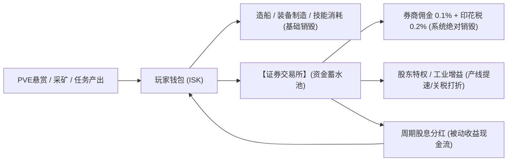
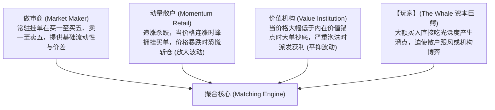

# 大鲸鱼证券交易所：理论到落地的工程实施白皮书

> 关联索引：[知识库总览](../README.md) | [[balance-master-game-economy|平衡掌控者]] | [[matching-engines-for-dummies|撮合引擎入门]] | [[tschonsen-stocksim|StockSim]]<br>
> 适用版本：Deepseek-EVE `packages/core` 架构演进<br>
> 核心目标：构建高拟真、抗作弊、纯本地确定性驱动并与游戏核心经济闭环强绑定的宇宙二级证券交易系统。

---

## 一、系统定位：宏观经济学与通胀闭环

依据《平衡掌控者》（似水无痕 著）的经济系统核心论断：**一个成熟的虚拟经济体必须具备“生产-积累-交易-消耗”的完整闭环，任何脱离货币产销的金融系统都会沦为无意义的数字空转。**

### 1.1 大鲸鱼现行经济生态现状与痛点
1. **信用点（ISK）单向沉淀**：
   - **产出端**：海盗悬赏、时效任务、大宗原矿与零件出售源源不断注入信用点；
   - **消耗端**：舰船购买、装备采购、技能许可学习和修理费均为阶段性一次性消费。到了中后期，老玩家持有的信用点呈现指数级积累，失去足够深度的消耗场景（即“货币空转与通胀压力”）。
2. **缺乏资产保值与风险博弈机制**：玩家资产全部以死现金或仓库积压物品形式存在，缺乏随星区政治、军工与科技演变而波动的动态金融标的。

### 1.2 股市在宏观闭环中的三大战略职能


1. **顶级资金蓄水池（Capital Reservoir）**：将玩家海量闲置信用点吸纳进股票资产中，平抑即时消费市场的通胀冲力。
2. **永久信用点销毁黑洞（Sinking Hole）**：
   - 买入收取 0.1% 券商佣金；
   - 卖出收取 0.2% 星区交易印花税；
   - 高频多空博弈与调仓将稳定而持续地销毁巨量游戏币，实现无痛的通胀治理。
3. **实体工业赋能（Real Economy Feedback）**：持股不仅赚取差价，还提供对应上市公司的被动股息分红以及战略特权（如制造提速、关税豁免），反哺游戏的核心挂机工业。

---

## 二、微观市场架构：CLOB 撮合与数据结构设计

借鉴《Matching Engines for Dummies》与《高频交易系统：开发与实战》的交易所级架构经验，设计大鲸鱼的订单簿与撮合状态机。

### 2.1 与现有拍卖行（`packages/core/src/market/`）的边界与关系
* **现有市场（Market）**：负责商品（物品、装备、蓝图、AI核心、舰船）的现货贸易。其订单簿（`PlayerOrder`）直接绑定物理仓库库存与 `escrowIsk`。
* **证券交易所（Exchange）**：负责虚拟企业股权的二级流通。标的物为无形股票资产（`StockHolding`），需要支持五档买卖深度、做市商流动性、高频价格冲击与分时 K 线生成。
* **架构决策**：**物理隔离、独立成域**。在 `packages/core/src/exchange/` 建立全新专属模块，避免与复杂的货物仓库和造船系统产生交叉耦合。

### 2.2 订单簿核心数据结构（纯内存 + 确定性状态机）

为保证确定性、防浮点漂移与高效序列化，订单簿设计遵循三层经典组合结构：

```typescript
// 纯整数定点数表达：价格与金额均使用放大 100 倍的整数（分）
export type FixedPrice = number; // 例如 124.50 记为 12450

export interface LimitOrder {
  orderId: string;
  sequenceId: number;     // 全局单调递增序号，保证绝对时间优先
  stockId: string;
  side: 'BUY' | 'SELL';
  price: FixedPrice;
  quantity: number;
  remainingQty: number;
  timestamp: number;
  isPlayer: boolean;      // 区分玩家订单与生态虚拟订单
}

export interface OrderBook {
  bids: Map<FixedPrice, LimitOrder[]>; // 买盘：价格由高到低（降序）
  asks: Map<FixedPrice, LimitOrder[]>; // 卖盘：价格由低到高（升序）
  orderIndex: Map<string, LimitOrder>; // O(1) 撤单与状态检索哈希表
}
```

---

## 三、价格演变与生态博弈模型

结合 `LagBack/corleonemarket`（均值回归与事件表）和 `Tschonsen/StockSim`（多交易者生态与供应链级联）的精髓，打造一套纯单机但极具博弈感的四维驱动引擎。

### 3.1 四维价格驱动算法公式

股票每拍（Tick）的报价变动由四部分线性叠加决定：

$$\Delta P_t = \text{Drift}(P_t) + \text{MeanReversion}(P_t, P_{\text{anchor}}) + \text{Shock}_{\text{Events}} + \text{Impact}_{\text{Flow}}$$

1. **几何布朗运动微漂移（Drift & Volatility）**：
   $$\text{Drift}(P_t) = P_t \times (\mu \Delta t + \sigma \sqrt{\Delta t} \cdot Z), \quad Z \sim \mathcal{N}(0, 1)$$
2. **均值回归拉力（Ornstein-Uhlenbeck 过程）**：
   $$\text{MeanReversion} = -\theta (P_t - P_{\text{anchor}}) \Delta t$$
   *其中 $P_{\text{anchor}}$ 为公司内在价值锚点（受宏观周期与企业业绩驱动），$\theta$ 为回归阻尼系数，防止价格脱轨。*
3. **星际大事件与行业快讯冲击（Event Shocks）**：
   - 遭遇异形入侵/星系战争：军工板块 $Shock > 0$，物流板块 $Shock < 0$；
   - 探针发现高危虫洞：科研板块波动率暴增；
   - 大宗原矿倾销：矿业板块估值承压。
4. **真实资金流冲击（Market Impact & Slippage）**：
   - 玩家大额买单吃单，消耗卖盘深度（Ask Depth），直接推高边际成交价；
   - 玩家大单抛售，击穿买盘支撑（Bid Depth），引爆价格下跌。

### 3.2 拟真交易者生态（4 类轻量级 AI 交易代理）

本地无需运行 14 种复杂多智能体，提炼出 4 种最具代表性的轻量代理模型即可构造出极其真实的盘口博弈：



---

## 四、离线演算与存档确定性契约

### 4.1 离线推进方案（无损、不卡死、闭式推演）
* **痛点**：若玩家离线数天（如 72 小时），逐秒执行几万次微观订单簿撮合将导致游戏启动卡死数分钟。
* **解法**：采用**宏观步进推演（Macro Step Simulation）**：
  1. 将离线总时长以 1 小时为单位划分为有限的 $N$ 个宏观周期（上限 72 步）；
  2. 每步使用解析式闭式计算价格曲线波动、均值回归以及事件触发；
  3. 挂单撮合按“挂单价与区间最高/最低价（High/Low）跨越判定”一次性结算；
  4. 累计派发各周期股息并写入分红流水；
  5. 1 秒内完成万次推演，即时呈现离线盈亏看板。

### 4.2 存档结构与白名单契约
在 `GameState` 增设顶层字段 `exchange`：
```typescript
export interface ExchangeSaveState {
  version: 1;
  cashInEscrow: number; // 挂买单托管金额
  holdings: Record<string, { shares: number; totalCostBasis: number }>;
  activeOrders: LimitOrder[];
  stockPrices: Record<string, {
    current: FixedPrice;
    open: FixedPrice;
    high: FixedPrice;
    low: FixedPrice;
    anchor: FixedPrice;
  }>;
  recentKlines: Record<string, { t: number; o: number; h: number; l: number; c: number; v: number }[]>;
  lastSettledWallMs: number;
  newsHistory: { id: string; timestamp: number; titleKey: string; impactSector: string }[];
}
```
* **随档安全性**：在 `packages/core/src/save.ts` 的 `normalizeState` 中进行严格类型校验与缺省填充，确保与 v31 存档完全往返兼容。

---

## 五、实施里程碑路线图

1. **第一阶段：核心模型与撮合引擎（Core Rules & Order Book）**
   - 建立 `packages/core/src/exchange/`；
   - 实现 CLOB 订单簿、价格优先-时间优先撮合、做市商流动性供给；
   - 编写确定性单元测试 `exchange.test.ts`。
2. **第二阶段：四维价格引擎与事件驱动（Price Engine & Events）**
   - 实现 GBM 随机漂移、均值回归与星际快讯事件表；
   - 实现玩家资金流冲击与滑点算法；
   - 实现周期股息结算与股东特权。
3. **第三阶段：离线推进与存档往返（Simulation & Persistence）**
   - 接入 `advanceGame` 心跳与宏观离线推演；
   - 登记 `normalizeState` 白名单与往返测试。
4. **第四阶段：表现层与一级主页面（UI & Charts）**
   - 实现一级主标签页「证券交易所」；
   - 纯 SVG 轻量高效 K 线图、分时图与五档深度盘口；
   - 交易面板、持仓管理看板与快讯滚动走马灯。

