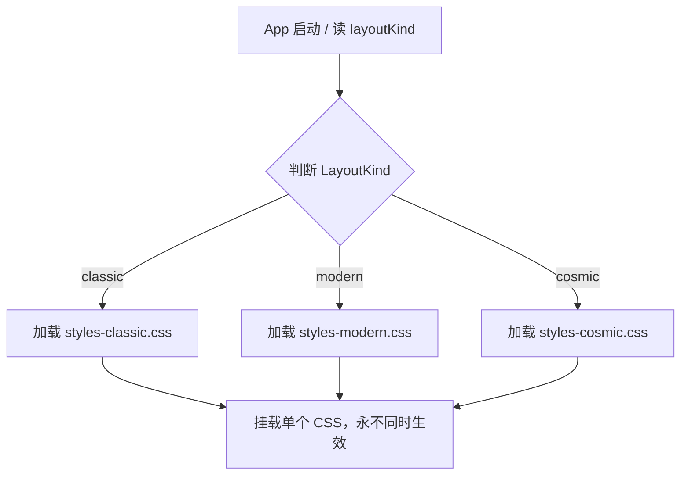

# 界面外壳：第三套可选布局「深空 HUD / Cosmic」设计方案

> 状态：船长已裁定并下达优化令（2026-11-02）
> 
> **船长原话（照抄）**：
> ①「**https://github.com/rizznme/cosmic-ui 我想用这个库做成我新版UI界面，可行吗？**」
> ②「**做一个新的UI选项呢 可用吗**」
> ③「**批准 B**」（确认编写针对第三套布局的《中文设计总结》）
> ④「**设置里的选项显示名称 科幻未来。**」
> ⑤「**克制耐看型吧**」
> ⑥「**可以非常好，但是你发现了吗，还是有很多圆角的元素喔，这个科幻未来不能有圆角的任何UI元素。然后在设置中，我截图中的，那个新版（测试中）的选项里的风格可以全部用科幻未来替换了，然后科幻未来的选项就可以去掉**」

---

## 〇、船长裁决记录（2026-11-02 13:02）

1. **绝对禁止圆角（Zero Border-Radius）**：
   - 科幻未来风格下，**严禁出现任何带圆角的 UI 元素**（包括弹窗边框、设置行、各种按钮、状态值胶囊、滑动条轨道与滑块、卡片、输入框等）；
   - 全部统一为纯硬朗直角（90° 锐利边缘）或锐利的 45° 战术倒角。
2. **选项与架构收敛**：
   - 不再额外增加第三个「科幻未来」按钮，而是将现有的**「新版（测试中）」全量升级为这套科幻未来风格**；
   - 设置界面恢复为经典的「新版（测试中）」与「旧版」双项切换，直观清晰、不增加冗余选项。

---

## 一、背景与设计定位

1. **背景**：
   - 船长关注到开源科幻组件库 `rizznme/cosmic-ui` 的切角与未来感 HUD 视觉风格，希望为游戏打造高科技感的全新 UI。
   - 经架构与技术栈评估，`cosmic-ui` 外部库全家桶（Tailwind v4 + Zag.js + JS 运行时动态算坐标的 SVG 渲染器）与本项目（原生 CSS Variables Token、高频 Tick 刷新、一级页不滚硬线）严重冲突，不可直接打包引入。
   - 但游戏现存成熟的双布局切换体系（`LayoutKind = 'modern' | 'classic'`），具备良好的架构隔离能力。因此，决定立项研发**第三套原生布局选项「深空 HUD / Cosmic」**。
2. **定位与原则**：
   - **原生无污染**：0 新增外部 npm 依赖，100% 沿用当前 `--wui-*` 单点设计变量体系；
   - **同 DOM、切皮肤**：不重写业务逻辑 DOM，新增功能一次编写、三套布局自动适配；
   - **完全自愿、零破坏**：旧档与默认配置保持不变，仅当玩家在设置中手动切换时启用；
   - **性能优先**：摒弃低效的 JS 动态计算切角，采用硬件加速的现代纯 CSS 几何切角与细线微光。

---

## 二、范围与不做的（Boundary）

### 做（In Scope）：
1. **类型与状态扩展**：
   - `packages` 与 `desktop` 共享类型扩展：`export type LayoutKind = 'modern' | 'classic' | 'cosmic'`；
   - 偏好存储与读写：`localStorage['whale-idle:layout']` 支持 `'cosmic'` 值的持久化与恢复。
2. **样式拆分管道扩展**：
   - 扩展 [`tools/layout-css-split.ts`](file:///d:/Documents/GitHub/Deepseek-EVE/tools/layout-css-split.ts)，由产出 2 份样式增加为 3 份：
     - `styles-classic.css`（经典竖栏外壳）；
     - `styles-modern.css`（现代底栏外壳）；
     - `styles-cosmic.css`（全新深空 HUD 外壳）。
   - 升级 [`apps/desktop/src/renderer/src/ui/layoutStyles.ts`](file:///d:/Documents/GitHub/Deepseek-EVE/apps/desktop/src/renderer/src/ui/layoutStyles.ts) 实现三布局的独立 `<link>` 热加载。
3. **深空 HUD（Cosmic）视觉系统**：
   - **切角与线框**：面板容器（`Panel` / `.wui-panel`）加入 45° 倒角与多层微光外框；
   - **科技按钮**：主副按钮采用带科幻切角的多边形几何轮廓，悬停时带有锐利的能量线流动；
   - **战术控制台外壳**：顶栏与活动栏加入科幻刻度线、斜切分割与科技点阵底纹氛围；
   - **守住底线**：保持高信息密度（8/10），严守「一级页不滚」红线，不加拖慢帧率的全局模糊滤镜。
4. **设置面板交互适配**：
   - [`apps/desktop/src/renderer/src/panels/appSettings.tsx`](file:///d:/Documents/GitHub/Deepseek-EVE/apps/desktop/src/renderer/src/panels/appSettings.tsx) 中的布局切换增设「深空 HUD」按钮与描述文案；
   - 联动现有的热重载确认横幅（`applyLayoutAndReload`）。
5. **门禁与自动化体检**：
   - 更新 `npm run ui:layout-css`（带 `--check` 参数验证生成一致性）；
   - 更新 `npm run ui:overflow` 与 `npm run ui:tokens` 确保三套布局全绿。

### 不做（Out of Scope）：
1. **不引入外部第三方 UI 依赖**：严禁把 Tailwind CSS、Zag.js 或外部 SVG 运行时注入仓库；
2. **不重写页面内部业务 DOM**：市场、工业、战斗、虫洞等数百个子面板结构保持不变，纯靠外壳与全局容器样式实现科技感；
3. **不改变既有交互契约**：悬停仍然统一严格走 [`ui/Tooltip.tsx`](file:///d:/Documents/GitHub/Deepseek-EVE/apps/desktop/src/renderer/src/ui/Tooltip.tsx)，不搞私有浮层；
4. **不改动战斗 SVG 与舰船线稿**：沿用既有 SVG 线稿核心表现资产。

---

## 三、架构与核心技术实现方案

### 1. 样式隔离机制（防串味）
沿用并扩充当前成熟的 `<link id="whale-layout-style">` 方案：


### 2. 高性能科技切角（纯 CSS 实现，替代 cosmic-ui 的运行时 JS）
`cosmic-ui` 的最大性能痛点是每个切角都由 JS 动态计算。我们采用纯 CSS 几何技术替代：
- **方案**：使用现代 CSS `clip-path: polygon(...)` 结合伪元素渐变描边。
- **结构示意**：
  ```css
  /* 深空 HUD 面板切角示范：右上角与左下角切 10px 45° 倒角 */
  .app-root.is-layout-cosmic .wui-panel {
    clip-path: polygon(
      0 0,
      calc(100% - 10px) 0,
      100% 10px,
      100% 100%,
      10px 100%,
      0 calc(100% - 10px)
    );
    border: 1px solid var(--wui-tone-hud-border, rgba(56, 189, 248, 0.3));
    background: var(--wui-tone-hud-bg, rgba(10, 15, 26, 0.92));
    position: relative;
  }
  ```
- **收益**：纯 GPU 硬件管线渲染，零内存开销，无论窗口怎么缩放、秒级高频重绘多少次，FPS 坚挺 60 帧。

### 3. 外壳布局骨架基底
在三套布局中，`cosmic` 采用更符合现代太空模拟器战术界面的**「底栏导航 + 紧凑左侧活动栏 + HUD 仪表顶栏」**作为基础骨架（即以 modern 的高空间利用率为蓝本进行 Sci-Fi HUD 视觉重塑）。

---

## 四、新增/修改/删除清单

### 1. 修改文件清单（预计）
- [`apps/desktop/src/renderer/src/ui/layoutPreference.ts`](file:///d:/Documents/GitHub/Deepseek-EVE/apps/desktop/src/renderer/src/ui/layoutPreference.ts)：扩展 `LayoutKind` 类型；
- [`apps/desktop/src/renderer/src/ui/layoutStyles.ts`](file:///d:/Documents/GitHub/Deepseek-EVE/apps/desktop/src/renderer/src/ui/layoutStyles.ts)：增加 `cosmicUrl` 引用与映射；
- [`tools/layout-css-split.ts`](file:///d:/Documents/GitHub/Deepseek-EVE/tools/layout-css-split.ts)：扩展拆分脚本，输出第三份 `styles-cosmic.css`；
- [`apps/desktop/src/renderer/src/styles.css`](file:///d:/Documents/GitHub/Deepseek-EVE/apps/desktop/src/renderer/src/styles.css)：增补 `.app-root.is-layout-cosmic` 专属外壳与面板变体规则；
- [`apps/desktop/src/renderer/src/panels/appSettings.tsx`](file:///d:/Documents/GitHub/Deepseek-EVE/apps/desktop/src/renderer/src/panels/appSettings.tsx)：增设第三个布局选项按钮及对应说明；
- [`packages/data/src/l10n/table.ts`](file:///d:/Documents/GitHub/Deepseek-EVE/packages/data/src/l10n/table.ts)：登记新增文案（中文落地，英文标记 `enDeferred`）。

### 2. 新增文件清单（预计）
- `apps/desktop/src/renderer/src/ui/layout-css/styles-cosmic.css`（由工具自动生成的独立第三外壳样式表，入库）；
- `docs/design/cosmic-hud-layout-20261102.md`（本文档）。

### 3. 删除文件清单
- **无**（完全向后兼容，不删减现有任何功能与文件）。

---

## 五、验收标准与验证流程

1. **静态契约与门禁闭环**：
   - `npm run ui:layout-css:check`：校验经典、现代、深空 HUD 三套样式表生成一致性；
   - `npm run ui:tokens`：校验没有未声明的非法 token；
   - `npm run ui:overflow`：在 1200x800 及常见分辨率下，确保深空 HUD 布局下**一级页坚决不出现滚动条**；
   - `npm run typecheck`：全项目 TypeScript 类型检查 0 报错。
2. **体验与观感验收**：
   - 在设置面板中在三种布局之间来回切换，验证重载生效流畅，无样式残留与错位；
   - 观感由船长亲自裁定。

---

## 六、待船长裁决点（Decision Points）

1. **文案命名裁决**：
   - 选项 A：**「深空 HUD」**（突出太空舰船操作台、硬核科技感，推荐）
   - 选项 B：**「科幻未来（Cosmic）」**（呼应原始灵感来源）
   - 选项 C：由船长指定其他名称。
2. **视觉切角风格裁决**：
   - 选项 A（克制内敛型 · 推荐）：关键面板容器右上/左下 8px 科技切角，细微蓝青色能量光边，保证界面整洁耐看、长时间挂机不视觉疲劳；
   - 选项 B（机甲战术型）：按钮与全量面板大倒角（12-16px）+ 装饰性刻度线与战术指示箭头，视觉冲击力更强，但对极限紧凑容器排版要求更高。

