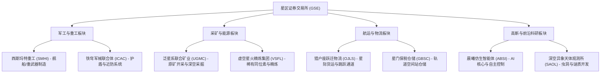

# 证券交易所（股市系统）设计方案与技术架构

> 状态：设计方案待裁决（未动手写功能代码）  
> 日期：2026-11-03  
> 船长原话：「我想在这个游戏项目里增加一个股市系统」「我想做真实的股市系统，玩家和玩家之间的行为会互相影响的那种」「独立设为一级主标签页『证券交易所 / 股市』」「先出方案，不用动手」

---

## 一、系统定位与世界观

股市系统（证券交易所，Galaxy Exchange）是大鲸鱼宇宙中的高阶金融核心系统。
它将游戏现有的产业、势力、商品与星际大事件进行资产证券化，为玩家提供：
1. **信用点终极投资与蓄水池**：解决中后期海量信用点的保值、增值与资产配置需求；
2. **拟真二级市场博弈体验**：具备真实的买卖盘口（L2深度）、滑点冲击、做市商撮合与多空博弈；
3. **玩家行为冲击市场**：玩家的资本体量能够真实影响盘面，大额买入推高股价，大单砸盘引发恐慌，实现资本寡头的操作快感；
4. **股东战略特权与分红**：长期持股享受实体企业分红，持有大额股份解锁对应势力的制造、关税、贸易特权。

---

## 二、核心机制与设计方案

### 2.1 玩家行为互动的实现模式裁决（单机高拟真 vs 云端轻联网）

针对船长提出的「玩家和玩家之间的行为会互相影响」：
当前游戏架构核心原则是**纯本地确定性演化（无服务器权威、单机读写档、离线确定性计算）**。针对此需求提供两种落地路径：

| 方案 | 原理 | 优势 | 风险与代价 |
|---|---|---|---|
| **路径 A（强力推荐）：高拟真全网生态模拟器（纯本地权威）** | 在本地构建微观市场生态。包含做市商（提供基准流动性）、机构资金、跟风游资、散户群（千百个性格参数不同的虚拟交易代理）。玩家挂单与吃单真实消耗盘口深度产生滑点；玩家的大额资金进出直接触发虚拟交易群体的跟风追涨或恐慌抛售，形成真实玩家与全市场的买卖力量博弈。 | 1. 零服务器开销与维护成本。<br>2. 存档完全确定性，离线结算完美兼容。<br>3. 免疫本地改档作弊对全网其他人的污染。<br>4. 玩家能真实扮演「庄家/资本巨鳄」，体验翻云覆雨拉盘砸盘的快感。 | 交易对手盘由精密演算法提供，非物理跨网络真实人类。 |
| **路径 B：轻量云端数据中继共享大盘（轻联网）** | 部署轻量级中心服务（如 Cloudflare Workers / 轻量 Node 节点）。客户端定时上传净买卖量，服务器汇聚全网真实玩家行为计算全局价格走势并下发给所有在线玩家。 | 真正汇聚全网真实玩家买卖力量。 | 1. **作弊风险极高**：单机存档可被修改，若有玩家修改自身信用点恶意拉爆某支股票，全网守规矩玩家资产将归零。<br>2. 需要网络服务器部署与维护成本。<br>3. 断网、无网环境与离线时间推进难以与服务器闭合。 |

> **建议**：首期按**路径 A（高拟真市场冲击与订单簿深度博弈）**落地，架构预留数据同步接口；未来如搭建云端服务器，可无缝切换接入真实网络聚合数据。

---

### 2.2 股票标的与上市公司体系（四大行业板块）

精选 8~10 家贴合大鲸鱼宇宙背景的上市公司：



每家企业包含核心属性：
- **总股本（Total Shares）** 与 **流通盘（Float）**
- **当前市价（Price）**、**每股净资产（NAV）**、**波动率（Volatility）**
- **行业联动事件**：例如星系爆发异形入侵时，军工重工股票上涨，航运物流受阻下跌；全星系矿石倾销时，矿业股价受压制。

---

### 2.3 交易机制与微观市场结构

1. **订单簿撮合机制（Order Book）**：
   - 盘口实时展示五档买卖深度（买一~买五，卖一~卖五）。
   - 支持**市价单（即时吃单，产生冲击与滑点）**与**限价单（挂单在盘口，等待行情触发撮合）**。
2. **资金冲击模型（Market Impact Model）**：
   - 股票价格由当前买卖订单的边际成交价决定。
   - 玩家若大额扫盘买入，会逐步吃光卖一、卖二直至推高价格；若巨额抛售，会砸穿买盘导致价格跳水。
3. **做市商（Market Maker）与群体流动性**：
   - 做市商提供基准流动性买卖挂单，维持买卖价差（Spread）。
   - 散户资金池根据近期趋势（动量追涨杀跌）和新闻情绪动态下单。
4. **交易费用与防高频套利**：
   - 买入免税，收取 0.1% 券商交易佣金；
   - 卖出收取 0.2% 星区印花税；
   - 设定单日/交易周期涨跌停限制（默认 ±10% 熔断保护），防止价格被瞬间拉穿或跌穿归零。

---

### 2.4 股东权益与被动分红（长期投资价值）

1. **股息分红（Dividend）**：
   - 企业每隔固定游戏周期（如游戏时间每 24 小时）结算净利润，按玩家持股数量派发信用点股息（离线同样累加）。
2. **控股特权（Stakeholder Privileges）**：
   - **持股 1%（荣誉股东）**：对应势力的专属商品交易税减免 10%。
   - **持股 5%（重要股东）**：对应企业的产线/装备生产时间缩短 5%。
   - **持股 10%（董事会席位）**：定期获得对应企业的研发蓝图碎片或内部物资配额。

---

## 三、UI 交互与视觉规范

系统设立为**一级主导航标签页「证券交易所」**。遵照仓库 UI 规范：**一级页不滚，二级容器内滚动；SVG 线稿与统一样式 Token**。

### 3.1 页面空间布局

```
+----------------------------------------------------------------------------------------------------+
| 顶部导航栏: [常规市场] [工业生产] [舰船舰队] [▶ 证券交易所 ◀] [探索与远征] ...                    |
+----------------------------------------------------------------------------------------------------+
| 市场概览走马灯: [星指 3421.50 ▲ +1.2%] [SMHI 124.5 ▲ +3.4%] [UGMC 45.2 ▼ -1.1%] [星际快讯: ...]  |
+-----------------------------------------+---------------------------------+------------------------+
| 左侧: 股票列表与行情榜单                | 中间: 行情看盘核心区 (Chart)    | 右侧: 交易面板与持仓   |
|                                         |                                 |                        |
| [全选] [军工] [矿业] [航运] [高科]     | 当前标的: 西斯玛特重工 (SMHI)   | 【买入】 / 【卖出】    |
|                                         | 当前价: 124.50 信用点 (+3.42%)  | 类型: [市价单] [限价单]|
| 股票代号  现价   涨跌幅   持仓          | ------------------------------- | 挂单价格: [ 124.50 ]   |
| > SMHI   124.5  +3.42%   1,000股        | [分时线] [日K线] [均线MA5/MA20] | 交易数量: [ 500 股 ]   |
|   ICAC    88.2  -0.50%       0          | [高性能自绘 SVG/Canvas 图表]    | 仓位: [25%] [50%] [MAX]|
|   UGMC    45.2  -1.12%   5,000股        |                                 | 预估金额: 62,250 信用点|
|   VSFL   210.0  +5.10%       0          | 成交量柱状图 (Volume)           | 手续费: 62 信用点      |
|   OJLS    34.0  +0.00%       0          | ------------------------------- | [   确认买入下单   ]    |
|   ...                                   | 盘口深度:                       | ---------------------- |
|                                         | 卖五: 125.10 (3,400)            | 我的持仓资产:          |
|                                         | 卖一: 124.60 (1,200)            | 总资产: 285,400 信用点 |
|                                         | ------------------------------- | 持仓盈亏: +14,200 (+5%)|
|                                         | 买一: 124.50 (2,100)            | 累计分红: 8,400 信用点 |
|                                         | 买五: 123.90 (5,000)            | [查看分红/股东权益]    |
+-----------------------------------------+---------------------------------+------------------------+
| 底部: 当前挂单簿与历史成交明细 (Tabs: [当前委托] [历史交易] [分红流水])                             |
+----------------------------------------------------------------------------------------------------+
```

---

## 四、技术分层与模块边界

遵循 `packages/core`（纯规则逻辑）、`packages/data`（静态配置与文本）、`packages/ui` 与 `apps/desktop`（展示与渲染）分层：

```
packages/
├── core/src/
│   └── exchange/                 # 股市系统核心功能域 (独立子目录)
│       ├── types.ts              # 股票、订单、盘口、持仓数据类型
│       ├── companies.ts          # 上市公司元数据与基础参数
│       ├── orderBook.ts          # 撮合引擎、限价单/市价单结算、盘口深度
│       ├── marketMaker.ts        # 做市商算法与虚拟交易代理群体
│       ├── priceEngine.ts        # 几何布朗运动 + 宏观周期 + 玩家资金流冲击算法
│       ├── dividends.ts          # 周期分红计算与发放
│       ├── events.ts             # 星际财经新闻与突发事件驱动
│       ├── advance.ts            # advanceGame 时间步进推进与离线平滑补算
│       └── save.ts               # 存档字段清洗 (normalizeState) 与白名单
├── data/src/
│   ├── static/
│   │   └── stocks.json           # 8~10 家上市公司的静态基础数据
│   └── l10n/table.ts             # 股票名称、介绍、财经事件多语言 (中文先行)
apps/desktop/src/renderer/src/
├── panels/
│   └── ExchangePanel.tsx         # 一级主标签页主入口组件
└── features/exchange/            # 表现层组件与交互
    ├── components/
    │   ├── StockChart.tsx        # 自绘轻量 K 线 / 分时图组件
    │   ├── OrderBookDepth.tsx    # 五档盘口与买卖深度条
    │   ├── TradeForm.tsx         # 买卖下单表单组件
    │   ├── HoldingsTable.tsx     # 持仓与盈亏列表
    │   └── NewsTicker.tsx        # 滚动财经简报走马灯
    └── hooks/
        └── useExchange.ts        # 股市数据状态订阅 Hook
```

---

## 五、存档兼容与离线演算（安全性与确定性）

1. **随档状态（State Storage）**：
   - 在 `GameState` 增设顶层字段 `exchange: ExchangeState`：
     - `holdings: Record<string, { shares: number; costBasis: number }>`（玩家持仓与持仓均价）
     - `orders: ExchangeOrder[]`（当前挂单）
     - `prices: Record<string, { current: number; open: number; high: number; low: number }>`（最新报价与当日四价）
     - `history: Record<string, PricePoint[]>`（近期 K 线历史数据缓存，保留有限长度如最近 60 点，避免存档无限膨胀）
     - `lastSettledTime: number`（上次结算分红与日切的时间戳）
   - 随档清洗白名单：在 `core/src/save.ts` 的 `normalizeState` 中进行默认值填充与字段白名单保护，防止丢失或污染。
2. **离线高确定性演算**：
   - 离线长达数天时，不逐秒做微观撮合（避免 CPU 飙升），而是按离线时长计算“宏观周期步长”做闭式价格更新与分红发放，保障秒级完成离线结算。

---

## 六、四步闸门实施清单预备（待确认后开工）

- **新增项**：
  - `packages/core/src/exchange/*`（全套股市核心规则）
  - `packages/data/src/static/stocks.json`（静态上市公司定义）
  - `apps/desktop/src/renderer/src/panels/ExchangePanel.tsx` 与相关图表组件
  - 确定性测试用例：`packages/core/test/exchange.test.ts`
- **修改项**：
  - `packages/core/src/state.ts`（增加 `exchange` 状态定义）
  - `packages/core/src/save.ts`（增加读档白名单与数据规范化）
  - `packages/core/src/simulation.ts`（在主游戏心跳推进中注入 `advanceExchange`）
  - `apps/desktop/src/renderer/src/App.tsx`（一级导航增加「证券交易所」标签）
- **删除项**：无。

